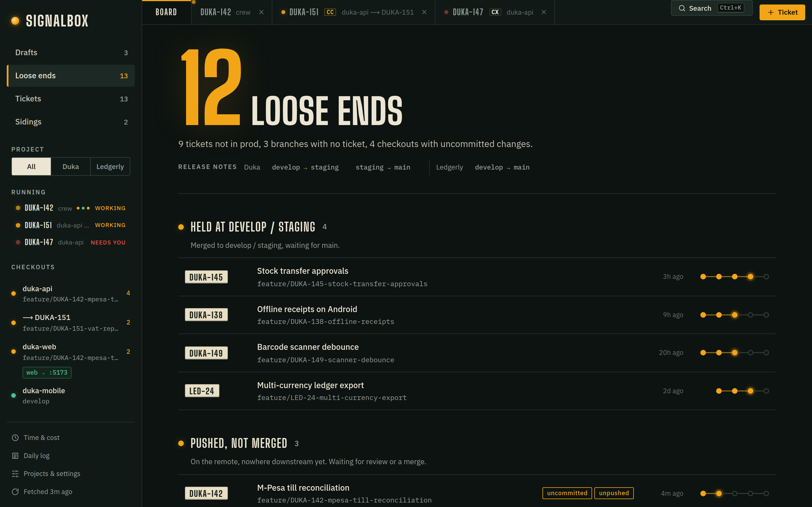
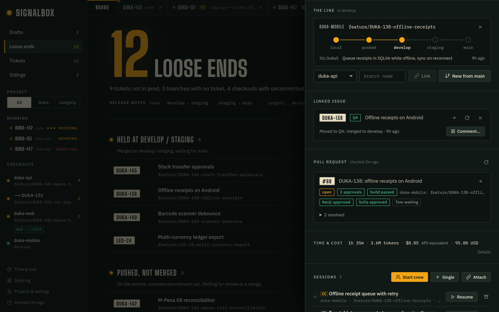
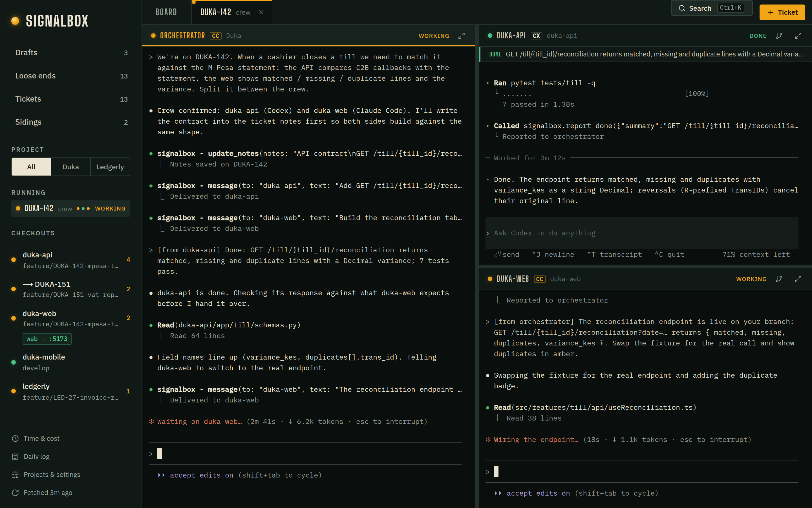

# Signalbox

Signalbox is a desktop app for macOS and Linux that keeps your tickets, git branches and AI coding agent sessions (Claude Code, Codex, Gemini CLI and opencode) on one board, and shows how far each ticket's branch has got: on your machine, pushed, merged into develop or staging, or in production.



**[Download Signalbox 0.2.4](https://signalbox.accessa.co.ke/download/)** for macOS or Linux · [Website](https://signalbox.accessa.co.ke/) · [Guides](https://signalbox.accessa.co.ke/guides/) · [Changelog](CHANGELOG.md) · [Releases](https://github.com/Accessa-suite/signalbox-app/releases)

This repository holds Signalbox's releases, documentation and issue tracker. The source code isn't published here.

## What it does

- **Tickets own their sessions.** Start Claude Code, Codex, Gemini CLI or opencode from a ticket. The session runs in a terminal inside Signalbox and stays filed under the ticket, so you can resume it tomorrow.
- **The track shows where every branch is.** Set your stages once, for example develop → staging → main. Each ticket's lamps come from git: red while the work is only on your machine, amber once it's pushed or merged into a stage, green in production.
- **Lamps for every session.** See which agent is working, which one is waiting for you and which one has finished, with desktop notifications and optional phone alerts through ntfy or Telegram.
- **Git worktrees.** Give a ticket's branch its own worktree, with a setup recipe that copies `.env` files and links or installs dependencies, and a dev server on its own port.
- **Crews of mixed agents.** For work across several repos, one orchestrator and one worker per repo, each running the agent you pick, messaging each other through a local MCP server.
- **Trackers.** Import and link issues from Jira Cloud, Kanboard, Notion or any board that implements the Signalbox Board API. Linked cards can move forward as branches merge, and QA notes for testers are drafted in plain language for you to check before posting.
- **Pull requests on the ticket.** GitHub and Bitbucket pull requests with approvals, build status and review comments by file; **Fix review comments** sends them to the agent; **Create PR** pushes the branch and drafts the description.
- **Write… from the work.** Ticket summaries, PR descriptions, QA notes, a daily log and release notes, drafted from the diff, commits and sessions. Nothing is sent until you press the button.
- **Time and cost per ticket**, read from the agents' transcripts, with a CSV export for invoicing.
- **Ctrl+K** (⌘K on a Mac) to jump anywhere and search what you and your agents said in past sessions.





## Download and install

The current version is **0.2.4**, released 24 November 2026. Download it from **[signalbox.accessa.co.ke/download](https://signalbox.accessa.co.ke/download/)**, where the files' SHA-256 checksums are listed, or from [GitHub Releases](https://github.com/Accessa-suite/signalbox-app/releases).

Signalbox runs the coding agents you already use. Install at least one and log in to it: Claude Code (`claude`), Codex (`codex`), Gemini CLI (`gemini`) or opencode (`opencode`). You'll also want `git`, and `gh` if you use GitHub.

### macOS

One universal `.dmg` for Apple silicon and Intel, macOS 11 Big Sur or later.

1. Open the `.dmg` and drag Signalbox onto Applications.
2. The app isn't signed with an Apple Developer ID yet, so clear the download quarantine once, in Terminal:

   ```
   xattr -dr com.apple.quarantine /Applications/Signalbox.app
   ```

3. Open Signalbox.

Without Terminal, use **System Settings → Privacy & Security → Open Anyway** instead. On macOS 15 and later, right-click → Open no longer gets past the warning. The full steps are in [docs/install-macos.md](docs/install-macos.md).

### Linux

x86_64, with glibc 2.34 or newer: Ubuntu 22.04, Debian 12, Fedora 35 and later, and their derivatives.

- **.deb** (Debian, Ubuntu and derivatives): `sudo apt install ./Signalbox_*_amd64.deb`, then open Signalbox from your app menu. Updates ask for your password to install the new package.
- **AppImage** (any distribution): `chmod +x Signalbox_*.AppImage` and run it. Keep it where you put it; updates replace the file in place.

### Updates

Signalbox checks for a new version when it starts and every 6 hours, and asks before installing it. Updates are signed, and Signalbox won't install one whose signature doesn't match.

## Guides

- [How to run several Claude Code sessions without losing track](docs/multiple-claude-code-sessions.md)
- [Run Claude Code and Codex together as one crew](docs/claude-code-and-codex-crew.md)
- [A kanban board for AI coding agents: tickets, branches and sessions](docs/kanban-for-ai-coding-agents.md)
- [Git worktrees for parallel AI agents](docs/git-worktrees-for-parallel-ai-agents.md)
- [Connect Jira, Kanboard or Notion to your AI coding workflow](docs/connect-jira-kanboard-notion.md)
- [Install on macOS](docs/install-macos.md)

## FAQ

### Is it free?

Yes. There's no account, no trial and no card to enter. Download it and use it.

### Does Signalbox send my code anywhere?

No. Signalbox has no server of its own. Your agents send code to their providers exactly as they do when you run them in a terminal: Claude Code to Anthropic, Codex to OpenAI, and so on. Signalbox itself only talks to the trackers and code hosts you connect, and checks signalbox.accessa.co.ke for updates.

### Which AI coding agents does it work with?

Claude Code, Codex, Gemini CLI and opencode. Install and log in to them as usual; Signalbox finds them on your PATH. You can set a default agent globally, per project or per ticket, and mix them in one crew.

### macOS says Signalbox can't be opened. What do I do?

The Mac builds aren't signed with an Apple Developer ID yet, so Gatekeeper blocks the first open. Run one Terminal command, or use Open Anyway in System Settings. The steps are on the [macOS install page](https://signalbox.accessa.co.ke/install/macos/). You only do it once per download.

### Which Linux distributions are supported?

Any x86_64 distribution with glibc 2.34 or newer: Ubuntu 22.04, Debian 12, Fedora 35 and later, and their derivatives. Use the .deb on Debian and Ubuntu, and the AppImage anywhere else.

### How do updates work?

Signalbox checks for a new version when it starts and every 6 hours. When there is one it asks: Restart now or Later. It never restarts on its own, and if agents are still working it asks again before restarting. Every update is signed, and Signalbox won't install one whose signature doesn't match.

### Do I need Jira or another tracker?

No. Tickets can live only in Signalbox. Connect a tracker when you want cards to move as branches move, or to import issues.

### Will it tell me when an agent needs me?

Yes. Each session's lamp goes amber while it works and tells you when it's waiting for you or done, with a desktop notification. Phone alerts can also go to ntfy or a Telegram bot: by default only while you're away from the keyboard, and never in your quiet hours.

## Privacy

Signalbox runs on your machine. There's no Signalbox account and no Signalbox server. Tickets, sessions and settings live in a local database, and tracker and code-host tokens go in the operating system's keychain (Keychain on macOS, Secret Service on Linux).

Signalbox talks to the trackers and code hosts you connect, and checks signalbox.accessa.co.ke for updates. Your agents talk to their own providers, as they do in a terminal.

## Price

Free. No account, no trial, no card.

## Reporting bugs and asking for features

Open an issue on this repository: [bug report](https://github.com/Accessa-suite/signalbox-app/issues/new?template=bug_report.yml) or [feature request](https://github.com/Accessa-suite/signalbox-app/issues/new?template=feature_request.yml). Include your Signalbox version (Settings → About), your OS and how you installed it. Leave out tokens and private code.

For a security problem, don't open a public issue; see [SECURITY.md](SECURITY.md).

## Licence

Free to use; all rights reserved; no source code is provided. See [LICENSE.md](LICENSE.md).

Made by Accessa.
