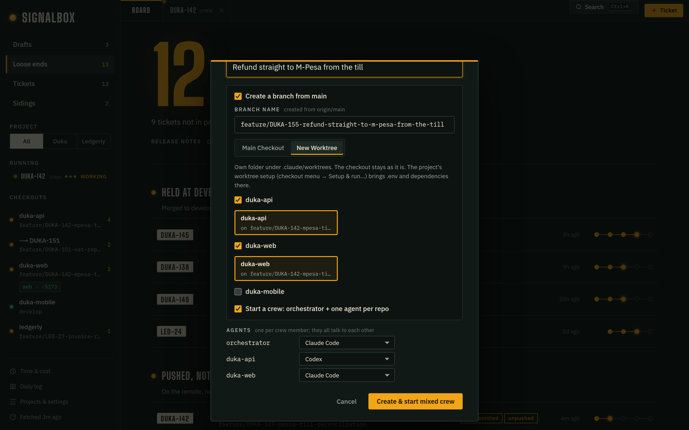
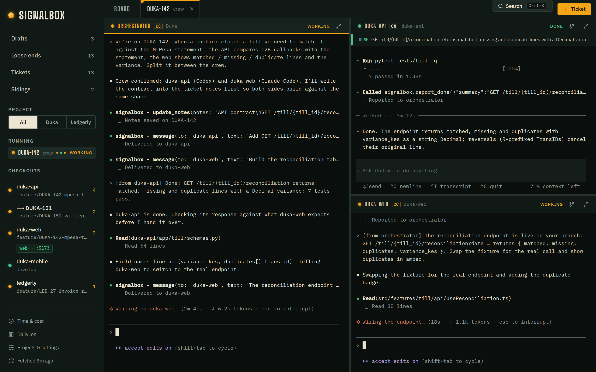

# Run Claude Code and Codex together as one crew

Put Claude Code and Codex on the same ticket across several repos: one orchestrator, one worker per repo, messages passed between them through a local MCP server.

A change that spans an API and a web client is two pieces of work that have to agree with each other: the endpoint, the payload, the field names, the error shapes. You can give the whole thing to one agent, run from the folder above both repos. You can also split it, with one agent per repo, and keep them in step yourself by copying messages from one terminal to the other.

The second way works, but you become the message bus. A crew in Signalbox automates that part. One agent is the orchestrator and plans the work. Each repo gets a worker, and each member can be a different agent: Claude Code as the orchestrator, Codex in the API, Claude Code in the web app. They send each other messages through Signalbox, and you watch all of it in one split view.

## What you need

- Claude Code (`claude`) and Codex (`codex`) installed and logged in, as you'd use them in a terminal. Gemini CLI and opencode can also be crew members.
- A Signalbox project with two or more repos, and a **crew root**: the folder the orchestrator runs in, above the repos. When the repos share a parent folder, Signalbox fills that in when you add the project. You can set or change it under **Projects & settings**. Without a crew root, the **Start crew** button doesn't appear.
- A ticket for the work. See [How to run several Claude Code sessions without losing track](multiple-claude-code-sessions.md) if you haven't made one yet.

## 1. Start the crew from the ticket

Open the ticket and click **Start crew** in its Sessions section. You can also tick **Start a crew: orchestrator + one agent per repo** when you create a ticket with more than one repo selected, or use **New crew on** from the `Ctrl+K` palette.

## 2. Choose an agent and a folder for each member

The dialog has a row for the orchestrator and one for each repo. Pick the agent per row, for example:

- orchestrator: Claude Code
- `duka-api`: Codex
- `duka-web`: Claude Code

For each repo, choose where the worker runs. It can use a checkout or worktree that already exists, check out the ticket's branch, or start a new branch from your production branch, either in the main checkout or in a new worktree. Worktrees keep the crew's edits out of your main checkout; see [Git worktrees for parallel AI agents](git-worktrees-for-parallel-ai-agents.md).

## 3. Give the orchestrator the task

Click **Start crew**. The workers start first, then the orchestrator, all in one tab with the orchestrator on the left. Each member gets a short first prompt that tells it its role and who else is in the crew:

- The orchestrator learns each worker's name, folder and branch. It is told to plan the work and split it, to keep both sides in step, and to let each worker make the edits in its own repo.
- Each worker is told to report back when it finishes a step and to ask the orchestrator if anything is unclear.
- Everyone is told not to commit, push or switch branches unless you say so.

The members reply that they're ready and wait. Then tell the orchestrator what to build, in its pane, the way you'd brief a colleague.

## 4. Follow the conversation

Messages between members arrive in the receiving agent's terminal as a new prompt that starts with the sender's name, such as `[from orchestrator] Add a refund endpoint that …`. You can read every exchange as it happens and type into any pane yourself.

When a worker finishes a step, it reports with a short summary. The summary shows as a green **Done** strip on that worker's pane and goes to the orchestrator as `[from duka-api] Done: …`. The orchestrator then sends the next instruction, or tells you it's finished.

## 5. Review, then commit yourself

The crew doesn't commit or push unless you tell it to. Look at each repo's changes in the **Changes** view, run the tests, and commit when you're satisfied. If a member's terminal closes, its pane shows a **Resume** button; the crew can also be resumed later from the ticket.

## How the agents talk to each other

Signalbox runs a small MCP server on your machine, named `signalbox`, and adds it to every crew member's session when it starts the agent. Claude Code gets it through `--mcp-config`, Codex through `-c mcp_servers.signalbox…` options, and opencode through its config environment variable. Your own agent config files aren't edited. Each agent starts the server as a local process, and that process talks to the Signalbox app over a local Unix socket that only your user can open. Nothing listens on a network port.

The server has five tools:

- `crew_members`: who is in the crew, which agent, which folder and branch, and whether each is working, waiting for you or done.
- `message`: send another member a message by name, such as `orchestrator` or `duka-api`.
- `ticket_info`: the ticket's key, title, branches and where they are, the linked tracker issue and the notes.
- `update_notes`: add to or replace the ticket's shared notes. This is a good place for the agreed endpoint and payload.
- `report_done`: finish a step with a summary, which goes to the orchestrator.

A member can only reach its own crew.

If the receiving agent is busy, a message waits in a queue until it's idle, so it isn't typed into the middle of a turn. That depends on what each agent reports. Claude Code reports working, waiting and done. Codex only reports when a turn is done. opencode reports nothing, so messages to it go in straight away.

## Questions

### Do Claude Code and Codex share one context?

No. Each runs as its own CLI with its own context, in its own folder. They share only what they send each other and what's in the ticket's notes. That is why the orchestrator is told to put decisions like endpoints and field names in the notes.

### Does a crew use more tokens than one agent?

Usually, yes. Each member reads its own repo and the messages it receives, and the orchestrator reads across repos. Signalbox shows the tokens and API-equivalent cost per ticket under **Time & cost**, so you can compare.

### Can the orchestrator also be Codex?

Yes. Any of the supported agents can be the orchestrator or a worker. Claude Code, Codex, Gemini CLI and opencode can all join a crew.

### Will the agents approve their own permission prompts?

No. Signalbox never adds flags that skip permission prompts. Each agent asks you exactly as it would in a terminal, in its own pane. For Claude Code, the lamp goes red while it waits for you.

### Do I need several repos for a crew?

A crew has one worker per repo, so it's meant for work that spans repos. For a single repo, one session per ticket is simpler. If you want more than one agent in the same repo, give each its own ticket and worktree.

---

This guide is also on the website: https://signalbox.accessa.co.ke/guides/claude-code-and-codex-crew/
