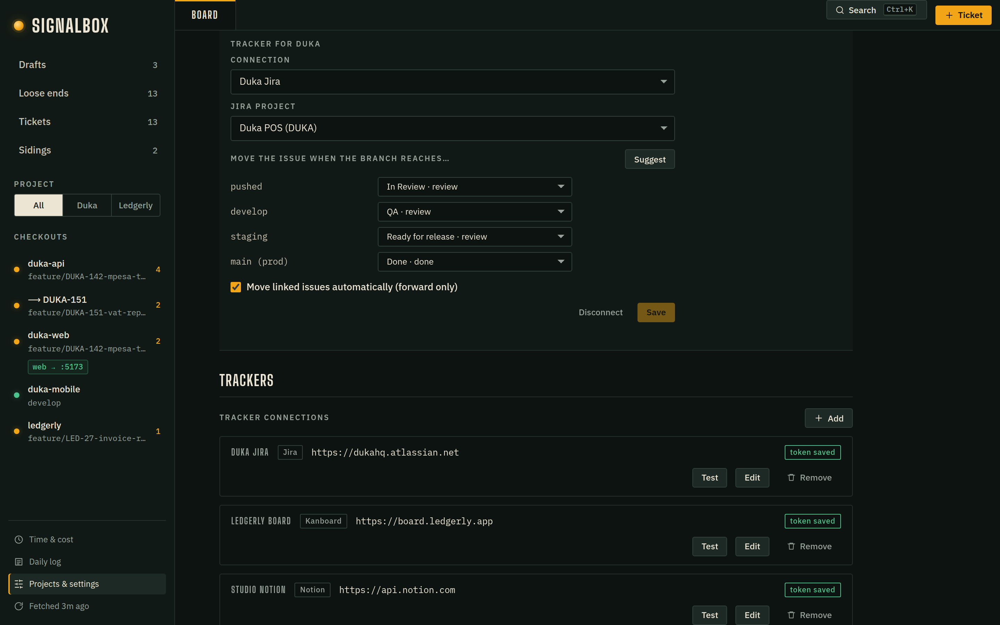
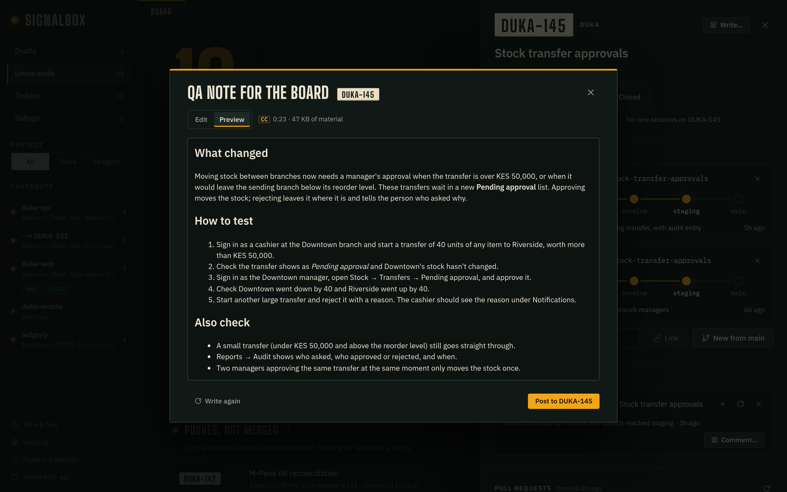

# Connect Jira, Kanboard or Notion to your AI coding workflow

Link the issues in Jira Cloud, Kanboard or Notion to the tickets your AI coding agents work on: import issues, move cards forward as branches merge, and post plain-language QA notes.

Your team's tracker is where testers, managers and clients look. Your agents work in terminals and branches. Keeping the two in step by hand means copying issue keys into branch names, moving cards when something merges, and writing a note for the tester on each ticket. When agents get through work faster, there is more of that to do.

Signalbox links each of its tickets to an issue in your tracker. It can import the issue, move the card forward as the branch reaches develop, staging and production, and post a comment you have read first. It works with Jira Cloud, Kanboard, Notion, and any board that implements the [Signalbox Board API](https://signalbox.accessa.co.ke/#trackers).

## Before you start

- **Jira:** Jira Cloud only (`https://<site>.atlassian.net`). Jira Server and Data Center aren't supported. You need your Atlassian email and an API token.
- **Kanboard:** your Kanboard address, your username, and a personal API token from **My profile → API** in Kanboard.
- **Notion:** an internal integration from notion.so/profile/integrations and its secret. Share the database you use for tasks with the integration (**•••** → **Connections**), or Signalbox can't see it.
- **Board API:** the API's base URL and a token.

Signalbox keeps the token in your operating system's keychain: Keychain on macOS, Secret Service on Linux, such as GNOME Keyring. It isn't stored in Signalbox's database, and the app's interface can't read it back once it's saved.

## 1. Add the connection

Open **Projects & settings**, find **Tracker connections** and click **Add**. Choose the kind, give it a name, and fill in the fields above. Click **Test**. A working connection shows who you're signed in as and what the tracker allows, such as comments and creating issues. Then click **Save**.

For Notion, the test also loads the workspace's people. Pick yourself under **Your Notion user** so that "assigned to me" means you; this needs the integration's "Read user information" capability.

## 2. Bind the project to a board

In the same settings, under **Tracker for** your project, choose the connection, then the **Jira project**, **Kanboard project** or **Notion database**. Each Signalbox project binds to one board. Different projects can use different connections, so a freelancer can have one client's Jira and another client's Kanboard side by side.

For a Notion database with more than one status-like property, choose which one moves with the branch under **Status property**.

## 3. Map your stages to the board's statuses

Under **Move the issue when the branch reaches…** there is a row for **pushed** and one for each of your stage branches, with the last one marked as production. Choose a status for each row, or leave it as it is. **Suggest** fills in a starting point: pushed to an in-progress status, the middle stages to review, production to done. The statuses come from the board itself: Jira's statuses for the project, Kanboard's columns, or the options of Notion's status property.

To have cards move on their own, tick **Move linked issues automatically (forward only)** and save. It's off until you turn it on.

## 4. Import or link the issue

When you create a ticket, click **Import from tracker**. The search starts with **Mine** ticked, showing the issues assigned to you. Type words to search, or paste a key like `OPS-345`; for Notion you can paste a page link. Picking an issue fills in the ticket's title, puts the description and the issue's link in the notes, and links the two. A Notion issue picked from search results brings only its link; paste the page link to bring its text as well. If the issue's key looks like `OPS-345`, the ticket uses that key as well.

For a ticket you already have, open it and click **Link existing…**. Or click **Create issue** to make a new issue from the ticket's title and notes. The ↻ button next to a linked issue re-reads its status from the tracker.

## 5. Let the card follow the branch

With automatic moves on, Signalbox checks linked tickets each time the board refreshes, which is about every 45 seconds while the window is open. When a ticket's branch reaches a stage you mapped, the issue moves to that status.

The rules are deliberately cautious:

- It only moves an issue forward. If someone has already moved the card further along by hand, it's left alone.
- It doesn't move a Kanboard or Notion card out of a status whose name says it failed or was rejected.
- If Jira's workflow has no transition from the issue's current status to the mapped one, nothing moves. The reason shows on the ticket and under **Recent automatic moves** in settings.

A move only changes the status. Signalbox doesn't post a comment when it moves a card.

## 6. Post a QA note your testers can follow

Open the ticket and choose **Write… → QA note for the board**. An agent runs in read-only mode over the ticket, its diff against production, the commits and the sessions. The agent is the project's writing agent if you've set one, otherwise the ticket's. It is asked for a note in plain language, without code or file names: **What changed**, numbered steps under **How to test**, and **Also check** for edge cases.

You can edit it, preview it, or have it written again. Nothing is posted until you click **Post to** and the issue key. Jira gets the note converted to its own rich-text format, Kanboard gets the Markdown as it is, and Notion gets it as a comment on the page. You can also post any comment of your own with **Comment…**.

## What stays in your tracker

Linking is not a two-way sync. Signalbox reads an issue's key, title, status and link, and the description when you import it. It writes status moves, comments you post and issues you create. Later edits to the ticket's title or notes aren't sent back. It doesn't change assignees, and it doesn't use webhooks.

## Questions

### Does it support Jira Server or Data Center?

No. The Jira connection uses Jira Cloud's REST API version 3, with an email and API token. Kanboard and the Board API are the options for a self-hosted board.

### Where are my API tokens stored?

In the operating system's keychain, under Signalbox's own entry. They aren't written to Signalbox's database, to a config file or to the project. Removing a connection deletes its token.

### Will it move cards without asking?

Only if you tick **Move linked issues automatically (forward only)** for that project, and only forward. Comments and new issues are never sent without you clicking the button.

### Can I use it without a tracker?

Yes. Tickets can live only in Signalbox. You can connect a tracker later and link existing tickets to issues.

### What is the Board API?

A small, documented REST API that a self-hosted board can implement so Signalbox can connect to it: boards, columns, cards, moving a card and comments, with a bearer token.

---

This guide is also on the website: https://signalbox.accessa.co.ke/guides/connect-jira-kanboard-notion/
