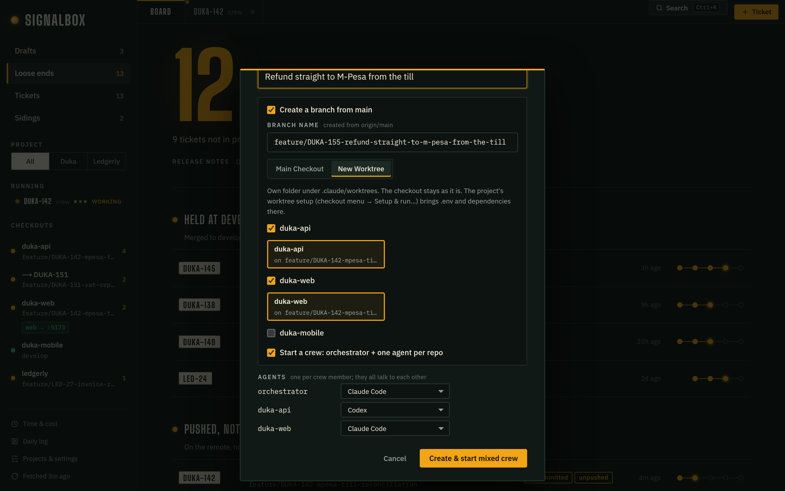
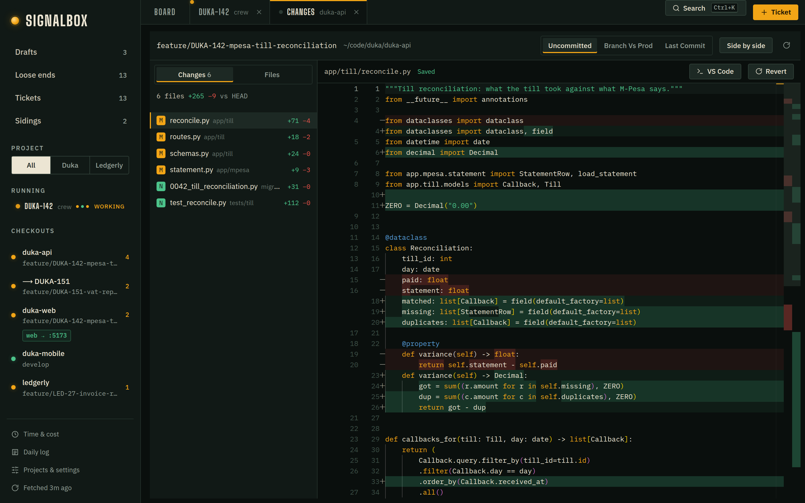

# Git worktrees for parallel AI agents

Give each AI coding agent its own git worktree so parallel sessions never edit the same files: the plain git commands, the setup they need (.env, dependencies, ports), and how Signalbox automates it.

Two agents in one checkout get in each other's way. They edit the same files, one runs `git switch` while the other is halfway through a change, and the test run you start belongs to neither branch. A git worktree avoids this. It is a second working folder for the same repository, with its own branch checked out, sharing the one `.git` history. Each agent gets its own folder and branch, and nothing it does touches the others.

## Worktrees with plain git

You don't need any tool for the basics:

```
git fetch origin main
git worktree add -b feature/refund-to-mpesa ../duka-api-refund origin/main
cd ../duka-api-refund && claude
```

`git worktree list` shows every worktree of a repo. `git worktree remove ../duka-api-refund` deletes the folder once you're done with it; the branch stays.

Three things catch people out:

- **Files git doesn't track aren't there.** A new worktree has no `.env`, no `node_modules` and no `vendor`, so the app won't start and the tests won't run until you copy or install them.
- **Ports clash.** Two dev servers on port 5173 won't both start.
- **Worktrees pile up.** Forgotten folders hold branches and disk space.

If you run one agent at a time, a single checkout and `git switch` is fine. Worktrees pay off once two sessions work at the same time.

## 1. Create the ticket's branch in a new worktree

In Signalbox, worktrees come from tickets. When you make a ticket, tick **Create a branch from main** and choose **New Worktree**. For an existing ticket, open it, choose **New Worktree** and click **Create branch**.

Signalbox fetches the production branch, then runs `git worktree add` with a new branch cut from the remote production branch. The worktree goes in `.claude/worktrees/` inside the repo's main checkout, named after the last part of the branch name. Signalbox adds `.claude/worktrees/` to the repo's `.git/info/exclude`, so the worktrees never show up as untracked files in your main checkout.

If you started a branch in the main checkout and now want it out of the way, open the ticket and click **Move to worktree**. Signalbox stashes your uncommitted changes, including untracked files, switches the main checkout back, creates the worktree and applies the changes there.



## 2. Tell Signalbox how to set up a new worktree

Open a checkout's menu in the sidebar and choose **Setup & run…**. The worktree setup has three kinds of step:

- **Copy** files from the main checkout, such as `.env` and `.env.local`.
- **Link** a folder from the main checkout instead of installing it again, such as `node_modules`, or run an install command for it instead, such as `npm ci` or `composer install`.
- **Run** commands in order, such as database migrations.

Click **Use detected** to start from what Signalbox finds. It suggests copying `.env` files that exist and linking `node_modules`. For a PHP project it suggests running `composer install` rather than linking `vendor`, because PHP resolves symlinks and a linked `vendor` would load the main checkout's classes. You can set one recipe for the project and a different one per repo.

The recipe runs on its own whenever Signalbox creates a worktree, in a **Setup** tab where you can watch it. If a command fails it stops there and leaves the worktree as it is, so you can fix it and choose **Run worktree setup** from the checkout menu. Paths must stay inside the repo; absolute paths and `..` are refused.

## 3. Give every worktree its own port

In the same **Setup & run…** screen, list the dev servers to run, each with a command and a base port. Signalbox detects Vite, Next.js and Laravel's `artisan serve`. The main checkout gets the base port. Each worktree gets the next free port above it, which it keeps from then on.

Each process gets its port as `PORT` in its environment, and as `{port}` in its command. A command can refer to another process's port with `{port:name}`, which is how a web app finds its own API. Choose **Run dev servers** in the checkout menu. The ports appear in the sidebar, and clicking one opens `http://localhost:<port>`.

## 4. Start the agent in the worktree

Start a session from the ticket and pick the worktree. The one on the ticket's branch is listed first. The agent runs with the worktree as its working folder, so its edits, tests and git commands stay there. Look at what it changed in the worktree's **Changes** view, and commit when you're happy.



## 5. Bring the branch back and remove the worktree

When you want the branch back in your main checkout, for example to keep working on it by hand, choose **Promote to main** from the worktree's menu and click again to confirm. Signalbox stops the terminals running in that worktree. It refuses if the main checkout has uncommitted changes. Otherwise it stashes the worktree's changes, switches the main checkout to the branch, applies them, and removes the worktree.

Files git ignores are not carried over: a copied `.env` or an installed `node_modules` in the worktree goes with it. To drop a worktree without promoting it, use `git worktree remove` yourself. Signalbox doesn't delete branches.

## Questions

### Where does Signalbox put worktrees?

In `.claude/worktrees/<name>` inside the repo's main checkout, where `<name>` is the last part of the branch name. That folder is listed in the repo's `.git/info/exclude`, so it never appears in `git status`.

### Do worktrees take a lot of disk space?

The git history is shared, so a worktree costs the size of the checked-out files plus whatever the setup adds. Linking `node_modules` instead of installing it keeps that small. A linked folder is the same folder, though, so a worktree that changes dependencies should install its own.

### Can two worktrees have the same branch checked out?

No; git doesn't allow it. Each worktree has its own branch. That is the point for parallel agents.

### Does it work with Codex, Gemini CLI and opencode too?

Yes. Worktrees are plain git, and any agent you start from the ticket runs in the folder you pick.

### What if the setup recipe fails?

It stops at the failing command and leaves the worktree as it is. The output is in the Setup tab. Fix the cause, then choose **Run worktree setup** from the checkout menu to run it again.

---

This guide is also on the website: https://signalbox.accessa.co.ke/guides/git-worktrees-for-parallel-ai-agents/
