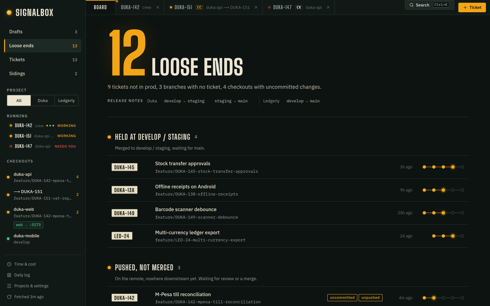
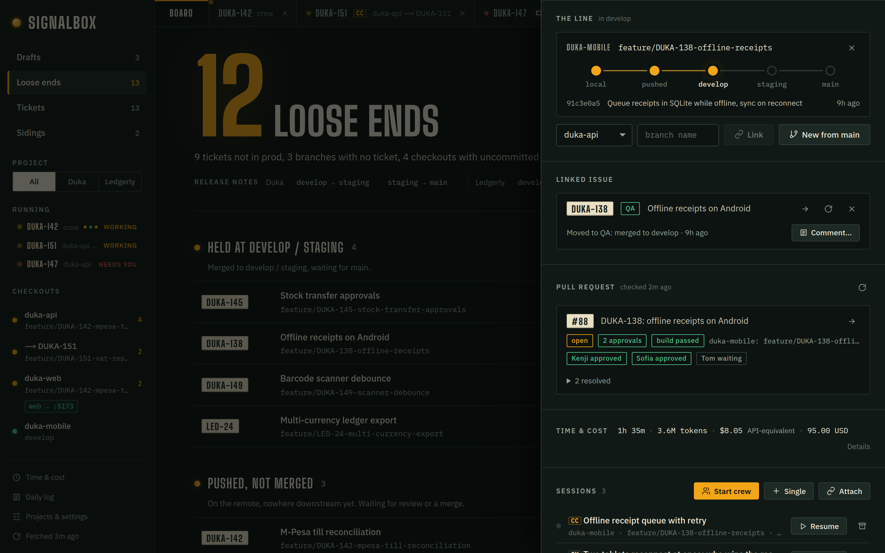

# A kanban board for AI coding agents: tickets, branches and sessions

A board for work done by AI coding agents should show each ticket's sessions and where its branch is, read from git. What that looks like, and how to set it up in Signalbox.

A normal kanban board tracks cards. Someone drags a card to "In review" or "Done", and the board is only as accurate as the last person who remembered to drag it. With AI coding agents doing much of the work, two things go missing from that picture: which agent session did the work on a ticket, and where the ticket's code actually is. Is it on your laptop, pushed, merged into develop, or already in production?

This guide describes a board built around those two things, and how Signalbox implements it. If you already use Jira, Kanboard or Notion, keep it. Signalbox can sit next to it and move its cards for you (see [Connect Jira, Kanboard or Notion](connect-jira-kanboard-notion.md)).

## What the board needs to show

For each ticket:

- **Its sessions.** The Claude Code, Codex, Gemini CLI or opencode sessions that worked on it, so you can resume the right one.
- **Its branch, per repo.** A ticket can touch more than one repo.
- **Where that branch is**, taken from git rather than from someone dragging a card.
- **Loose ends.** Uncommitted changes, commits that were never pushed, and tickets that are closed but never shipped.

## Columns from git, not from dragging

Signalbox doesn't have columns you drag cards between. You set your branch stages once, for example develop → staging → main, and each ticket's position comes from git. Every ticket shows a short track of lamps:

- **local** (red): the branch has commits only on your machine;
- **pushed** (amber): the branch is on the remote but not merged anywhere;
- **each stage** (amber): the branch's last commit is in that stage's remote branch;
- **production** (green): the last commit is in the last stage.

Signalbox works this out with git itself. It asks which stage branches on the remote contain the ticket branch's last commit. It runs `git fetch` on every checkout when it starts, every five minutes after that, and when you click **Fetched … ago** in the sidebar. When a ticket has branches in several repos, the ticket is as far along as its least advanced repo.

One limit to know about: if your team squash-merges or rebases pull requests, the branch's own commits never reach develop, so the track can't see the merge. Signalbox reads ordinary merge commits and fast-forwards.

## 1. Add the project and its stages

Under **Projects & settings**, add a project and choose its folder. Signalbox finds the git repos in it and suggests stages from the branches on your remote, such as develop, test, qa or staging, with main or master last as production. Change the order or add stages per repo. New stages go in before production.

## 2. Make tickets and give them branches

Click **+ Ticket**, type a title and tick **Create a branch from main**. The branch is cut from the remote production branch, in your main checkout or in a new worktree. If you use a tracker, **Import from tracker** brings in an existing issue. When the issue has a key like `OPS-345`, the ticket takes that key instead of a new number.

By default a branch name carries a tracker key, as in `feature/OPS-345-refund-to-m-pesa`, but not the project's own numbering. To put every ticket's key in its branch, set a pattern such as `feature/{KEY}-{slug}` under **Branch names** in the project settings.

Start an agent from the ticket and its session is filed under it.

## 3. Work from Loose ends

**Loose ends** is the board's default view. Instead of to-do/doing/done, it groups what still needs attention, with the number of loose ends at the top:

- **Held at develop / staging**: merged into a stage, waiting for production.
- **Pushed, not merged**: on the remote, waiting for review or a merge.
- **On the bench**: work that exists only on this machine.
- **Closed, never shipped**: tickets marked closed whose last commit isn't in production.
- **No branch yet**: active tickets with nothing to track.
- **Unclaimed branches**: recent local branches that aren't on any ticket. Make a ticket from one, or ignore it.
- **Uncommitted changes**: checkouts with work that isn't committed.
- **Shipped. Close these out**: in production, so the ticket can be closed.

Each row shows the ticket key, the title, the branch, how long ago it was last touched, its track, and flags such as `uncommitted`, `unpushed`, `blocked`, or `cold 6d` for an active ticket nobody has touched for days. When everything is clear, the view says **Line clear.**

## 4. Open a ticket for the whole picture

Click a ticket to open it. You get its branch on the track, the linked tracker issue, the pull request with approvals and the build status, time and cost, and its sessions with **Resume** buttons. From here you can start another session or a crew, look at the changes, or write a PR description or QA note from the work.

**Tickets** lists every ticket, with filters for Open, Active, Blocked, Backlog, Closed and All, and a search box for key, title or branch.

## Other ways to do this

- **Your existing tracker plus discipline.** Put the branch name in the card and move it when you merge. This works for small teams that keep their cards up to date.
- **GitHub or GitLab pull request lists.** They show what's open and merged, but not work that was never pushed, and not which agent session did it.
- **A text file per task** with the session ids. Cheap and private, but nothing checks it against git.

Signalbox's version is local and per developer. There's no shared server; for a team, the shared layer is your tracker.

## Questions

### Can I drag tickets between columns?

No. A ticket's position on the track comes from git. A ticket also has a status (backlog, active, blocked or closed), which you set yourself.

### Does it work with several repos per ticket?

Yes. A ticket can have a branch in each repo of the project. The ticket's track shows its least advanced repo, so a ticket isn't shown in production until every part of it is.

### Does it replace Jira?

It doesn't have to. Signalbox can import and link issues from Jira, Kanboard and Notion, and move the linked card forward as the branch moves. You can also keep tickets only in Signalbox.

### Is the board shared with my team?

No. Signalbox runs on your machine and keeps its data in a local database. Your tracker is the shared part.

### What happens with squash merges?

The track follows commits. After a squash merge, the branch's commits aren't in develop, so the ticket stays at pushed. Signalbox handles ordinary merge commits and fast-forwards.

---

This guide is also on the website: https://signalbox.accessa.co.ke/guides/kanban-for-ai-coding-agents/
