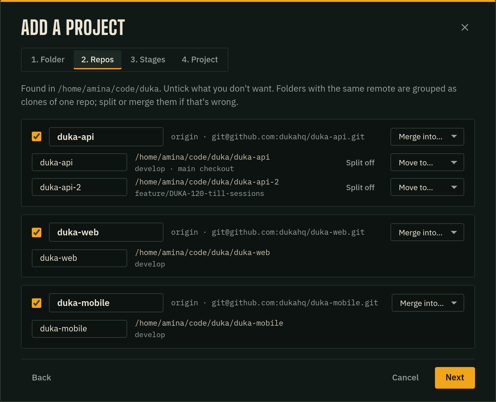
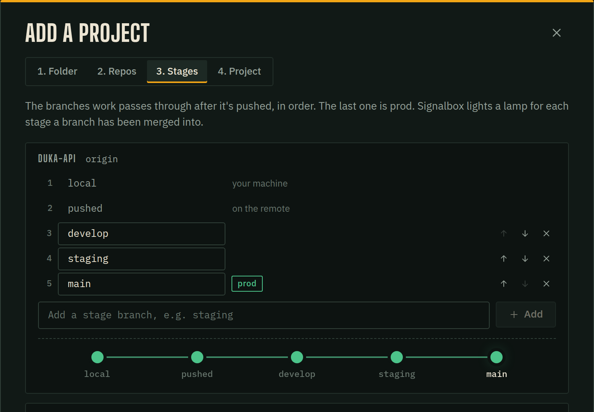
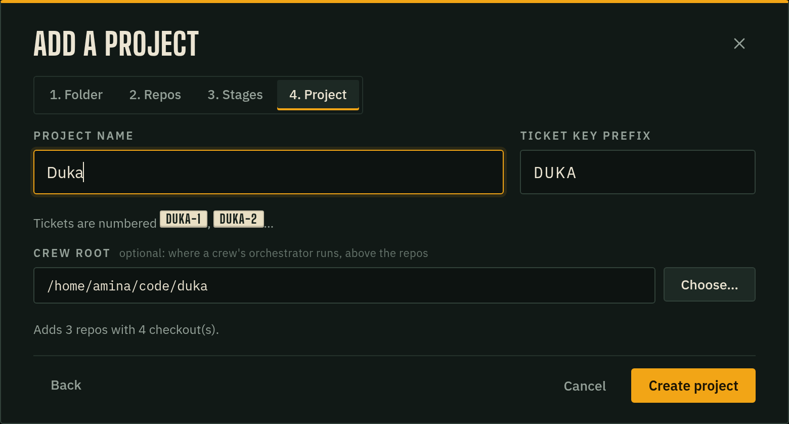
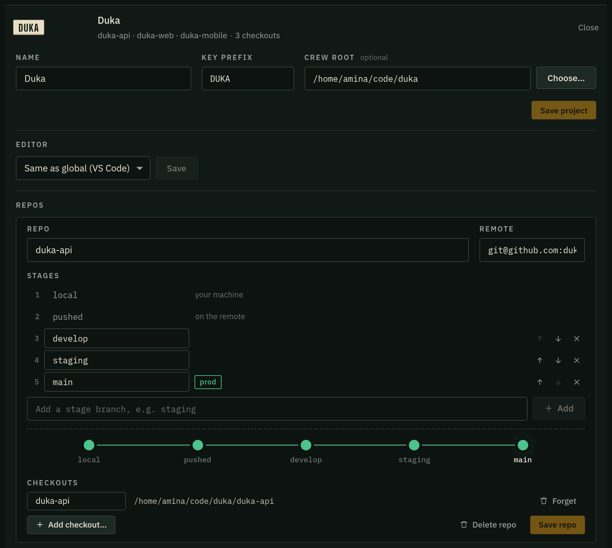

# Add a project and its repos

> Add a project from a folder of repos, set each repo's stage branches, and manage checkouts, worktrees and the crew root afterwards.

Section: Getting started · Updated: 2026-11-23

A project groups the repos that ship together, such as an API, a web app and a mobile app. Signalbox needs to know each repo's checkouts on your disk and the branches work passes through on its way to production.

## Add a project

Click **Add your first project** on the welcome screen, or **Add project** at the top of **Projects & settings**. The wizard has four steps.

### 1. Folder

1. Click **Choose folder…** and pick the folder that holds your repos, or a single repo. You can also type the path.
2. Click **Scan**.

Signalbox looks in that folder and up to two levels below it. It skips `node_modules`, `vendor` and `.claude/worktrees`, and doesn't count linked worktrees as repos of their own. Scanning only runs read-only `git` commands; nothing on disk is changed.

### 2. Repos

Signalbox lists every repo it found. Folders with the same remote URL are grouped as clones of one repo; the first is the main checkout.

- Untick a repo you don't want. A folder that is already a checkout in Signalbox shows **already added** and is skipped.
- Rename a repo in the name field. The name is how the repo appears on tickets and crews.
- Each folder has a **label**. It is how that checkout appears in the rail.
- **Split off** treats a folder as a repo of its own. **Move to…** moves it into another repo. **Merge into…** joins two repo groups.

Click **Next**.

### 3. Stages

The stages are the branches work is merged into after it's pushed, in order. The last one is prod. Signalbox pre-fills them from the remote's branches: one each of `develop`/`dev`, `test`, `qa` and `staging` it finds, then the prod branch (the default branch when it is `main`, `master` or similar).

- Edit a stage name in place.
- Use the arrows to move a stage earlier or later, and **×** to remove it.
- Type a branch in **Add a stage branch** and click **Add**. New stages go just before prod.

`local` and `pushed` are always there and can't be edited. The track under the list shows how the lamps will look.

Click **Next**.

### 4. Project

- **Project name.** Shown in the rail and on tickets.
- **Ticket key prefix.** Letters and digits, such as `DUKA`. Tickets are numbered `DUKA-1`, `DUKA-2`… Each project needs its own prefix.
- **Crew root** (optional). The folder a crew's orchestrator runs in, usually the folder above the repos. Signalbox fills it in when you add two or more repos. Left empty, a project with two or more repos still gets one when all its repos sit side by side in one folder: that folder. See [Crews](crews.md).

Click **Create project**. The project appears on the board.

> **Note:** Adding a project changes nothing on disk. Deleting one later only makes Signalbox forget it.

## Change a project later

Open **Projects & settings**. Under **Projects**, click a project's row (it says **Edit**) to open it.

| Setting | What it does |
|---|---|
| **Name**, **Key prefix**, **Crew root** | Click **Save project** after a change. Existing tickets keep their old prefix; new tickets use the new one. |
| **Editor** | The editor this project's files open in. **Same as global** uses the one under **Editor**. See [Open in editor](open-in-editor.md). |
| **Repos** | Each repo's **Repo** name, **Remote** (usually `origin`), **Stages** and **Checkouts**. Click **Save repo** after a change. |
| **Add repos from a folder…** | Runs the same wizard without the naming step, adding repos to this project. |
| **Agent** | The agent new sessions in this project use, unless the ticket says otherwise. See [Supported agents](agents.md). |
| Writer, tracker, rates, branch names, worktree setup & run | See [Write…](write.md), [Stage → status mapping](stage-status-mapping.md), [Time & cost](time-and-cost.md), [Branches & worktrees](branches-and-worktrees.md) and [Run & worktree setup](run-and-worktree-setup.md). |
| **Delete project** | Click twice. Forgets the project, its repos and checkouts. Nothing on disk is touched. |

## Checkouts

A checkout is a folder with a clone of a repo. You can have several, for example a second clone for long-running work.

- **Add checkout…** under a repo picks another folder. Signalbox checks that it is a clone of the same repo before adding it.
- Change a checkout's label in its field; it saves when you leave the field.
- **Forget** removes a checkout from Signalbox. The folder stays on disk.

## Worktrees

You don't add worktrees by hand. Signalbox finds every git worktree of a known checkout and lists it in the rail under that checkout, as `⟶ name`. Worktrees Signalbox creates go in `.claude/worktrees/<name>` inside the checkout. See [Branches & worktrees](branches-and-worktrees.md).

## Stages

A repo's stage list decides the lamps on its track. A branch lights the lamp for each stage branch that contains its last commit, after `local` and `pushed`. The last stage is prod: work there counts as shipped.

When a project's repos have different stage lists, the longest one is used for its tickets, and shorter lists line up with it at prod. See [The track](the-track.md).

> **Tip:** If your team merges `feature → develop → main`, your stages are `develop`, `main`. If you deploy straight from `main`, your only stage is `main`.

## Related

- [Create your first ticket](create-your-first-ticket.md)
- [The track](the-track.md)
- [Branches & worktrees](branches-and-worktrees.md)
- [Crews](crews.md)
- ["Not a checkout Signalbox knows"](not-a-known-checkout.md)

---

Also on the website: https://signalbox.accessa.co.ke/docs/add-a-project/
