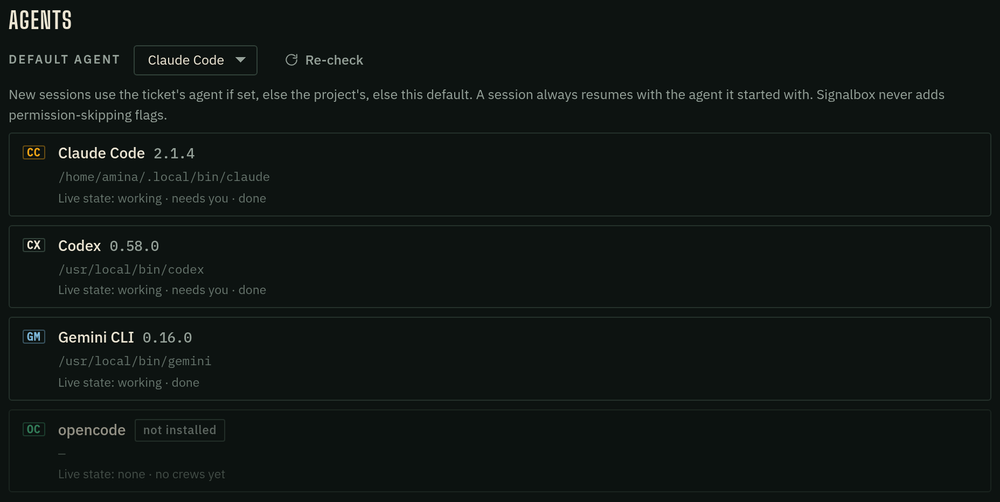

# Supported agents

> Signalbox runs Claude Code, Codex, Gemini CLI and opencode. How it finds them, how it picks one for a session, and what each one reports.

Section: Agents & sessions · Updated: 2026-11-23

Signalbox starts your coding agents in a terminal tab, inside the right checkout, on the right ticket. It works with four agents and lets you choose one per project, per ticket or per session.

## The four agents

| Agent | Badge | Live state it reports | Crews |
|---|---|---|---|
| Claude Code (`claude`) | CC | working, needs you, done | Yes |
| Codex (`codex`) | CX | done | Yes |
| Gemini CLI (`gemini`) | GM | working, needs you, done (untested) | Yes |
| opencode (`opencode`) | OC | none | Yes |

The badge shows next to every session, tab and crew pane, so you can tell at a glance which agent runs where.

Signalbox doesn't install agents. Install the ones you want with their own installers, then let Signalbox find them.

> **Note:** Signalbox never adds permission-skipping flags to any agent. Each agent asks for approvals the way it normally does, and you answer in its terminal.

## Check which agents are installed

1. Open **Projects & settings** in the rail.
2. Scroll to **Agents**.
3. Each agent shows its version and path, or **not installed**.
4. If you installed an agent while Signalbox was open, click **Re-check**.

The line under each agent reads **Live state:** and lists what it reports. **(untested)** means the mechanism hasn't been seen working end to end. **no crews yet** would mean the agent can't join a crew; all four can today.

### Where Signalbox looks

Signalbox looks for each agent's program in this order:

1. Your `PATH`.
2. The agent's own install folder (`~/.local/bin` for Claude Code, `~/.opencode/bin` for opencode).
3. Common install folders: `~/.local/bin`, nvm's Node versions (newest first), `~/.bun/bin`, `~/.npm-global/bin`, `~/.volta/bin`, `~/.cargo/bin`, `~/.yarn/bin`, `/usr/local/bin`, `/opt/homebrew/bin` and `/usr/bin`.
4. Your login shell, with `command -v`.

The result is kept for ten minutes. **Re-check** looks again straight away.

Sessions start through your interactive login shell, so they get the same `PATH` and environment as a normal terminal.

## How the agent for a session is chosen

Signalbox uses the first of these that is set:

1. **The session.** A session always resumes with the agent it started with.
2. **The ticket.** Set in the ticket drawer, under **Agent**.
3. **The project.** Set under **Projects & settings → Projects →** the project **→ Edit**, under **Agent**.
4. **The global default.** Set under **Projects & settings → Agents → Default agent**.
5. Claude Code, if nothing else is set.

### Set the global default

1. Open **Projects & settings → Agents**.
2. Pick an agent in **Default agent**.

### Set a project's agent

1. Open **Projects & settings**.
2. Click the project, then **Edit**.
3. Under **Agent**, pick an agent. **Global default (…)** removes the override.

### Set a ticket's agent

1. Open the ticket.
2. Under the status buttons, pick an agent in **Agent**. The first option, **Project: …** or **Default: …**, removes the override.

The choice applies to new sessions on that ticket. Sessions that already exist keep their own agent.

### Pick an agent for one session

You can override the agent each time you start something:

- **New ticket** form: the **Agent** field, shown when **Start the agent on it** is ticked. If you pick a different agent from the project's, it is saved on the ticket, so later sessions use it too.
- Ticket drawer: **New session** (or **Single**) opens a picker that starts with **Start** and an agent list.
- Checkout menu in the rail: the **Agent** list next to **Start a session on…**. Leave it on **Each ticket's agent** to use each ticket's own choice.
- **Start crew**: one agent per member. See [Crews](crews.md).

Agents that aren't installed are listed as **(not installed)** and can't be picked.

## What each agent reports

Signalbox lights lamps from what the agent tells it. See [States and notifications](states-and-notifications.md) for what the lamps mean.

- **Claude Code:** Signalbox starts it with a settings file of hooks (`--settings`). They report when you send a prompt, when it uses a tool, when it stops and when it asks for something. Your own Claude settings aren't changed.
- **Codex:** Signalbox passes a `notify` program with `-c notify=…`. Codex only calls it when a turn finishes, so you get **done** but never **working** or **needs you**. If your Codex config already sets `notify`, Signalbox leaves it alone and gets no state at all.
- **Gemini CLI:** Signalbox passes hooks through `GEMINI_CLI_SYSTEM_SETTINGS_PATH`. This only happens when you don't have a Gemini system settings file of your own.
- **opencode:** no state is reported. Its lamp stays at idle.

### Session ids

Claude Code is given its session id when it starts. Codex, Gemini CLI and opencode pick their own, so Signalbox watches for the session file they write and links it to the ticket. Until then the session shows as **New session**.

## Related

- [Sessions](sessions.md)
- [Crews](crews.md)
- [States and notifications](states-and-notifications.md)
- [Agent not found](agent-not-found.md)

---

Also on the website: https://signalbox.accessa.co.ke/docs/agents/
