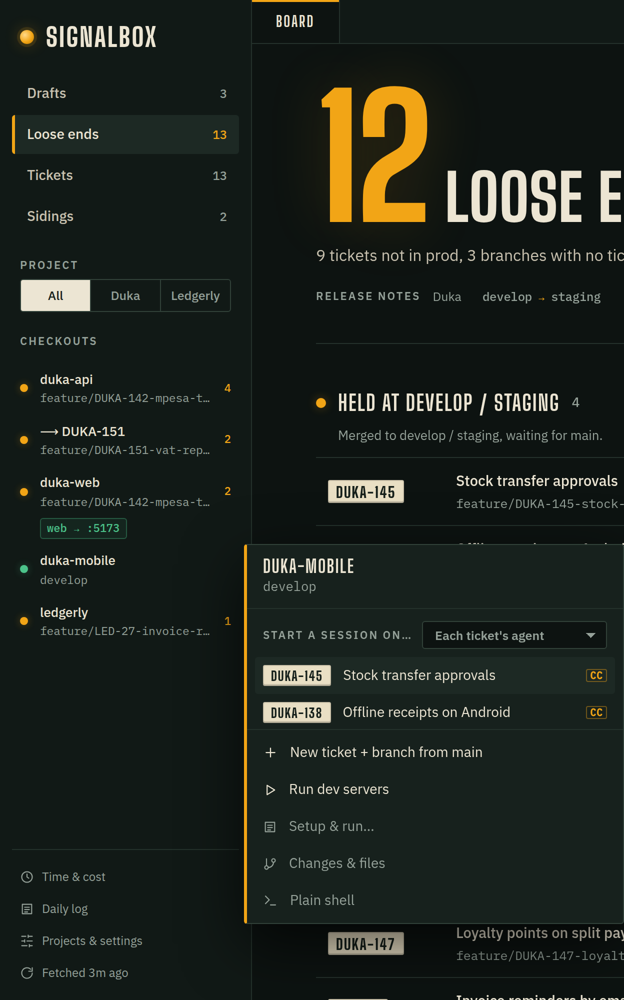
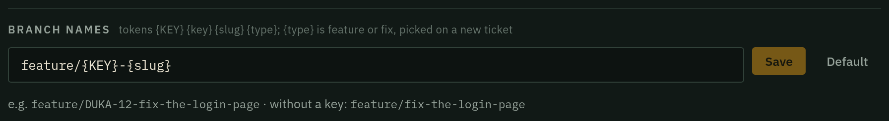

# Branches & worktrees

> Create and link a ticket's branches, work in git worktrees, move a branch into a worktree and promote it back, and set the branch name pattern.

Section: Tickets & branches · Updated: 2026-11-23

A ticket's branches are how Signalbox knows where its work is. A branch can live in a repo's main checkout or in its own git worktree. This page covers creating, linking and moving branches, and naming them.

## Create a branch for a ticket

The usual way is the New ticket form, with **Create a branch from main** ticked. See [Create your first ticket](create-your-first-ticket.md).

For a ticket that already exists:

1. Open the ticket.
2. Under **The line**, click **New from main** (the button names your prod branch).
3. Check the **Branch name**, pick **Main Checkout** or **New Worktree**, and pick the checkout. With several repos, tick the repos that need the branch.
4. Click **Create branch**.

The branch is always created from the prod branch on the remote (`origin/main`), fetched at that moment, and it doesn't track a remote branch until you push it.

## Link an existing branch

When the branch already exists, for example one a teammate pushed, link it instead:

1. Open the ticket.
2. Under **The line**, pick the repo (when the project has several) and type the branch name in **branch name**. Local and remote branches are suggested as you type.
3. Click **Link**.

The branch appears on the ticket's track. Linking doesn't check anything out; it only tells Signalbox to follow that branch. The **×** next to a branch unlinks it; the branch itself isn't touched.

Other ways to link a branch:

- **Loose ends → Unclaimed branches → Ticket** creates a ticket for a branch that has none.
- A checkout in the rail on a branch no ticket owns offers **New ticket for** `branch`.

## Main checkout or worktree

| | Main checkout | Worktree |
|---|---|---|
| Where | The folder you added as a checkout. | `<checkout>/.claude/worktrees/<name>`, named after the last part of the branch name. |
| Switching | The checkout switches to the new branch. It must have no uncommitted changes. | The checkout stays as it is. |
| Several at once | One branch at a time per checkout. | One worktree per branch, side by side. |
| Setup | Already set up. | Runs the project's worktree setup: copies `.env` files, links or installs dependencies. |

Signalbox adds `.claude/worktrees/` to the repo's local git exclude file, so worktrees never show up as untracked files in the main checkout.

Every worktree of a known checkout, including ones you made yourself with `git worktree add`, is listed in the rail under its checkout as `⟶ name`. You can start sessions there like anywhere else.

> **Tip:** Use worktrees when you want two agents working in the same repo at the same time, or to keep your main checkout free for reviews and hotfixes.

## Move to worktree

When a branch is checked out in the main checkout and you want the checkout back, move the branch into a worktree.

1. Open the ticket. On the branch's line, click **Move to worktree**.
2. Click again (**Move out of** `checkout`**?**) to confirm.

Signalbox then:

1. stashes the checkout's uncommitted changes, untracked files included;
2. switches the checkout back to the branch it was on before, or to prod;
3. creates a worktree for the branch;
4. puts the changes back in the worktree;
5. restarts any session that was running in the checkout, now in the worktree.

If the changes don't apply cleanly in the worktree, they stay in `git stash`, and the session that was running there (or a new one on the ticket) is asked to resolve it.

## Promote to main

The reverse: bring a worktree's branch into the main checkout and delete the worktree.

1. Open the ticket. On the branch's line, click **Promote to** `checkout`. Or click the worktree in the rail and choose **Promote to main (**`checkout`**)**.
2. Click again to confirm (**Switch** `checkout` **& delete worktree?**).

Signalbox switches the main checkout to the branch, carries over the worktree's uncommitted changes, deletes the worktree, and restarts any session that was running there in the main checkout.

The main checkout must have no uncommitted changes first. If the carried changes conflict, they are left in `git stash` and an agent is asked to resolve them.

## The checkout menu

Click any checkout or worktree in the rail for its menu:



| Item | What it does |
|---|---|
| **Start a session on…** | Lists the project's open tickets; tickets on this checkout's branch first, marked **this branch**. Click one to start a session here. |
| **New ticket + branch from main** | Opens New ticket with this checkout as the place for the branch. |
| **New ticket for** `branch` | Shown when the checkout is on a branch no ticket owns. Creates a ticket that links it. |
| **Promote to main (**`checkout`**)** | Worktrees only. See above. |
| **Run dev servers** / **Stop** | See [Run & worktree setup](run-and-worktree-setup.md). |
| **Run worktree setup** | Worktrees only. Runs the setup recipe again. |
| **Setup & run…** | Edit the project's worktree setup and run commands. |
| **Changes & files** | The diff and file browser for this folder. See [Changes](changes.md). |
| **Plain shell** | A terminal in this folder. |

## Branch name pattern

Each project can have its own pattern for new branch names. Open **Projects & settings**, open the project, and find **Branch names**.



| Token | Becomes | Example |
|---|---|---|
| `{KEY}` | The ticket key, upper case. | `DUKA-12` |
| `{key}` | The ticket key, lower case. | `duka-12` |
| `{slug}` | The title in lower case, words joined by `-`, up to 48 characters. | `fix-the-login-page` |
| `{type}` | `feature` or `fix`, picked on the New ticket form. | `fix` |

Examples:

```
feature/{KEY}-{slug}     feature/DUKA-12-fix-the-login-page
{type}/{key}-{slug}      fix/duka-12-fix-the-login-page
{KEY}                    DUKA-12
```

- The pattern must contain `{slug}`, `{KEY}` or `{key}` so each ticket gets its own branch.
- The preview under the field shows a sample name, and the name without a key. When a token has no value, the separator next to it goes too, so `feature/{KEY}-{slug}` without a key is `feature/fix-the-login-page`.
- Click **Save**. **Default** goes back to the default.

Without a pattern of its own, a project uses `feature/{KEY}-{slug}`, but only puts a key in when the ticket came from a tracker issue. Tickets numbered by Signalbox get `feature/<slug>`. Once you save a pattern, every new ticket's own key goes in.

The pattern only fills in the suggestion. You can always edit the branch name before creating it.

## Related

- [The track](the-track.md)
- [Create your first ticket](create-your-first-ticket.md)
- [Run & worktree setup](run-and-worktree-setup.md)
- [Sessions](sessions.md)
- ["Not a checkout Signalbox knows"](not-a-known-checkout.md)

---

Also on the website: https://signalbox.accessa.co.ke/docs/branches-and-worktrees/
