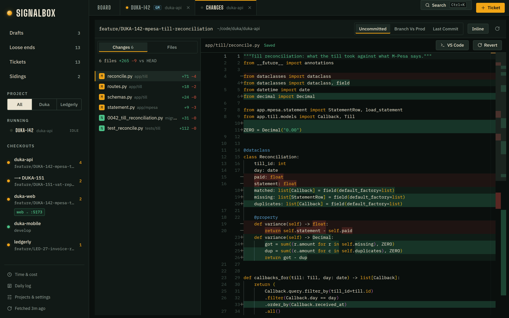

# Changes

> Review what an agent changed in a checkout or worktree, edit the files in place, revert a file, and compare against prod or the last commit.

Section: Work on code · Updated: 2026-11-23

The Changes view shows the diff of one checkout or worktree, file by file. You can read what an agent did, fix things by hand in the same editor, and throw away a file's changes.

## Open the Changes view

Any of these opens a **Changes** tab for a folder:

- In a session tab, click **Changes** in the tab bar.
- In a crew, click the Changes button (the branch icon) in a worker's pane header.
- In the ticket drawer, under **The line**, click **Changes** next to a branch that's checked out.
- In the rail, click a checkout under **Checkouts**, then **Changes & files**.

The tab is labelled **Changes** and the checkout's name. Opening it again for the same folder takes you to the same tab.

## What to compare

The header shows the branch and the folder. Pick what to compare with the buttons on the right:

| Button | Shows |
|---|---|
| **Uncommitted** | What's changed since the last commit, including new files. |
| **Branch Vs Prod** | Everything on this branch since it left prod, plus uncommitted work. Compared with the remote's prod branch, such as `origin/main`. |
| **Last Commit** | Just the last commit. Read-only. |

**Inline** switches the diff to one column; **Side by side** switches back. The refresh button reloads the list.

The list on the left shows each file with a letter: **A** added, **M** modified, **D** deleted, **R** renamed, **N** new (not yet tracked by git). The numbers are lines added and removed; binary files show `bin`. The line above the list sums it up, for example "4 files +120 −36 vs HEAD".

While the tab is open, the list refreshes every few seconds, so you can watch an agent work.

## Edit a file

The right side of the diff is the file on disk, and you can type in it.

- Changes save on their own a moment after you stop typing. Press Ctrl+S (⌘S on Mac) to save at once.
- The label next to the file name shows **Saved**, **Saving…**, **Read-only** or **Changed on disk**.
- **Last Commit** and deleted files are read-only.

If the file changes on disk while you have no unsaved edits (for example, the agent edits it), the editor follows the disk.

If it changes on disk while you do have unsaved edits, a bar appears: "This file changed on disk (Claude?) while you had unsaved edits."

- **Use disk version** drops your edits and loads the file from disk.
- **Keep mine** saves your version over it.

## Revert a file

1. Select the file.
2. Click **Revert**.
3. Click **Discard changes?** to confirm.

This throws away the file's uncommitted changes. A new file is deleted. **Revert** isn't offered in **Last Commit**.

> **Warning:** Reverting doesn't go to a trash. Uncommitted work in that file is gone.

## Open the file in your editor

The button with your editor's name, such as **VS Code**, opens the file in that editor at the line your cursor is on. See [Open in editor](open-in-editor.md) to choose the editor.

## Browse all files

Click **Files** above the list to switch from the changed files to every file in the checkout. See [Files](files.md).

## Related

- [Files](files.md)
- [Open in editor](open-in-editor.md)
- [Branches and worktrees](branches-and-worktrees.md)
- [Sessions](sessions.md)

---

Also on the website: https://signalbox.accessa.co.ke/docs/changes/
