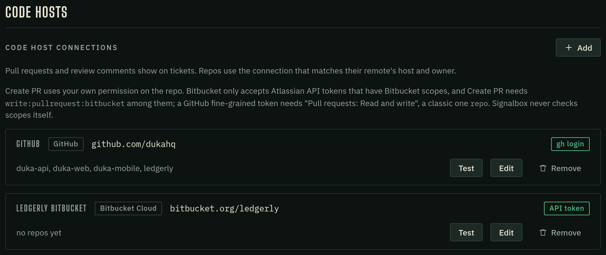

# Code hosts

> Connect Bitbucket Cloud or GitHub so tickets show their pull requests, review comments and builds, and so you can open PRs from Signalbox.

Section: Trackers & code hosts · Updated: 2026-11-23

Connect your code host so each ticket shows the pull requests from its branches, with reviews, builds and review comments. The same connection lets you [create a PR](create-a-pr.md) from the ticket.

Signalbox supports **Bitbucket Cloud** and **GitHub** (github.com or GitHub Enterprise).

## Add a connection

1. Open **Projects & settings** and scroll to **Code hosts**.
2. Under **Code host connections**, click **Add**.
3. Choose **Bitbucket Cloud** or **GitHub**.
4. Fill in the fields below for your host.
5. Click **Test**. A working connection says **Signed in as** and your account name.
6. Click **Save**.

Tokens are kept in your system keychain, not in Signalbox's database. When you edit a connection, leave the token empty to keep the saved one.

## Bitbucket Cloud

| Field | What to enter |
|---|---|
| **Name** | Anything, for example "Acme Bitbucket" |
| **Workspace** | Optional. Only repos in this workspace use the connection. Needed for a workspace access token. |
| **Atlassian email** | The account your API token belongs to. Leave it empty for a workspace, project or repository access token. |
| **API token** | An Atlassian API token with Bitbucket scopes, or an access token |

The form lists the scopes under the token field, each with what it's for and a **Copy** button:

| Scope | Used for |
|---|---|
| `read:repository:bitbucket` | Recommended. Reading the repos; no call needs it on its own, but it's the usual partner of the pull-request scopes. |
| `read:pullrequest:bitbucket` | Pull requests on tickets: reviewers, comments, builds and default reviewers. |
| `read:user:bitbucket` | The connection test: **Test** shows who you're signed in as. Without it, Test still says the token is accepted. |
| `write:pullrequest:bitbucket` | Opening pull requests with [Create PR](create-a-pr.md). |

To make an Atlassian API token:

1. Go to **id.atlassian.com → Security → API tokens**.
2. Click **Create API token with scopes** and choose **Bitbucket**.
3. Tick the scopes above. Ticking every Bitbucket scope works too.
4. Copy the token into Signalbox with your Atlassian email.

> **Warning:** Bitbucket refuses an Atlassian API token that has no Bitbucket scopes. This is Bitbucket's rule, not Signalbox's: Signalbox never checks scopes itself, and any token with the scopes above works. If Test says the token has no Bitbucket scopes, make a new one as above.

A workspace, project or repository access token (no email) needs **Pull requests: Read**, plus **Write** for Create PR.

A token that works but can't read your profile (an access token, or a token without `read:user:bitbucket`) tests as "token accepted (it can't read your profile, which is fine)".

## GitHub

| Field | What to enter |
|---|---|
| **Name** | Anything, for example "Work GitHub" |
| **Host** | `github.com`, or your GitHub Enterprise host |
| **Owner** | Optional. Only repos under this user or organisation use the connection. |
| **Use my gh login** | Tick to use the GitHub CLI's login instead of a token |
| **Token** | A personal access token, if you don't use `gh` |

For a token, use either a fine-grained token or a classic one. The form lists what it needs under the token field:

| Permission (fine-grained token, Repository permissions) | Used for |
|---|---|
| **Pull requests: Read** (**Read and write** for Create PR) | Pull requests, reviews and review comments on tickets; opening pull requests. |
| **Commit statuses: Read** | Build statuses on a pull request. |
| **Checks: Read** | Check runs, such as GitHub Actions, on a pull request. |
| **Metadata: Read** | Added by GitHub automatically. |

A classic token needs just the `repo` scope, which covers all of the above. Make either at **github.com → Settings → Developer settings → Personal access tokens**.

**Use my gh login** is available when `gh auth login` has been run for that host. Signalbox reads the `gh` token each time it needs it and never stores it.

## Which repos use which connection

Each repo uses the connection that matches its remote's host, then its owner (workspace or organisation). The connection's row lists the repos that use it, or **no repos yet**.

If a repo's remote is on a code host but no connection matches, Settings shows "No connection yet for:" with the repo name. Add a connection for that host or owner.

## Related

- [Pull requests on the ticket](pull-requests.md)
- [Create a PR](create-a-pr.md)
- ["Bitbucket didn't answer in time"](bitbucket-didnt-answer.md)
- [Jira](jira.md)

---

Also on the website: https://signalbox.accessa.co.ke/docs/code-hosts/
