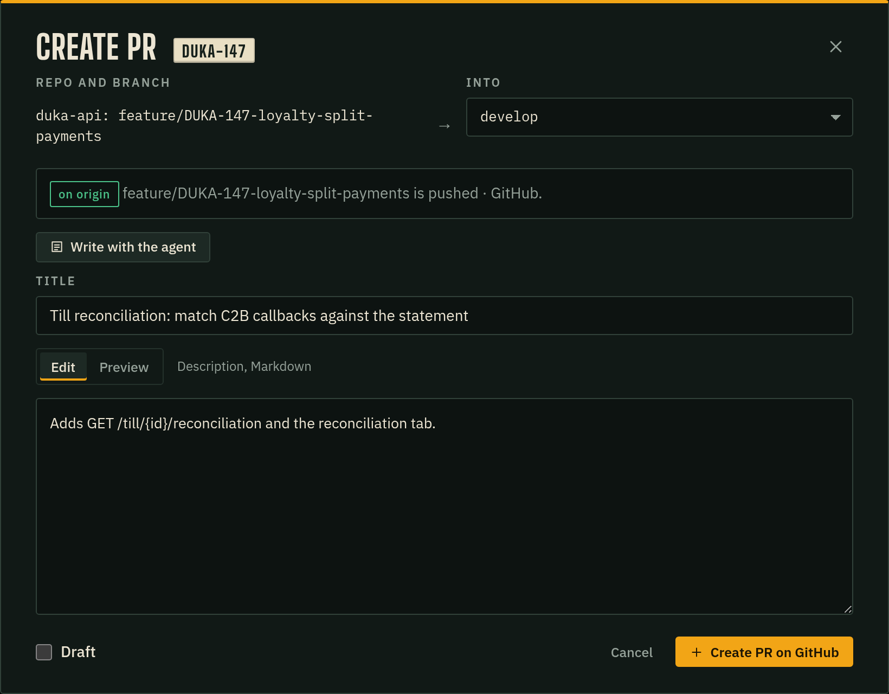

# Create a PR

> Open a pull request on Bitbucket or GitHub from a ticket's branch, with the title and description filled from your commits or written by the agent.

Section: Trackers & code hosts · Updated: 2026-11-23

Open a pull request for one of the ticket's branches without leaving Signalbox. You see and can edit everything first. Nothing is sent until you click **Create PR**.

You need a [code host connection](code-hosts.md) for the repo. To open PRs, its token needs write access to pull requests.

## Open the form

Use either of these:

- In the ticket drawer's **Pull request** section, click **Create PR** next to a branch that has **no open PR**.
- In **Write… → PR description**, click **Create PR with this** once the description is written. The form opens with that title and description. See [PR description](pr-description.md).

## Fill it in

1. **Repo and branch:** the branch the PR comes from. When you open the form from Write… and the ticket has several branches without a PR, pick one here.
2. **Into:** the branch it goes into. The default is the repo's first stage that isn't the branch itself, for example `develop`. Pick another stage, or **Other branch…** and type a name.
3. **Title** and description: filled from the branch's commits. The newest commit's subject becomes the title and its body the description. With several commits and no body on the newest, the description lists their subjects, oldest first.
4. Use the **Edit** and **Preview** tabs to check the Markdown.
5. On GitHub, tick **Draft** to open it as a draft PR.
6. Click **Create PR on Bitbucket** or **Create PR on GitHub**.

The title and description stop following the commits once you type in them.

> **Note:** Lines like "Co-Authored-By: …" and "Generated with Claude Code" are removed from the title and description before the PR is sent.

### Write with the agent

Click **Write with the agent** to have the writing agent fill the title and description from the diff, commits and sessions. If there's already text, click again on **Replace what's here?** to confirm. You can click **Cancel** while it writes. See [Write…](write.md) for who writes.

## Push first

Signalbox checks the branch before you create the PR:

- **Push branch first:** the branch isn't on the remote yet, or has commits that aren't pushed. Click **Push**. This runs `git push -u <remote> <branch>` in the checkout that has the branch.
- **on origin** (or your remote): the branch is pushed and ready.
- Uncommitted changes in the checkout get a warning: they won't be in the PR until you commit and push them.
- If the remote has commits your checkout doesn't, you're told to pull before pushing more.

**Create PR** stays disabled until the branch is on the remote. Hover it to see why.

> **Warning:** Signalbox never force-pushes. If the push is rejected because the remote has commits your branch doesn't, pull or rebase in a terminal, then push again.

## After you click Create PR

- A message says "Opened PR #N on Bitbucket" (or GitHub), with **Open** to view it in the browser.
- The PR appears in the ticket's **Pull request** section.
- If an open PR from that branch into that target already exists, nothing new is created. The message says "#N was already open from … into …".

### Default reviewers on Bitbucket

On Bitbucket, the repo's default reviewers (from the repository and project settings, as Bitbucket's own page adds them) are added to the PR, leaving you out. If Bitbucket can't read or refuses them, the PR is still opened and a message tells you to add reviewers on Bitbucket. On GitHub, Signalbox doesn't add reviewers.

## If it fails

- "No code host connection for …": add one in **Projects & settings → Code hosts**.
- "… didn't let this token open a pull request (HTTP 403)": the token can read but not write. On Bitbucket, a scoped Atlassian token needs `write:pullrequest:bitbucket`; an access token needs **Pull requests: Write**. On GitHub, a fine-grained token needs **Pull requests: Read and write**, a classic token needs `repo`, and with **Use my gh login** run `gh auth refresh -s repo`.

## Related

- [Pull requests on the ticket](pull-requests.md)
- [PR description](pr-description.md)
- [Code hosts](code-hosts.md)
- [Branches & worktrees](branches-and-worktrees.md)

---

Also on the website: https://signalbox.accessa.co.ke/docs/create-a-pr/
