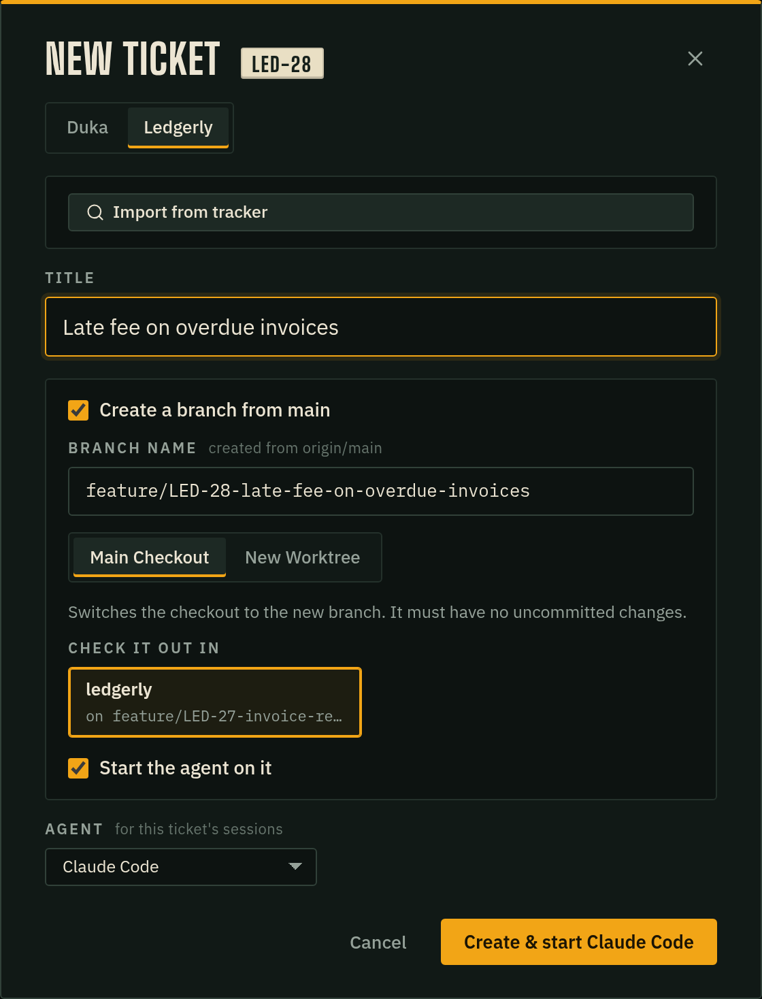
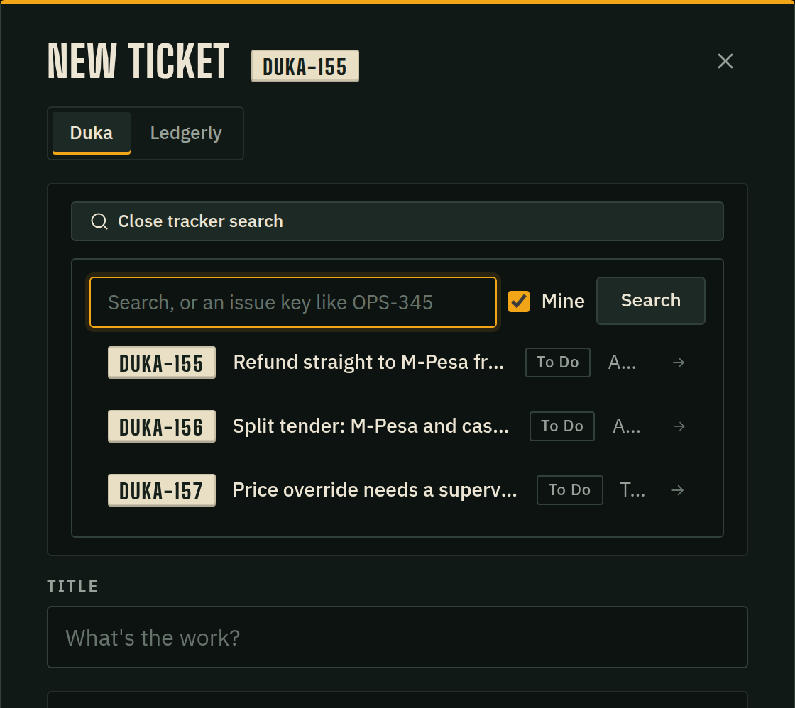
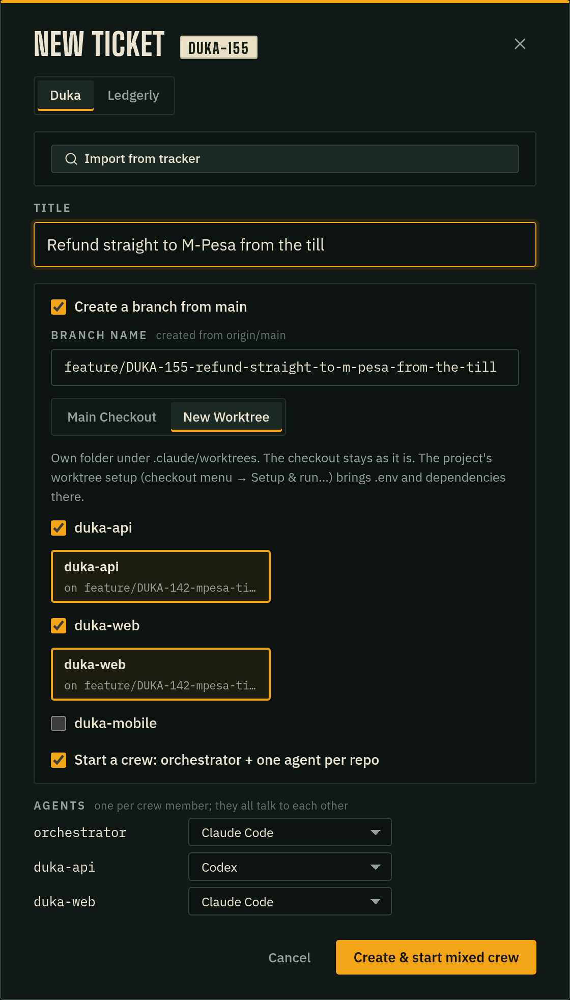

# Create your first ticket

> Every field of the New ticket form, step by step: project, title, tracker import, the branch from prod, checkout or worktree, agent or crew.

Section: Getting started · Updated: 2026-11-23

A ticket is how Signalbox keeps track of a piece of work. One form creates the ticket, makes its branch from prod, and starts an agent or a crew on it. This page goes through every field.

## Before you start

- You need a project with at least one repo. See [Add a project and its repos](add-a-project.md).
- To start an agent, it must be installed and logged in. See [Supported agents](agents.md).
- To create the branch in the main checkout, that checkout must have no uncommitted changes. A new worktree doesn't need that.

## Quick version

1. Click **Ticket** at the top right, or press Ctrl+Shift+N (⇧⌘N on Mac).
2. Type a **Title**.
3. Leave **Create a branch from main** ticked, and pick **Main Checkout** or **New Worktree**.
4. Leave **Start the agent on it** ticked and pick the **Agent**.
5. Click **Create & start Claude Code** (the button names the agent).

The ticket is created, its branch is made from the latest prod branch on the remote, and the agent opens in a new tab in that checkout, ready for you to tell it what to do.

## Open the form

Any of these opens **New ticket**:

| From | What it fills in |
|---|---|
| **Ticket** button at the top right, or Ctrl+Shift+N (⇧⌘N on Mac) | The project picked in the rail, if one is. |
| **New ticket** on the **Tickets** view | The same. |
| A checkout in the rail → **New ticket + branch from main** | The project, and that checkout as the place for the branch. |
| A checkout in the rail → **New ticket for** `branch` | The project, a title from the branch name, and the existing branch to link. Shown when the checkout is on a branch no ticket owns. |
| **Loose ends → Unclaimed branches → Ticket** | A title from the branch name, and the branch to link. |
| **Sidings → Attach → + New ticket from this session** | A title from the session, its branch, and the session to attach. |
| **Drafts → Start** | The draft's text as the title and its notes. The draft is removed once the ticket exists. |

## The fields

### Project

When the form opens without a project, a row of project buttons sits at the top. Click the one the work belongs to. The ticket key in the heading, such as **DUKA-155**, is the key the ticket will get.

### Import from tracker

Shown when the project is linked to a tracker (Jira, Kanboard, Notion or a Board API board). Use it when the work already has an issue.

1. Click **Import from tracker**.
2. Issues assigned to you are listed. Untick **Mine** to see everyone's. Type words or an issue key, such as `OPS-345`, and click **Search**.
3. Click an issue.

The title becomes the issue's title. When you create the ticket:

- it takes the issue's key, such as `DUKA-155`, if that key is free in Signalbox; otherwise it gets the project's next number;
- the issue's description and link go into the ticket's notes;
- the ticket is linked to the issue, so it can move the issue along as the branch progresses.

Click **Don't link** to drop the issue and keep the title. See [Importing from a tracker](import-from-a-tracker.md).

### Title

What the work is, in a few words. It becomes the ticket's title and, by default, part of the branch name. It's required.

### Create a branch from main

Ticked by default. The label names the project's prod branch, the last stage of each repo (`main` here). Untick it to create the ticket alone; you can add or link a branch later from the ticket.

**Branch type** (**Feature** / **Fix**) appears when the project's branch pattern uses `{type}`.

**Branch name.** Pre-filled from the project's branch pattern. The default pattern is `feature/{KEY}-{slug}`: the key goes in when the ticket was imported from a tracker or the project has its own pattern; otherwise the name is `feature/<title-in-kebab-case>`. Edit it freely; once you type in it, changing the title no longer changes it. See [Branches & worktrees](branches-and-worktrees.md) for patterns.

The branch is always created from `origin/<prod>`, fetched fresh at that moment. It is never created from whatever the checkout happens to be on.

### Main Checkout or New Worktree

| Choice | What happens |
|---|---|
| **Main Checkout** | The checkout you pick switches to the new branch. It must have no uncommitted changes; a checkout with changes is greyed out and shows **N uncommitted**. |
| **New Worktree** | A new folder is made for the branch at `<checkout>/.claude/worktrees/<name>`, where the name is the last part of the branch name (after the last `/`). The checkout itself stays as it is, changes and all. If the project has a worktree setup, it runs in a **Setup** tab to copy `.env` files and install dependencies. |

Use a worktree when the checkout is busy with other work, or when you want several agents in the same repo at once.

### Where: the checkouts

- **One repo:** under **Check it out in** (or **Add the worktree to**), click the checkout to use. Each shows the branch it is on now.
- **Several repos:** each repo has a checkbox. Tick the repos this work touches, and pick a checkout for each. The branch, with the same name, is created in every ticked repo.

### Start the agent on it

Ticked by default. Untick it to create the ticket and branch without starting anything. With several repos ticked, the label changes:

- **Start a crew: orchestrator + one agent per repo** when the project has a crew root. See [Crews](crews.md).
- **Start the agent on it (in the first checkout)** when it doesn't.

### Agent

Shown when an agent will start.

- **One agent:** **Agent** (for this ticket's sessions). It starts on the project's agent, else your default agent. Agents that aren't installed are listed as **(not installed)** and can't be picked.
- **A crew:** **Agents** lists the **orchestrator** and each ticked repo, each with its own picker. Mix them as you like, for example Claude Code as orchestrator and Codex on the API.

If you pick a different agent than the project's, the ticket remembers it, and later sessions on the ticket use it too.

### The button

The button says what will happen:

| Button | When |
|---|---|
| **Create ticket** | No branch, or no agent to start. |
| **Create & start Claude Code** (or Codex, …) | One agent will start. |
| **Create & start Claude Code crew** | A crew where every member runs the same agent. |
| **Create & start mixed crew** | A crew with different agents. |

Press Esc or click **Cancel** to close the form without creating anything.

## What happens after Create

1. The ticket is created and appears on the board. A message confirms it, for example `DUKA-155 created on feature/DUKA-155-refund-straight-to-m-pesa-from-the-till`.
2. If you imported an issue, the ticket is linked to it. If you started from a draft, the draft is removed. If you started from a branch or a session, they are linked or attached.
3. For each repo, Signalbox fetches the prod branch and creates the branch from it, in the checkout or in a new worktree. If one repo fails, for example because its checkout has uncommitted changes, you get a message naming that repo; the others still go ahead.
4. A new worktree with a worktree setup gets a **Setup** tab that runs the recipe.
5. Then the agent starts, or the ticket opens.

| You chose | What opens |
|---|---|
| One agent | A new tab in the checkout or worktree, with the ticket key and title as the session's name. Type your first instruction. |
| A crew | One split tab. The workers start first, then the orchestrator. The orchestrator is told the ticket, its notes and who the workers are, confirms the crew in one line, and waits for you to say what to build. |
| No agent | The ticket's drawer. |

The branch stays `local` until you or the agent push it. Watch its lamps light up on [the track](the-track.md) as it moves to prod.

## If something goes wrong

| Message | What to do |
|---|---|
| **Give it a title.** | Type a title. |
| **Give the branch a name.** | The branch name is empty. Type one or untick **Create a branch from main**. |
| `N uncommitted change(s) here. Commit or stash first, or pick another checkout` | Commit or stash in that checkout, or pick **New Worktree**. |
| `… already exists in this checkout` | A branch with that name exists. Change the name, or link the existing branch from the ticket instead. |
| `fetching main failed: …` | Signalbox couldn't reach the remote. Check your network and that `git fetch` works in that checkout. |
| `'…' isn't a valid branch name` | Remove spaces and characters git doesn't allow, such as `~ ^ : ? * [`. |
| `This project has no shared folder for an orchestrator` | Set a **Crew root** on the project. See [Crews](crews.md). |

## Related

- [Start your first session](start-your-first-session.md)
- [Tickets](tickets.md)
- [Branches & worktrees](branches-and-worktrees.md)
- [Crews](crews.md)
- [Run & worktree setup](run-and-worktree-setup.md)
- [Importing from a tracker](import-from-a-tracker.md)

---

Also on the website: https://signalbox.accessa.co.ke/docs/create-your-first-ticket/
