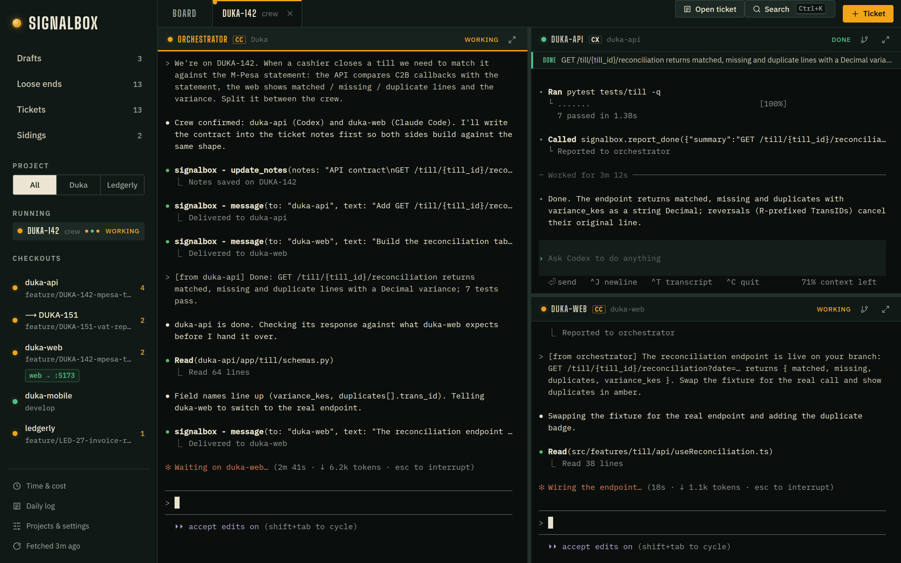

# Crews

> Run an orchestrator and one agent per repo in one split tab. The members message each other through Signalbox, and each can be a different agent.

Section: Agents & sessions · Updated: 2026-11-23

A crew is a set of sessions that work on one ticket together: an orchestrator that plans and directs, and one worker per repo that makes the edits. They all appear in one split tab and talk to each other through Signalbox.

Use a crew when one ticket touches several repos, for example an API and the web app that calls it.

## Before you start

A crew needs:

- A project with two or more repos.
- A **Crew root** on the project. This is the folder the orchestrator runs in, usually the folder above the repos, so it can read all of them. Set it when you add the project, or later under **Projects & settings → Projects →** the project **→ Edit → Crew root**.

Without a crew root, the **Start crew** button doesn't appear.

## Start a crew from a ticket

1. Open the ticket.
2. In **Sessions**, click **Start crew**.
3. For each repo, pick where its worker runs: an existing checkout or worktree (the ticket's branch is marked **✓ ticket branch**), **Check out …** to put the ticket's branch into the checkout, or **New branch from …** to create a branch from prod.
4. If you're checking out or creating a branch, choose **Main Checkout** or **New Worktree**, and set the **New branch name** if asked.
5. Pick an agent for the orchestrator and for each worker. They default to the ticket's agent.
6. Click **Start crew**.

## Start a crew from the New ticket form

1. Click **Ticket** (or press Ctrl+Shift+N, ⇧⌘N on Mac).
2. Fill in the title and tick **Create a branch from …**.
3. Tick two or more repos.
4. Tick **Start a crew: orchestrator + one agent per repo**.
5. Under **Agents**, pick an agent for the orchestrator and each repo.
6. Click **Create & start … crew** (or **Create & start mixed crew** when the agents differ).

See [Create your first ticket](create-your-first-ticket.md) for every field of the form.

## How the crew works

When the crew starts, Signalbox starts the workers first, then the orchestrator. Each gets a first message that tells it:

- who it is (`orchestrator`, or the repo's name, such as `duka-api`),
- where it runs and on which branch,
- who the others are, and how to reach them.

Each member is told not to commit, push or switch branches unless you say so. The orchestrator replies with one line confirming the crew, then waits for you. Workers reply "ready".

You then tell the orchestrator what to build, in its pane. It splits the work and sends each worker instructions.

### The crew tools

Every member gets the same tools from Signalbox's `signalbox` MCP server:

| Tool | What it does |
|---|---|
| `crew_members` | Lists the crew: each member's name, agent, folder, branch and state, and any messages waiting for them. |
| `message` | Sends a message to another member by name. |
| `ticket_info` | The ticket's key, title, status, notes, branches and how far each has got, and the linked tracker issue. |
| `update_notes` | Adds to (or replaces) the ticket's notes, which the whole crew and you share. |
| `report_done` | Marks the current step done. The summary shows on the member's pane and goes to the orchestrator. |

The server runs on your machine only. It talks to Signalbox over a private socket in its data folder; nothing listens on a network port. Each member can only reach its own crew.

### Messages between members

A message arrives in the other member's terminal as a new turn, starting with `[from <name>]`. A worker's `report_done` reaches the orchestrator as `[from <name>] Done: …`.

If the member is busy (working, or waiting for you to approve something), the message waits and is delivered when it finishes its turn. This works best with agents that report their state. Codex only reports finished turns. opencode reports nothing, so messages to it are typed in straight away, even mid-turn.

When a worker calls `report_done`, a **Done** strip with its summary appears at the top of its pane.

### Mixed agents

Each member can run a different agent: for example a Claude Code orchestrator with a Codex worker on the API and a Claude Code worker on the web app. They all use the same tools, so they don't need to know what the others run. The agent badge on each pane shows which is which.

## The crew tab

- The orchestrator has the left half. Workers share the right half.
- Up to three workers stack in one column. With four or more, they use two columns.
- Drag the gutters between panes to resize them.
- Double-click a pane's header, or click its maximise button, to fill the tab with it. Do it again to restore.
- Each pane header shows the member's lamp, role, agent badge, checkout and state.
- Workers have a Changes button (the branch icon) that opens the [Changes view](changes.md) for their folder.
- If a member's session ends, its header shows **Resume**.

In the rail, a crew is one row under **Running**, with a dot per member. Its lamp shows the most urgent member's state, and clicking it takes you to the member that needs you.

## Resume a crew

1. Open the ticket.
2. In **Sessions**, find the row marked **Crew**.
3. Click **Resume crew**. If it's already running, the button says **Open**.

Every member resumes with the agent it started with.

## First run in a new folder

Some agents ask a question the first time they start in a folder, for example whether you trust it. Each new worktree is a new folder, so you may see this in several panes at once.

1. Click into each pane that's asking.
2. Answer the question there.

Signalbox holds back crew messages to a session that hasn't reported anything yet, so a message doesn't answer the question by accident. For agents that report finished turns, it waits up to 20 minutes.

Agents also ask before they use a Signalbox tool for the first time, the same way they ask for any MCP tool. Signalbox doesn't pre-approve tools. Approve them in each pane.

> **Tip:** Answer the trust and tool prompts once in each pane before you give the orchestrator its first task.

## Related

- [Supported agents](agents.md)
- [Sessions](sessions.md)
- [Add a project and its repos](add-a-project.md)
- [Branches and worktrees](branches-and-worktrees.md)
- [States and notifications](states-and-notifications.md)

---

Also on the website: https://signalbox.accessa.co.ke/docs/crews/
