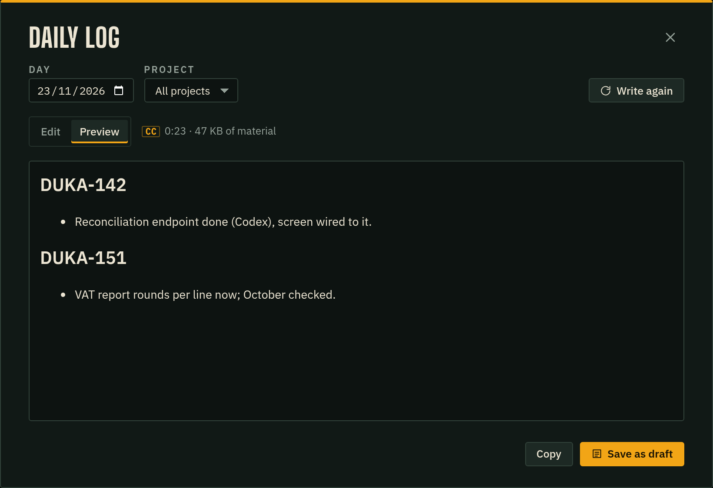

# Daily log

> Have the agent write what you did on a day, from your commits, session prompts and ticket moves, grouped by ticket.

Section: Writing · Updated: 2026-11-23

The daily log is a short write-up of one day's work across your tickets, for you and your lead. The agent writes it from what Signalbox already saw that day.

## Write a daily log

1. Click **Daily log** in the left rail, under **Time & cost**. Or press Ctrl+K (⌘K on Mac) and pick **Write daily log**.
2. Pick the **Day**. It starts on today; you can't pick a future day.
3. Pick the **Project**, or **All projects**. It starts on the project you have selected in the rail.
4. Click **Write**.
5. Read the log and edit it. **Preview** shows it rendered.
6. Click **Copy** to paste it somewhere, or **Save as draft** to keep it.

**Save as draft** adds a draft named like "Daily log 2026-11-23 · Duka", with the log in the draft's notes. Find it under **Drafts** in the rail.

Click **Write again** to rewrite it, for example after you change the day or project.

## What goes in

- Commits you authored that day, from local midnight to midnight, in every repo. "You" means each repo's git `user.email`.
- Your prompts and the agent's final replies from ticket sessions that day.
- Tickets created, updated or moved on the board that day, and crew workers' reports.

Everything is grouped by ticket. Sessions that aren't attached to a ticket aren't included.

## What it looks like

- A heading with the date, and the project when you picked one.
- One section per ticket, headed with its key and title, with up to three lists: **Done**, **In progress** and **Blocked / needs a decision**. Empty lists are left out.
- Work with no ticket under **Other**.
- A **Tomorrow** list with the next steps.

It's plain language, keeps ticket keys, and stays under 300 words.

## Related

- [Write… overview](write.md)
- [Release notes](release-notes.md)
- [Time & cost](time-and-cost.md)
- [Sessions](sessions.md)

---

Also on the website: https://signalbox.accessa.co.ke/docs/daily-log/
