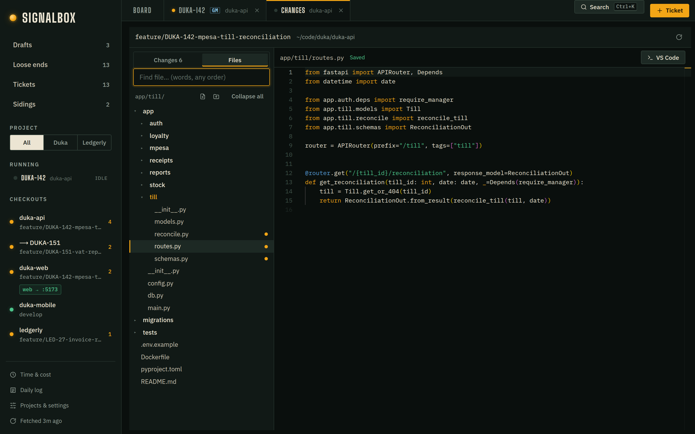

# Files

> Browse every file in a checkout, find one by name, and create, rename or delete files and folders without leaving Signalbox.

Section: Work on code · Updated: 2026-11-23

The Files view lists every file in a checkout or worktree as a folder tree. Open a file to read or edit it, or make a quick change to the tree yourself.

## Open the Files view

1. Open the [Changes view](changes.md) for the checkout. From the rail: click the checkout, then **Changes & files**.
2. Click **Files** above the list on the left.

The tree shows the files git tracks, plus new files that aren't ignored by `.gitignore`, plus empty folders. Ignored files, such as `node_modules`, aren't listed.

Files with uncommitted changes have a dot next to their name.

## Find a file

Type in **Find file… (words, any order)**. Every word must appear somewhere in the path, in any order. For example, `till api` finds `api/routes/till.ts`.

The first 500 matches are shown. Clear the box to get the tree back.

## Open and edit a file

Click a file to open it in the editor on the right. Edits save on their own, like in the Changes view. Ctrl+S (⌘S on Mac) saves at once. The button with your editor's name opens it in your own editor.

## Create a file or folder

1. Click the folder you want to create in. The toolbar shows it, for example `api/routes/`. With nothing selected, items go in the top folder.
2. Click the new file or new folder button in the toolbar.
3. Type the name and press Enter. Press Esc to cancel.

You can also hover a folder and use its own new file and new folder buttons, or right-click a folder.

A name can include folders: `a/b/name.ts` creates `a` and `b` on the way if they don't exist. A new file opens in the editor, ready to type in.

## Rename a file or folder

1. Right-click it, or hover it and click the **⋯** button.
2. Click **Rename…**. Or select it and press F2.
3. Type the new name and press Enter.

Like a new name, it can include folders to move the item. A file open in the editor stays open under its new name.

## Delete a file or folder

1. Right-click it, or hover it and click **⋯**.
2. Click **Delete…**.
3. Click **Delete** to confirm.

Only empty folders can be deleted here. For a folder with something in it, the menu shows **Delete (folder isn't empty)** and is greyed out.

> **Warning:** Deleting doesn't go to a trash. Committed versions stay in git, but anything new or uncommitted in the file is gone.

## Names Signalbox refuses

The name box tells you when a name won't work:

- empty names, or names that start or end with a space,
- `..` or `.` as a folder, or an absolute path,
- anything inside `.git` (Signalbox doesn't touch it),
- a name that already exists,
- a path that leads outside the checkout, including through a symlink.

**Collapse all** in the toolbar closes every open folder.

## Related

- [Changes](changes.md)
- [Open in editor](open-in-editor.md)
- [Search and palette](search-and-palette.md)

---

Also on the website: https://signalbox.accessa.co.ke/docs/files/
