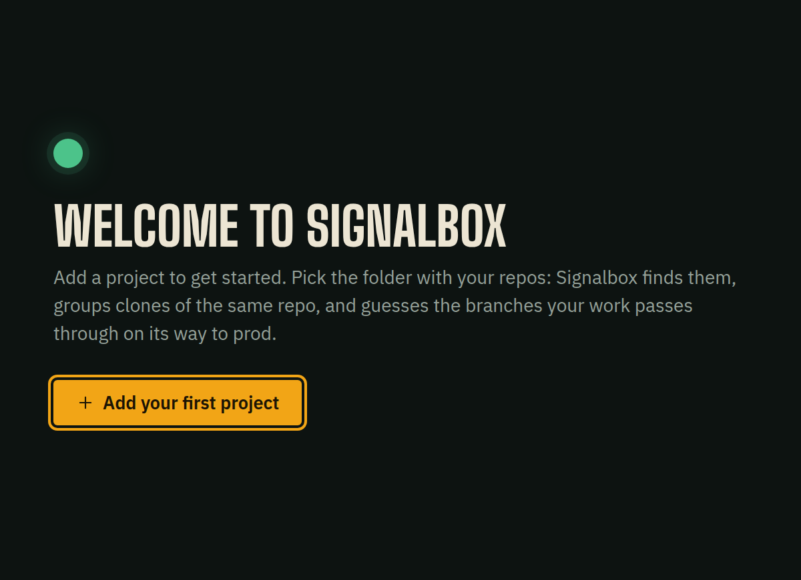
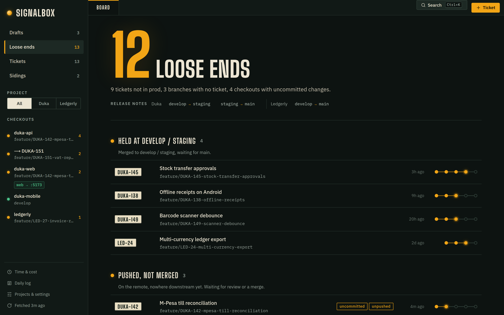

# First run

> What you see the first time you open Signalbox, how the window is laid out, and the three things to set up before your first ticket.

Section: Getting started · Updated: 2026-11-23

The first time you open Signalbox it has no projects, so it shows a welcome screen. This page walks you from there to a board you can work from, and explains the parts of the window.

## The welcome screen

1. Click **Add your first project**. A short wizard opens. Follow [Add a project and its repos](add-a-project.md).
2. If you used Signalbox V1 on this computer, there is also an **Import from Signalbox V1** button. It copies V1's projects, tickets and sessions. V1's database is only read; nothing in it changes.

Once a project exists, the welcome screen gives way to the board.

## Set up in this order

1. **Add a project.** Point Signalbox at the folder with your repos. It finds them, groups clones of the same repo and guesses each repo's stage branches. See [Add a project and its repos](add-a-project.md).
2. **Check your agents.** Open **Projects & settings** (bottom of the left rail) and scroll to **Agents**. Every agent Signalbox found is listed with its version and path. Pick the **Default agent** for new sessions. See [Supported agents](agents.md).
3. **Create a ticket.** Click **Ticket** at the top right, or press Ctrl+Shift+N (⇧⌘N on Mac). See [Create your first ticket](create-your-first-ticket.md).

Everything else is optional and can wait: trackers, code hosts, phone alerts, worktree setup and the editor.

## The window

### The rail (left)

- **Views**, each with a count. **Drafts:** tasks jotted down that aren't tickets yet. **Loose ends:** work that isn't in production yet; this is the board you start on. **Tickets:** every ticket, filtered by status. **Sidings:** agent sessions that aren't attached to a ticket.
- **Project.** **All**, or one project. The views, counts and checkouts follow this choice.
- **Running.** One row per open session or crew, with a lamp: working, needs you, done or idle. Click a row to go to its tab.
- **Checkouts.** Every checkout and worktree of the projects in view, with its branch and the number of uncommitted files. Click one for the checkout menu: start a session there, create a ticket and branch, run dev servers, open Changes & files, or a plain shell.
- **Time & cost**, **Daily log** and **Projects & settings** at the bottom.
- **Fetched … ago.** Signalbox fetches every repo's remote every 5 minutes. Click it to fetch now. A **!** means the last fetch failed for some repo; hover it to see why.

### The tabs (top)

**Board** is always the first tab. Every session, crew, Changes view, dev server run and shell you open gets its own tab next to it. On the right are **Search** (Ctrl+K, ⌘K on Mac) and **Ticket**.

### The ticket drawer

Click a ticket anywhere to open its drawer on the right. It holds the title, status, agent, branches and their track, linked issue, pull requests, time and cost, sessions and notes. Press Esc or click outside it to close it.

## Where Signalbox keeps its data

Signalbox keeps its own database and settings in its data folder, and tokens in your system keychain. Your repos are never moved or copied. See [Logs and data locations](logs-and-data.md) and [Privacy and data](privacy-and-data.md).

## Related

- [Add a project and its repos](add-a-project.md)
- [Create your first ticket](create-your-first-ticket.md)
- [Supported agents](agents.md)
- [Keyboard shortcuts](keyboard-shortcuts.md)

---

Also on the website: https://signalbox.accessa.co.ke/docs/first-run/
