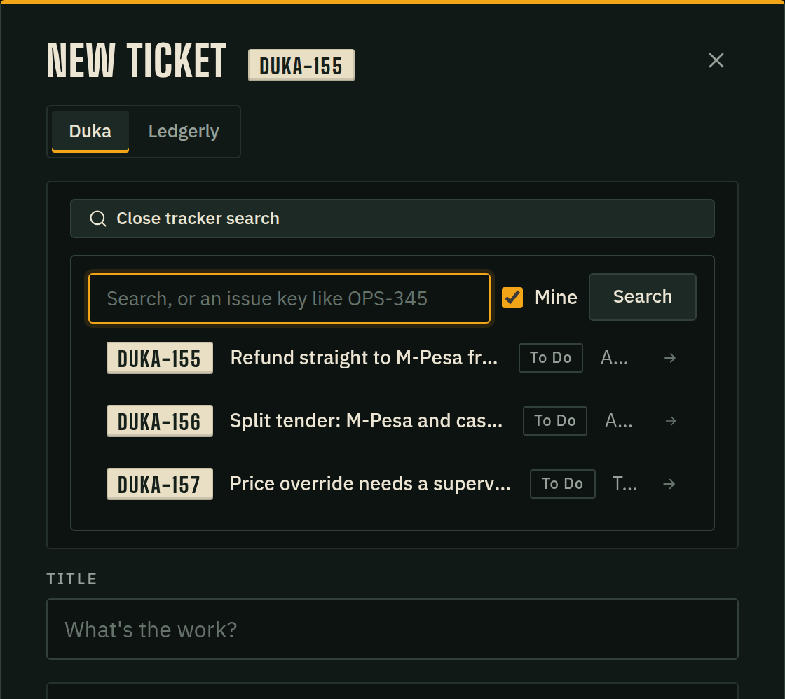
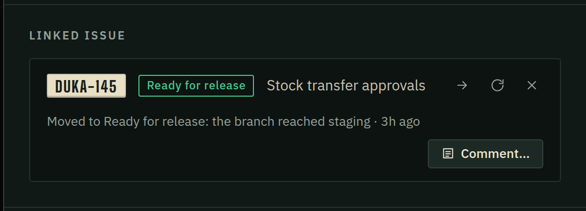

# Importing from a tracker

> Start a ticket from a Jira, Kanboard, Notion or Board API issue, link an existing ticket to an issue, or create an issue from a ticket or draft.

Section: Tickets & branches · Updated: 2026-11-23

When your team's work lives in a tracker, start each Signalbox ticket from its issue. The ticket then carries the issue's key, its description and a link that lets Signalbox move the issue along as the branch progresses.

## Before you start

1. Add a connection to your tracker under **Projects & settings → Trackers**. See [Kanboard](kanboard.md), [Jira](jira.md), [Notion](notion.md) or [Board API](board-api.md).
2. Link the project to a board: open the project in **Projects & settings**, and under its tracker section pick the **Connection** and the board, then **Save**. See [Stage → status mapping](stage-status-mapping.md).

Until the project is linked to a board, the import options below don't appear.

## Start a ticket from an issue

1. Click **Ticket** (or press Ctrl+Shift+N, ⇧⌘N on Mac) and pick the project.
2. Click **Import from tracker**.
3. Issues assigned to you are listed, with their status and assignees. To find another one, untick **Mine** to include everyone's issues, or type words from the title or an issue key such as `OPS-345`, and click **Search**.
4. Click the issue. Its title becomes the ticket's title, and the form says **Imported from** `KEY`.
5. Fill in the rest of the form as usual and click **Create…**. See [Create your first ticket](create-your-first-ticket.md).

What the ticket gets:

| From the issue | On the ticket |
|---|---|
| Key, such as `DUKA-155` | The ticket's key, when it looks like `ABC-123` and no ticket in Signalbox has it yet. A number-only key such as Kanboard's `#42` becomes your project's prefix and that number, such as `DUKA-42`. If the key is taken, or isn't either shape, the ticket gets the project's next number. |
| Title | The title. You can edit it before creating. |
| Description and link | The ticket's notes. |
| The issue itself | A link. It shows under **Linked issue** in the drawer. |

With the default branch pattern, an imported key also goes into the branch name, such as `feature/DUKA-155-refund-straight-to-m-pesa-from-the-till`.

Changed your mind? **Don't link** next to **Imported from** drops the issue but keeps the title.

> **Note:** Kanboard tasks and Notion pages without an ID prefix have number-only keys such as `#42`. The ticket key becomes your project's prefix and that number, such as `DUKA-42`, when it's free. The key in the form's heading shows what the ticket will get.

## Link an existing ticket to an issue

1. Open the ticket.
2. Under **Linked issue**, click **Link existing…**.
3. Search as above and click the issue.

The linked issue shows its key, status and title. From there:

- the arrow opens the issue in your browser;
- the refresh button re-reads its title and status from the tracker;
- **×** (click twice) unlinks it; the issue isn't changed;
- **Comment…** writes a comment, previews it, and posts it, when the tracker takes comments.

The line under the issue shows the last thing Signalbox did to it, such as a move to another status, or **No automatic moves yet.**

## Create an issue from a ticket

For work you started in Signalbox first: open the ticket, and under **Linked issue** click **Create issue**. Signalbox creates an issue on the project's board from the ticket's title and notes, and links it. The button appears when the tracker allows creating issues.

## Send a draft to the tracker

A draft in a project with a tracker has **Send to tracker**. Click it twice to create an issue from the draft's text and notes; the draft is removed. When you start the work, import that issue. See [Tickets](tickets.md).

## What happens next

Once linked, the issue follows the branch. When the branch is pushed, merged to a stage or reaches prod, Signalbox can move the issue to the status you mapped for that stage. It only moves issues forward. See [Stage → status mapping](stage-status-mapping.md).

You can also post a plain-language QA note to the issue, as a comment or in its description. See [QA note](qa-note.md).

## Related

- [Stage → status mapping](stage-status-mapping.md)
- [Jira](jira.md), [Kanboard](kanboard.md), [Notion](notion.md), [Board API](board-api.md)
- [Create your first ticket](create-your-first-ticket.md)
- [QA note](qa-note.md)
- [Tracker token rejected](tracker-token-rejected.md)

---

Also on the website: https://signalbox.accessa.co.ke/docs/import-from-a-tracker/
