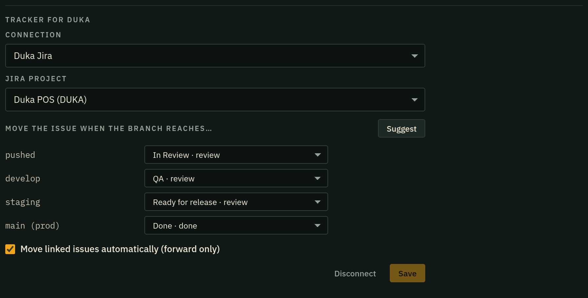

# Jira

> Connect Jira Cloud with your Atlassian email and an API token, link issues to tickets, post QA notes and move issues through your workflow.

Section: Trackers & code hosts · Updated: 2026-11-23

Connect Jira Cloud so each Signalbox ticket can link to a Jira issue. You can import issues, comment on them, post QA notes and move them through your workflow as the branch merges.

## Before you start

- Jira Cloud only: a site on `atlassian.net`, such as `acme.atlassian.net`. Jira Server and Data Center aren't supported.
- The email you sign in to Atlassian with.
- An Atlassian API token. Create one at **id.atlassian.com → Security → API tokens → Create API token**.

The token has no Jira scopes of its own: it acts as you, with your Jira project permissions. Signalbox never checks them; Jira does. The form lists what each feature needs:

| Jira permission | Used for |
|---|---|
| **Browse Projects** | Listing projects, searching and importing issues. |
| **Create Issues** | **Create issue** and **Send to tracker**. |
| **Edit Issues** | A QA note in the description. |
| **Transition Issues** | Moving issues as branches merge. |
| **Add Comments** | Comments and QA notes as comments. |

## Add the connection

1. Open **Projects & settings** and scroll to **Trackers**.
2. Under **Tracker connections**, click **Add**.
3. Choose **Jira Cloud**.
4. Fill in **Name**, **Base URL** (your site's full HTTPS address, as your browser shows it, for example for `acme.atlassian.net`), **Email** and **API token**.
5. Click **Test**. A working connection says **Signed in as** your name and email.
6. Click **Save**.

The token is kept in your system keychain, not in Signalbox's database. To change it later, click **Edit** on the connection and paste a new one. Leave the field empty to keep the saved token.

## Bind a project to a Jira project

1. In **Projects & settings → Projects**, click **Edit** on your project.
2. Under **Tracker for** your project, pick the connection.
3. Pick the project under **Jira project**. Jira projects are listed by name with their key, for example "Duka POS (DUKA)".
4. Map your stages to Jira statuses and click **Save**. See [Stage → status mapping](stage-status-mapping.md).

## What works with Jira

| Feature | Works | Notes |
|---|---|---|
| Import an issue when you create a ticket | Yes | The issue key becomes the ticket key when it's free. |
| Link an existing issue | Yes | **Linked issue → Link existing…** in the ticket drawer. |
| Create an issue from a ticket | Yes | Created as a Task, else a Story, else the first type that isn't a sub-task. |
| Send a draft to Jira | Yes | **Send to tracker** on a draft. |
| Comments | Yes | Written in Markdown, converted to Jira's format. |
| QA note in the description | Yes | **Add below** keeps tables, panels and mentions in the rest of the description. |
| Move issues as branches merge | Yes | Through your workflow's transitions, forward only. |

## Searching for issues

Type words to search issue text, or an issue key such as `DUKA-155` to get just that issue. With **Mine** ticked, only issues assigned to you are listed. Results are the 50 most recently updated.

## How moves work in Jira

Jira doesn't let an app set a status directly. Signalbox looks for a transition from the issue's current status to the mapped one and runs it. If your workflow has no such transition, the move fails with "Jira's workflow has no transition from … to the mapped one". The error shows on the ticket's linked issue and under **Recent automatic moves**. Add the transition in Jira, or map that stage to a status you can reach.

## Related

- [Stage → status mapping](stage-status-mapping.md)
- [Importing from a tracker](import-from-a-tracker.md)
- [QA note](qa-note.md)
- [Code hosts](code-hosts.md) (Bitbucket uses an Atlassian token too)
- [Tracker token rejected](tracker-token-rejected.md)

---

Also on the website: https://signalbox.accessa.co.ke/docs/jira/
