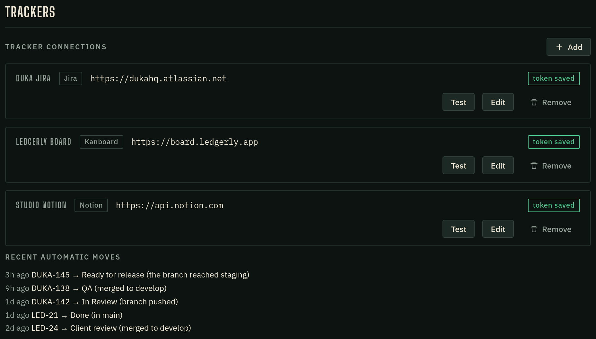

# Kanboard

> Connect a self-hosted Kanboard to Signalbox with your username and personal API token, then link tasks to tickets and move them as branches merge.

Section: Trackers & code hosts · Updated: 2026-11-23

Connect Kanboard so each Signalbox ticket can link to a Kanboard task. You can import tasks, comment on them, post QA notes and move them across columns as the branch moves down the line.

## Before you start

You need three things from Kanboard:

- The HTTPS address of your Kanboard site, for example for `kanban.example.com`, or `example.com/kanboard` if Kanboard is installed in a folder. You can paste a board or task link, or the address ending in `/jsonrpc.php`: Signalbox cuts it down to the site address and shows that in the field.
- Your Kanboard username (the login you sign in with).
- A personal API token. In Kanboard, open **My profile → API** and copy the token.

Signalbox uses Kanboard's User API, so you don't need an admin account. You only see projects you're a member of.

> **Note:** The address must use HTTPS. Plain HTTP is only allowed for `localhost` and `127.0.0.1`.

## Add the connection

1. Open **Projects & settings** and scroll to **Trackers**.
2. Under **Tracker connections**, click **Add**.
3. Choose **Kanboard**.
4. Fill in **Name** (anything you like, for example "Team board"), **Base URL**, **Username** and **Personal API token**.
5. Click **Test**. A working connection says **Signed in as** your name, followed by what Kanboard allows (comments, create, dev info).
6. Click **Save**.

The connection now shows in the list with a **token saved** flag. The token is kept in your system keychain (Keychain on macOS, Secret Service such as GNOME Keyring on Linux), not in Signalbox's database.

## Bind a project to a Kanboard project

A Signalbox project links to one Kanboard project.

1. In **Projects & settings → Projects**, click **Edit** on your project.
2. Find **Tracker for** your project.
3. Pick the connection under **Connection**.
4. Pick the project under **Kanboard project**. Only active projects you belong to are listed.
5. Map your stages to columns. See [Stage → status mapping](stage-status-mapping.md).
6. Click **Save**.

## What works with Kanboard

| Feature | Works | Notes |
|---|---|---|
| Import a task when you create a ticket | Yes | The task's description goes into the ticket notes. |
| Link an existing task to a ticket | Yes | **Linked issue → Link existing…** in the ticket drawer. |
| Create a task from a ticket | Yes | **Linked issue → Create issue** uses the ticket's title and notes. |
| Send a draft to Kanboard | Yes | **Send to tracker** on a draft. The draft is removed. |
| Comments | Yes | Markdown, as Kanboard stores it. |
| QA note in the description | Yes | **Add below** and **Replace** both work. |
| Move tasks as branches merge | Yes | Forward only. See below for QA columns. |

## Searching for tasks

The search box in **Import from tracker** and **Link existing…** takes words, a task number such as `#42`, or Kanboard's own filter syntax, for example `column:"QA FAILED"`. Column names you type are matched to the real column title, so case doesn't matter.

With **Mine** ticked, Signalbox adds `assignee:me` and `status:open`. With **Mine** off and an empty box, it lists open tasks. Results are newest first, up to 100.

> **Note:** Kanboard tasks only have numbers, not keys. A ticket you create from task `#42` gets your project's prefix and the task number, such as `DUKA-42`. If that key is already taken, it gets the project's next key instead.

## QA columns are left alone

A task in a column whose name says a reviewer sent it back (any column with the word "fail", "failed", "failure", "reject" or "rejected", such as **QA FAILED**) is never moved automatically. The branch usually sits at the same stage while it's fixed, so moving it on would bounce it straight back to QA. Move it yourself when you're ready.

A passed verdict such as **QA PASSED** isn't held. It still moves on to your done column when the branch reaches prod.

## Troubleshooting

- **the token was rejected:** check the username and token. The token belongs to the username you entered.
- **not allowed with this token:** Kanboard refused the action. You may not be allowed to edit tasks in that project.
- **This doesn't look like Kanboard's address:** Kanboard's API wasn't found at that address (HTTP 404). Use just the site address, such as the one for `kanban.example.com`, without any folder that isn't part of your Kanboard install.
- Links in tasks point to `localhost`: Signalbox builds task links from your base URL, so they open the right address even when Kanboard's own URL setting is wrong.

## Related

- [Stage → status mapping](stage-status-mapping.md)
- [Importing from a tracker](import-from-a-tracker.md)
- [QA note](qa-note.md)
- [Tracker token rejected](tracker-token-rejected.md)

---

Also on the website: https://signalbox.accessa.co.ke/docs/kanboard/
