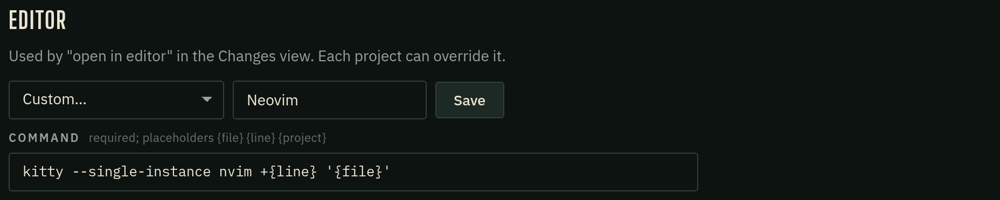

# Open in editor

> Choose the editor Signalbox opens files in: VS Code, Cursor, Zed, Android Studio, any JetBrains IDE, Xcode on a Mac, or your own command.

Section: Work on code · Updated: 2026-11-23

From the Changes and Files views, one click opens the file in your own editor at the line your cursor is on. Pick the editor once, and give a project its own if it needs a different one.

## Choose your editor

1. Open **Projects & settings**.
2. Scroll to **Editor**.
3. Pick an editor from the list.
4. Optionally, fill in **Command** to override how it's started, for example with a full path.
5. Click **Save**.



The default is VS Code.

### The presets

| Editor | Command it runs |
|---|---|
| VS Code | `code -g {file}:{line}` |
| Cursor | `cursor -g {file}:{line}` |
| Zed | `zed {file}:{line}` |
| PhpStorm | `phpstorm {project} --line {line} {file}` |
| Android Studio | `studio {project} --line {line} {file}` |
| IntelliJ IDEA | `idea {project} --line {line} {file}` |
| WebStorm | `webstorm {project} --line {line} {file}` |
| PyCharm | `pycharm {project} --line {line} {file}` |
| GoLand | `goland {project} --line {line} {file}` |
| RustRover | `rustrover {project} --line {line} {file}` |
| CLion | `clion {project} --line {line} {file}` |
| Rider | `rider {project} --line {line} {file}` |
| RubyMine | `rubymine {project} --line {line} {file}` |
| DataGrip | `datagrip {project} --line {line} {file}` |
| Xcode (macOS only) | `xed --line {line} {file}` |

JetBrains IDEs and Android Studio hand the file to the IDE if it's already open. Xcode is only offered on a Mac; `xed` comes with Xcode.

## Open a file

1. Open the [Changes](changes.md) or [Files](files.md) view.
2. Select a file and put the cursor on a line.
3. Click the button with your editor's name, such as **VS Code**, above the file.

## Give a project its own editor

1. Open **Projects & settings**, click the project, then **Edit**.
2. Under **Editor**, pick an editor. **Same as global (…)** removes the override.
3. Click **Save**.

## Use a custom command

1. In the editor list, pick **Custom…**.
2. Optionally give it a **Name**. It shows on the button. Without one, the program's name is used.
3. Type the **Command**, using the placeholders below.
4. Click **Save**.

| Placeholder | Becomes |
|---|---|
| `{file}` | The full path of the file. |
| `{line}` | The cursor's line (1 or more). |
| `{project}` | The checkout or worktree folder the file is in. |

For example:

```
myeditor --line {line} {file}
'/opt/My Editor/bin/ed' +{line} {file}
```

How the command is read:

- Spaces separate arguments.
- Put an argument with spaces in `'…'` or `"…"`. A `\` escapes the next character.
- It isn't run through a shell, so pipes, `~` and `$VARIABLES` don't work. Use full paths.
- Placeholders are filled in after the split, so a file path with spaces stays one argument. You don't need to quote `{file}`.

## Where Signalbox looks for the editor

When the command starts with a bare program name, such as `code` or `studio`, Signalbox looks in:

1. Your `PATH`.
2. `~/.local/bin`.

Then, on Linux, for JetBrains IDEs and Android Studio:

- the JetBrains Toolbox scripts folder, `~/.local/share/JetBrains/Toolbox/scripts`,
- `/snap/bin`,
- `/opt/<ide>/bin/<ide>.sh`,
- for Android Studio: `/snap/bin/android-studio`, and `bin/studio` or `bin/studio.sh` under `/opt/android-studio`, `/usr/local/android-studio` and `~/android-studio`.

On macOS, it also looks in the app itself, in `/Applications` and `~/Applications`:

- the JetBrains Toolbox scripts folder, `~/Library/Application Support/JetBrains/Toolbox/scripts` (JetBrains IDEs),
- the command-line tool inside the app, such as VS Code's or Cursor's `bin/code`, Zed's `cli`, or the IDE's own binary.

So VS Code, Cursor, Zed and the JetBrains IDEs work on a Mac even if you never installed their shell command. If only the app is found and not its launcher, Signalbox opens the file with `open -a`, which can't jump to the line.

> **Tip:** If nothing opens, put the full path to the program in **Command**. The error message, "couldn't start …", names the editor it tried.

## Related

- [Changes](changes.md)
- [Files](files.md)
- [Add a project and its repos](add-a-project.md)

---

Also on the website: https://signalbox.accessa.co.ke/docs/open-in-editor/
