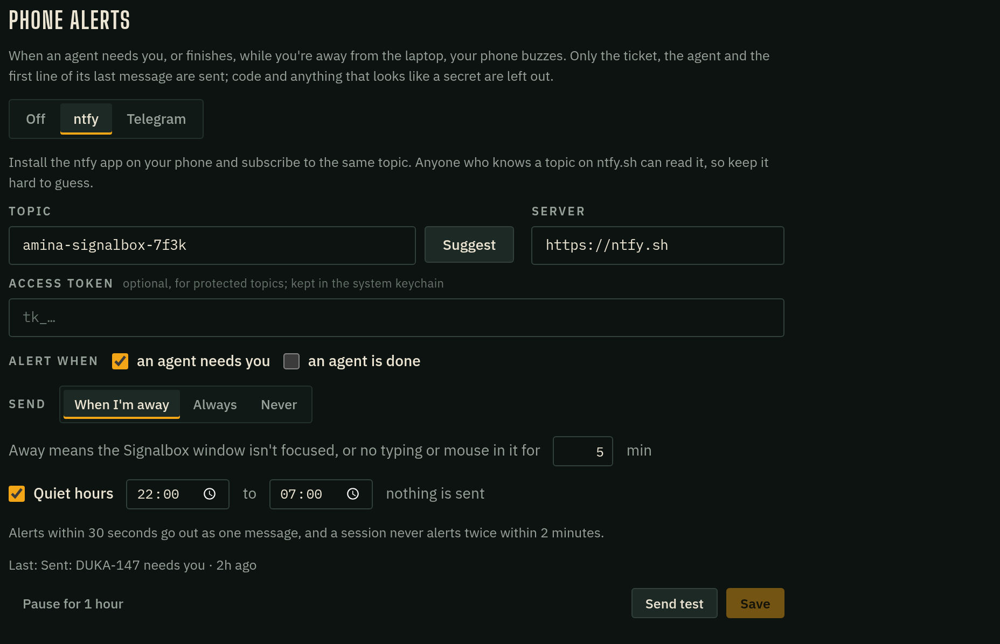

# Phone alerts

> Get a message on your phone through ntfy or a Telegram bot when an agent needs you or finishes while you're away from the laptop.

Section: More · Updated: 2026-11-23

When an agent stops to ask you something, or finishes, while you're away from the laptop, Signalbox can buzz your phone. It works through ntfy or a Telegram bot you create.

## What gets sent

Only the ticket key and title, the agent, and the first line of its last message. Code and anything that looks like a secret are left out. Alerts that arrive within 30 seconds of each other go out as one message, and one session never alerts twice within 2 minutes.

Alerts come from the agents' live state (**needs you** and **done**). An agent that doesn't report that state can't trigger an alert. **Projects & settings → Agents** shows what each agent reports. See [States & notifications](states-and-notifications.md).

## Set up ntfy

ntfy is a free push service with a phone app. You can use the public server at ntfy.sh or your own.

1. Install the ntfy app on your phone.
2. In Signalbox, open **Projects & settings → Phone alerts** and choose **ntfy**.
3. Enter a **Topic**, or click **Suggest** for a random one.
4. Leave **Server** set to the public ntfy.sh server, or enter your own server's address.
5. If your topic is protected, enter its **Access token**.
6. Click **Save**, then **Send test**.
7. In the ntfy app, subscribe to the same topic. The test should arrive.

> **Warning:** Anyone who knows a topic on ntfy.sh can read it. Keep the topic hard to guess, or use a protected topic with an access token.

## Set up Telegram

1. In Telegram, talk to **@BotFather** and create a bot. Copy its token.
2. Open your new bot in Telegram and send it any message.
3. In Signalbox, open **Projects & settings → Phone alerts** and choose **Telegram**.
4. Paste the **Bot token**.
5. Click **Find my chat id**. If several chats have messaged the bot, pick yours.
6. Click **Save**, then **Send test**.

You can also type the **Chat id** yourself: a number (negative for a group) or `@channelname`.

## Choose when to alert

| Setting | What it does |
|---|---|
| **Alert when** | **an agent needs you** (on by default), **an agent is done** (off by default) |
| **Send** | **When I'm away** (default), **Always**, or **Never** |
| Away after | With **When I'm away**: you're away when the Signalbox window isn't focused, or there's been no typing or mouse in it for this many minutes (1 to 240, default 3) |
| **Quiet hours** | Nothing is sent between these two times, for example 22:00 to 07:00. A range past midnight is fine |

Click **Save** after any change.

## Pause alerts

For a meeting or a call:

- Click **Pause for 1 hour** in **Projects & settings → Phone alerts**. Click **Resume** to end the pause early.
- Or open the palette (Ctrl+K, ⌘K on Mac) and choose **Pause phone alerts for 1 hour**.

While paused, the settings show how long is left.

## Tokens

The ntfy access token and the Telegram bot token are kept in your system keychain, not in Signalbox's database. To change one, type a new one and click **Save**. Leave the field empty to keep the saved one. Click **Forget** to remove it from the keychain.

## Turn alerts off

Choose **Off** and click **Save**.

## Check it worked

Under the form, **Last:** shows the last alert Signalbox tried to send, when, and whether it went through. If sending failed, the reason shows there in red.

## Related

- [States & notifications](states-and-notifications.md)
- [Supported agents](agents.md)
- [Privacy & data](privacy-and-data.md)

---

Also on the website: https://signalbox.accessa.co.ke/docs/phone-alerts/
