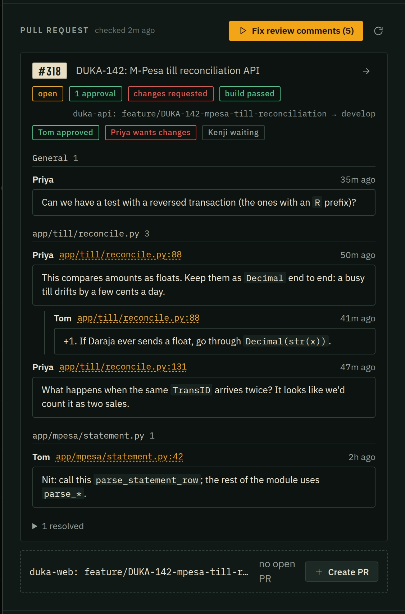

# Pull requests on the ticket

> See each branch's pull request in the ticket drawer, with approvals, build state and review comments by file, and hand the comments to the agent.

Section: Trackers & code hosts · Updated: 2026-11-23

The ticket drawer shows the pull requests from the ticket's branches: state, approvals, build and review comments grouped by file. **Fix review comments** hands the open comments to the ticket's agent.

You need a [code host connection](code-hosts.md) for the repo first.

## Where to find it

1. Open a ticket that has a linked branch.
2. Scroll to the **Pull request** section, below **Linked issue**.

The section heading says when the PRs were last checked, for example "checked 2m ago". Click the refresh icon (**Look again**) to check now.

Signalbox shows open pull requests from the ticket's branches, and ones merged in the last 14 days. If there's none, it says "No open or recently merged pull request from" and the branch names.

## What each PR card shows

- The PR number and title. The arrow opens it on Bitbucket or GitHub.
- Chips: **open** or **draft**, **merged** or **declined**; the number of approvals; **changes requested**; and the build, such as **build passed** or **build failed**. Hover the build chip to see each check.
- The route, for example `duka-api: feature/DUKA-142-till-reconciliation → develop`.
- Each reviewer and their state: **approved**, **wants changes**, **commented** or **waiting**.
- Review comments, grouped by file, newest first. Comments on no file are under **General**. Resolved comments are folded under "N resolved".

A comment marked **outdated** was on code that has changed since. Click a comment's file and line to open it in your editor, in a checkout of that branch if there is one. See [Open in editor](open-in-editor.md).

## Fix review comments

1. Click **Fix review comments (N)**. N counts open comments on current code in open PRs.
2. Click again on **Send N to the agent?** to confirm.

What happens next:

- If a session on the ticket is running, the comments are typed into it. If it's in the middle of a turn, they're queued and go in when the turn ends. A session on the PR's branch is preferred.
- If no session is running, Signalbox starts one in a checkout that has the PR's branch, with the comments as its first prompt.
- If the branch isn't checked out anywhere, you're asked to check it out or start a session on it first.

The agent changes the code on the branch. It leaves comments it disagrees with and says why. Nothing is posted to the PR and nothing is pushed: you review, commit and push yourself.

## Refreshes and new comments

Tickets with an open PR are checked again in the background every 5 minutes. When new review comments arrive, a message says so, for example "DUKA-142: 3 new review comments".

If a refresh fails, the drawer keeps the PRs it found last time and adds a line such as "couldn't refresh (Bitbucket slow) · retry". Click **retry** to try again. Hover the line to see the full error and when the PRs were found. Other problems, such as a rejected token, show as an amber line in the section.

## Create a PR from here

A branch with no open PR gets a row with **no open PR** and a **Create PR** button. See [Create a PR](create-a-pr.md).

## Related

- [Code hosts](code-hosts.md)
- [Create a PR](create-a-pr.md)
- ["Bitbucket didn't answer in time"](bitbucket-didnt-answer.md)
- [Sessions](sessions.md)

---

Also on the website: https://signalbox.accessa.co.ke/docs/pull-requests/
