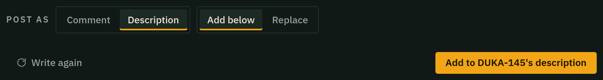

# QA note

> Have the agent write a plain-language QA note for testers, then post it on the linked issue as a comment or into its description.

Section: Writing · Updated: 2026-11-23

A QA note tells testers and non-technical people what changed and how to test it, in plain words. Signalbox posts it on the ticket's linked tracker issue, as a comment or in the issue's description.

The ticket needs a linked issue first. See [Importing from a tracker](import-from-a-tracker.md).

## Write and post a QA note

1. Open the ticket.
2. Click **Write…** and pick **QA note for the board**.
3. Wait while it writes. Click **Cancel** to stop.
4. Read it and edit it. **Preview** shows how it will look.
5. Under **Post as**, pick **Comment** or **Description**.
6. For **Description**, pick **Add below** or **Replace**.
7. Click the button at the bottom right. It says what will happen, for example **Post to DUKA-145**, **Add to DUKA-145's description** or **Replace DUKA-145's description**.

A message confirms what happened, with **Open** to view the issue in the browser. Signalbox remembers your choice for each tracker connection.

If the ticket is linked to issues in more than one tracker, pick the issue in the list next to the button.

## What the note says

The agent is told to write for testers, not developers: no code, file or branch names, and the app's own screen and button names. It uses these parts:

- **What changed:** one to three sentences, as a user sees it.
- **How to test:** numbered steps: where to go, what to do, what should happen.
- **Also check:** edge cases, permissions and other screens the change could affect.
- **Before testing:** settings, data or roles needed. Left out when there's nothing.

Read it before you post. The agent only knows what's in the diff, commits and sessions.

## Comment or description

| Choice | What happens |
|---|---|
| **Comment** | A new comment on the issue. |
| **Description**, **Add below** | The note goes at the end of the description, under a line and the heading "QA note (date)", ending with "— QA note from Signalbox". If an earlier Signalbox QA note is there, it's replaced, not repeated. |
| **Description**, **Replace** | The note becomes the whole description. |

> **Warning:** **Replace** removes the current description from the tracker. Signalbox first copies it into the ticket's notes, headed "Previous description of DUKA-145, replaced 2026-11-23:", so nothing is lost.

## Which trackers support what

| Tracker | Comment | Add below | Replace |
|---|---|---|---|
| [Kanboard](kanboard.md) | Yes | Yes | Yes |
| [Jira](jira.md) | Yes | Yes, keeping tables, panels and mentions | Yes |
| [Notion](notion.md) | Yes | Yes, at the end of the page body | Yes, for pages up to 300 blocks |
| [Board API](board-api.md) | With the `comments` capability | Yes | Yes |

On Notion, sub-pages and databases on the page are always kept, even with **Replace**.

A choice the tracker doesn't support is greyed out; hover it to see why. If a tracker takes neither comments nor description edits, the editor offers **Copy** instead.

## Related

- [Write… overview](write.md)
- [Importing from a tracker](import-from-a-tracker.md)
- [Release notes](release-notes.md)
- [Kanboard](kanboard.md) · [Jira](jira.md) · [Notion](notion.md)

---

Also on the website: https://signalbox.accessa.co.ke/docs/qa-note/
