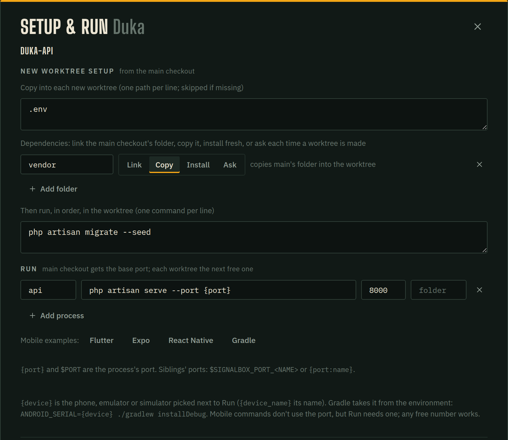
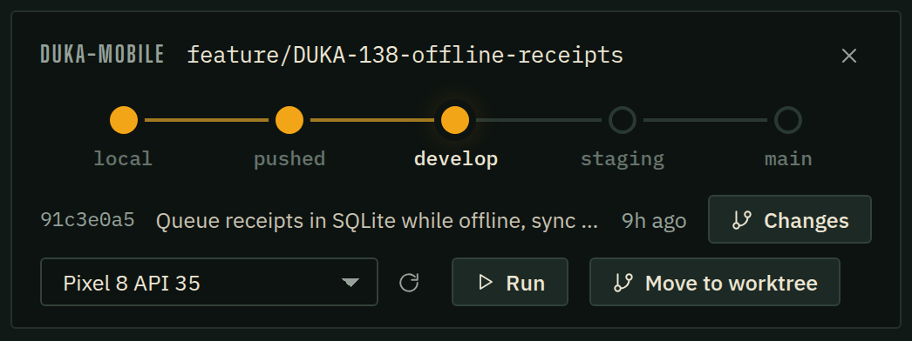

# Run and worktree setup

> Make new worktrees ready to use (.env, dependencies, setup commands), and run each checkout's dev servers on its own ports, or on a phone or emulator.

Section: Work on code · Updated: 2026-11-24

A fresh worktree has your code but not your `.env` or installed dependencies, and two checkouts can't both run a dev server on the same port. Setup & run fixes both: a recipe that prepares each new worktree, and a **Run** button that starts the dev servers on free ports.

Both are set per project, separately for each repo.

## Open the settings

Either:

- In the rail, click a checkout under **Checkouts**, then **Setup & run…**, or
- Open **Projects & settings → Projects →** the project **→ Edit**, and scroll to **Worktree setup & run**.



When a repo has nothing saved yet, Signalbox reads its main checkout and pre-fills what it recognises, such as Laravel, PHP, Vite or Next.js. For a PHP project it sets `vendor` to **Copy**, and for a Node project it sets `node_modules` to **Link**. Those repos show **pre-filled, not saved yet**. **Use detected** replaces a repo's settings with what was detected. Nothing is used until you click **Save**.

## New worktree setup

This recipe runs every time Signalbox creates a worktree: from the **New ticket** form, **New from …** in the drawer, **Start crew**, and **Move to worktree**. It takes files from the repo's main checkout.

Fill in, for each repo:

1. **Copy into each new worktree:** one path per line, such as `.env`. Missing files are skipped.
2. **Dependencies:** click **Add folder** for each one, type the folder (such as `node_modules`) and choose how it gets into the worktree:
   - **Link** makes a symlink to the main checkout's folder. It's instant, and the two share it.
   - **Copy** copies the main checkout's folder into the worktree. It's quick and needs no network, and the worktree gets its own copy. On disks that support it (APFS on macOS, Btrfs or XFS on Linux) the copy takes almost no extra space until files change.
   - **Install** runs a command instead, such as `npm ci` or `composer install`.
   - **Ask** asks you each time a worktree is made. See [Choose when the worktree is made](#choose-when-the-worktree-is-made).

   Link, Copy and Install are skipped if the folder is already in the worktree.
3. **Then run, in order, in the worktree:** one command per line, such as `php artisan key:generate`.
4. Click **Save**.

> **Warning:** Don't link `vendor` in a PHP project. PHP resolves symlinks, so the autoloader would load the main checkout's classes, not the worktree's. Signalbox flags this with **linked vendor autoloads main's code**. Use **Copy** instead: a copied `vendor` loads the worktree's code, and it's much faster than `composer install`. Choose **Install** when the worktree's branch changes `composer.json` or `composer.lock`.

### Choose when the worktree is made

With a folder set to **Ask**, Signalbox asks before the setup runs. A small window lists each folder with **Link**, **Copy** and **Install**:

1. Pick one for each folder. The one picked first is your last choice for that folder, or else what Signalbox would pick for it.
2. To stop being asked, tick **Remember for this repo**. The folder is then set to your choice in the repo's settings. You can set it back to **Ask** in Setup & run.
3. Click **Run setup**. Or click **Skip setup** to make the worktree without it; you can run it later.

If Signalbox has no window open to ask in, each folder gets the choice that would have been picked first, and the Setup tab says so.

### What happens when a worktree is made

1. If a folder is set to **Ask**, Signalbox asks first.
2. It copies and links the files.
3. It opens a **Setup** tab and runs the commands there, so you can watch. A message says "Setting up …: see its Setup tab".
4. Each step shows ✓ or ✗. It ends with "✓ worktree ready", or stops at the first failing command.

Nothing is undone when a step fails. Fix the problem in the Setup tab's folder, then run the setup again.

### Run setup again

In the rail, click the worktree under **Checkouts**, then **Run worktree setup**. It isn't offered for the main checkout. Folders set to **Ask** are asked about here too.

## Run dev servers

### Set up the processes

Under **Run**, click **Add process** for each dev server and fill in:

| Field | Example | Notes |
|---|---|---|
| Name | `web` | Must be unique in the repo. |
| Command | `npm run dev -- --port {port}` | Runs through your shell. |
| Base port | `5173` | The main checkout's port. |
| Subfolder | `app` | Optional. Where to run, inside the checkout. |

Then click **Save**.

The command can use:

- `{port}` or `$PORT`: this process's port.
- `{port:name}` or `$SIGNALBOX_PORT_<NAME>`: another process's port in the same checkout, such as the API's port for the web app.
- `{device}` and `{device_name}`: the device picked next to Run. See below.

### Ports

The main checkout gets each process's base port. A worktree gets the next free port above it. Each checkout keeps its port from one run to the next while it's free, and no two checkouts are given the same one.

### Start and stop

- In the ticket drawer, under **The line**, click **Run** next to a checked-out branch.
- Or in the rail, click the checkout and choose **Run dev servers**.

A **Run** tab opens with one terminal per process, side by side (stacked when there are three or more). Port chips such as `web → :5174` appear in the drawer and under the checkout in the rail. Click a chip to open `http://localhost:<port>` in your browser.

To stop, click **Stop** in the drawer or the Run tab, choose **Stop …** in the checkout menu, or close the Run tab. **Run again** in the Run tab starts them again. Quitting Signalbox stops every run.

If a repo has no run command yet, Run says "No run command set for … yet. Add one in Setup & run…" and opens the settings.

## Run on a phone or emulator

For mobile apps, put `{device}` in the run command. Signalbox then shows a device picker next to **Run**.



1. In the repo's **Run** settings, under **Mobile examples:**, click **Flutter**, **Expo**, **React Native** or **Gradle** to fill in a command. If Signalbox recognised a mobile app in the repo and no command is set yet, it also offers a command made for it.
2. Save.
3. Next to **Run**, open the device list and pick a device. It lists **Ready**, **Offline** and **Not running** devices.
4. For an emulator or simulator that's off, click **Start** and wait until it says it's up.
5. Click **Run**.

Signalbox finds devices with `adb`, `emulator`, `flutter devices` (in a Flutter project) and, on macOS, `xcrun simctl` and `xcrun devicectl`. Tools that aren't installed are skipped. Click the refresh button next to the list to look again.

| Placeholder | Becomes |
|---|---|
| `{device}` | The device's id: an adb serial, a simulator or iPhone UDID, or a Flutter device id. |
| `{device_name}` | Its name, quoted for the shell. |

Example commands:

```
flutter run -d {device}
npx expo run:android --device {device} --port {port}
npx react-native run-ios --udid {device} --port {port}
ANDROID_SERIAL={device} ./gradlew installDebug
```

Mobile commands don't use the port, but Run needs one. Any free number works.

The device you pick is remembered for each checkout on this computer. If one device is ready and none is picked, Signalbox picks it.

> **Note:** If you click Run without a device, Signalbox says "This run command needs a device ({device}). Pick one next to Run first." An emulator that's off has to be started first.

If an emulator doesn't come up within two and a half minutes, Signalbox says so. The emulator's log is in Signalbox's data folder, under `logs`. See [Logs and data locations](logs-and-data.md).

## Related

- [Branches and worktrees](branches-and-worktrees.md)
- [Add a project and its repos](add-a-project.md)
- [Changes](changes.md)
- [Logs and data locations](logs-and-data.md)

---

Also on the website: https://signalbox.accessa.co.ke/docs/run-and-worktree-setup/
