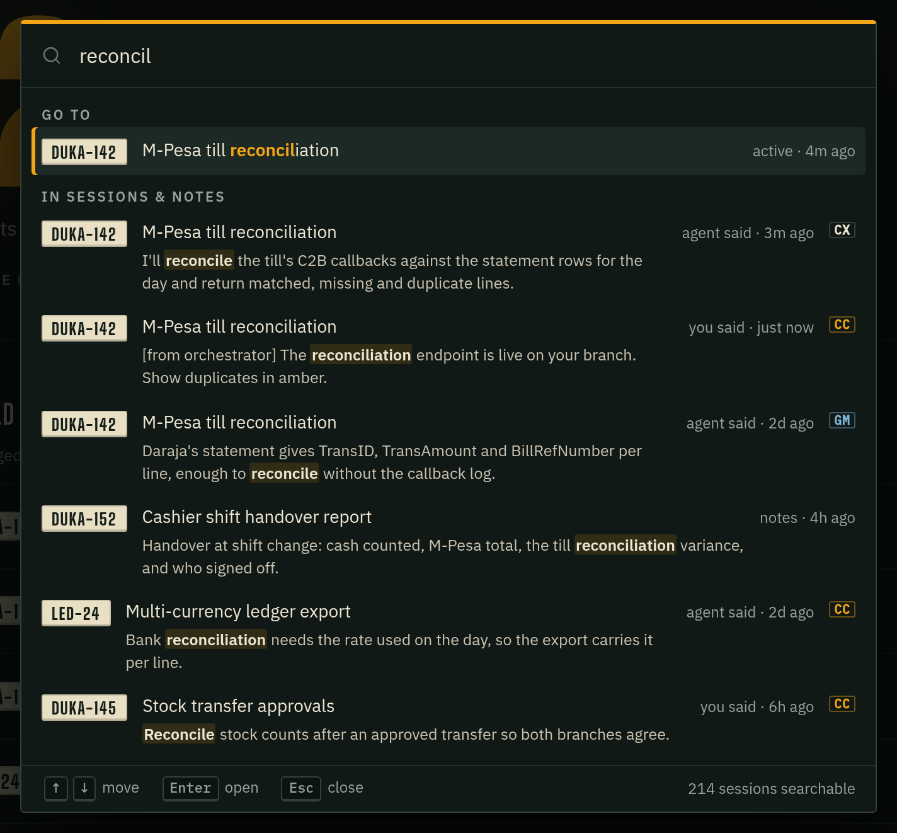

# Search & palette

> Press Ctrl+K (⌘K on Mac) to jump to any ticket, project, view or action, or to find words said in any agent session.

Section: More · Updated: 2026-11-23

The palette is one box for getting anywhere in Signalbox. Type part of a ticket key or title, a view, a setting or an action, or a phrase you remember an agent saying.

## Open the palette

- Press **Ctrl+K** (**⌘K** on Mac), from anywhere in the app.
- Inside a terminal on Linux, press **Ctrl+Shift+K**. Plain Ctrl+K belongs to the shell or the agent there (it deletes to the end of the line).
- Or click **Search** in the tab bar.

Press the same shortcut again, or **Esc**, to close it.

## What an empty palette shows

- **Recent:** your six most recent tickets. Open tickets come first, and tickets in the project picked in the rail come before others.
- **Actions** for the ticket in front of you (the open drawer, or the active tab's ticket), then the common actions.

## What you can type

Type a few letters. Matching is fuzzy: `stx` finds "Stock transfer approvals", and words can come in any order. Results are grouped:

| Group | What's in it |
|---|---|
| **Go to** | Tickets by key or title; `Project: <name>`; the views (**Loose ends**, **Tickets**, **Sidings**, **Drafts**, **Settings**, **Time & cost**); and settings sections (`Settings: Projects`, `Editor`, `Agents`, `Trackers`, `Time & cost`, `Phone alerts`) |
| **Actions** | Things to do (below) |
| **In sessions & notes** | Words found in what you or an agent said in a session, or in a ticket's notes |

### Actions

Always there:

- **New ticket**
- **New crew…**, or **New crew on <KEY>** when the ticket in front of you can have a crew
- **Settings**
- **Switch project…**
- **Pause phone alerts for 1 hour**
- **Check for updates**
- **Write daily log**
- **Write release notes…**, when a project has more than one stage. Type more to pick a step, such as `Write release notes: develop → staging`.

For the ticket in front of you:

- **Open <KEY>**
- **Write… Summary for <KEY>**, **Write… PR description for <KEY>**, and **Write… QA note for the board for <KEY>** when the ticket is linked to a tracker issue
- For each place the ticket's branch is checked out: **Run <checkout>** (or **Stop <checkout>** while it runs), **Changes in <checkout>**, and **Open in editor: <checkout>**, which opens the first changed file

**Switch project…** and **New crew…** open a short list. Press **Backspace** in the empty box, or click the chip at the left, to go back.

## Search what was said in sessions

Type at least two characters and the palette also searches the session text Signalbox has indexed. Each hit shows the ticket, a snippet with the matched words marked, and who said it: **you said**, **agent said**, or **notes**.

- Pick a session hit to open that session. If it isn't running, Signalbox resumes it (a crew resumes as a crew).
- Pick a notes hit to open the ticket.
- All the words you type must appear. The last word matches as a prefix, so `reconcil` finds "reconciliation".
- Recent sessions rank a little higher.

### What's indexed

- Each ticket's key, title and notes.
- For sessions attached to a ticket: your prompts and the agent's final replies. Tool output isn't indexed.

Sessions in Sidings aren't searched until you attach them to a ticket. Signalbox indexes in the background at startup and every 3 minutes, and only re-reads transcripts that changed. The palette's footer says how many sessions are searchable, or **Indexing sessions…** while it works.

> **Note:** If the footer says **Session search is off: this SQLite has no FTS5**, session search isn't available on this build. Everything else in the palette still works.

## Keys inside the palette

| Key | Does |
|---|---|
| **↑** / **↓**, **Ctrl+P** / **Ctrl+N**, **Shift+Tab** / **Tab** | Move the selection (it wraps) |
| **Page Up** / **Page Down** | Move 8 rows |
| **Ctrl+Home** / **Ctrl+End** (**⌘Home** / **⌘End** on Mac) | First / last row |
| **Enter** | Open the selected row |
| **Backspace** in an empty box | Leave **Switch project…** or **New crew…** |
| **Esc** | Close |

## Related

- [Keyboard shortcuts](keyboard-shortcuts.md)
- [Sessions](sessions.md)
- [Crews](crews.md)
- [Write… overview](write.md)

---

Also on the website: https://signalbox.accessa.co.ke/docs/search-and-palette/
