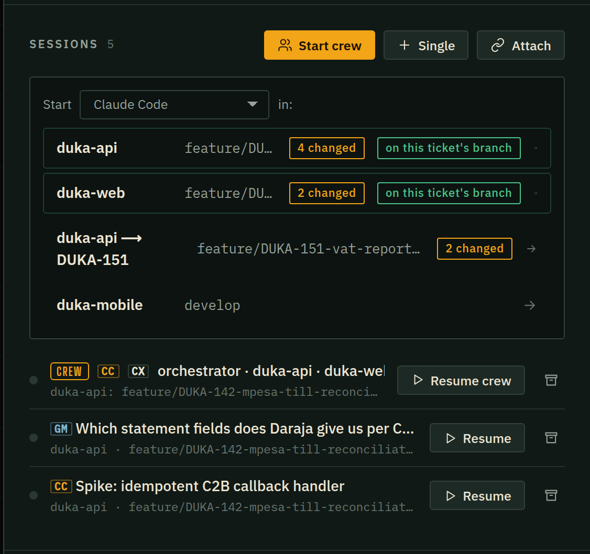
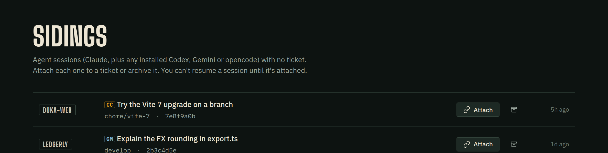
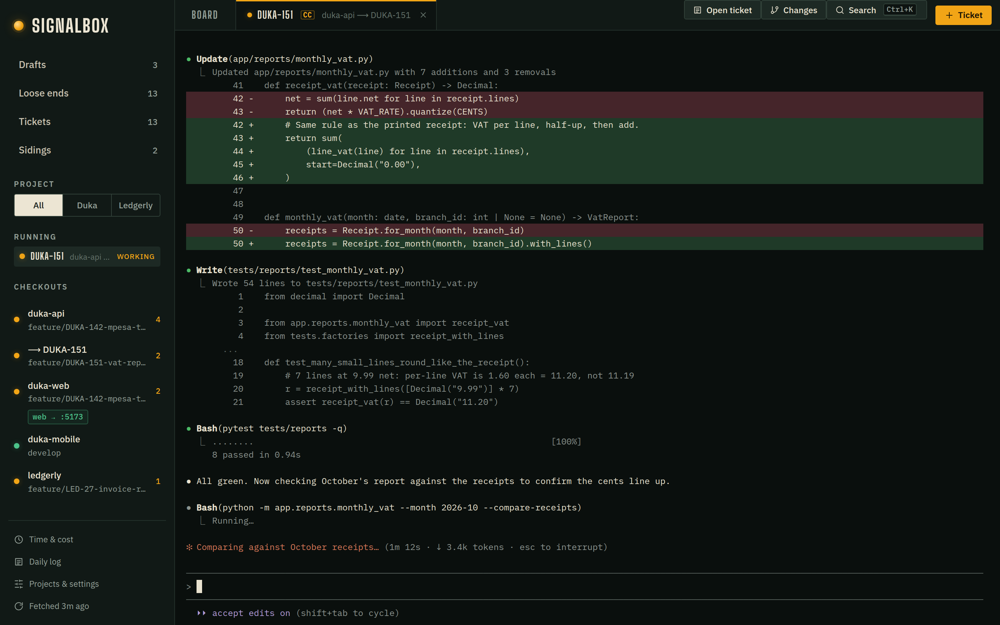

# Sessions

> Start, resume, attach and archive agent sessions on a ticket, and find your way around the tabs they open in.

Section: Agents & sessions · Updated: 2026-11-23

A session is one conversation with a coding agent, running in a terminal tab inside one checkout or worktree. Every session belongs to a ticket, so you can always find it again.

## Start a session

From the ticket:

1. Open the ticket (click it on the board).
2. In **Sessions**, click **New session**. If the project has a crew root, the button is called **Single**, next to **Start crew**.
3. Pick the agent after **Start**. It defaults to the ticket's agent.
4. Click the checkout or worktree to run in. Places on the ticket's branch are marked **on this ticket's branch** and listed first. Places with uncommitted work show **N changed**.

The session opens in its own tab and the drawer closes.

From the rail:

1. Click a checkout under **Checkouts**.
2. Optionally pick an **Agent** next to **Start a session on…**.
3. Click a ticket. Tickets on that checkout's branch are marked **this branch** and listed first.

You can also start the agent straight from the **New ticket** form. See [Create your first ticket](create-your-first-ticket.md).

## Resume a session

1. Open the ticket.
2. In **Sessions**, click **Resume** on the session.

A session that is already running shows **Open** instead, and takes you to its tab. A session always resumes with the agent it started with.

> **Note:** You can only resume a session that is attached to a ticket. Sessions found in **Sidings** have to be attached first.

## Attach a session you started elsewhere

If you started an agent in a normal terminal, attach it to a ticket by its id.

1. Open the ticket.
2. In **Sessions**, click **Attach**.
3. Paste the session id. At least the first 8 characters are needed. You can also paste a whole `claude --resume …` or `codex resume …` line; Signalbox takes the last word.
4. Click **Attach**.

Signalbox searches Claude Code's sessions and every installed agent's. It works for sessions on another ticket or archived ones too; they move to this ticket.

| Message | What to do |
|---|---|
| `no session … on this machine` | Check the id. The session must have run on this computer. |
| `N sessions start with …; paste more of the id` | Paste a longer part of the id. |
| `found … session …, but not the folder it ran in` | The agent didn't record its folder. Start a new session instead. |

## Sessions with no ticket: Sidings

**Sidings** in the rail lists agent sessions that ran in your checkouts but aren't on any ticket. This includes sessions you started outside Signalbox.

For each one:

- If a ticket already owns the session's branch, a button with that ticket's key attaches it in one click.
- **Attach** opens a list: pick a ticket, or **+ New ticket from this session**.
- The archive button hides it from the list.

Sessions older than 14 days are folded under **Show N older sessions**. **Archive N older than 14d** archives them all at once.

## Archive a session

In the ticket's **Sessions** list, click the archive button on a session. It is removed from the ticket and doesn't come back in Sidings. For a crew, the archive button archives every member's session.

Archiving doesn't delete anything from the agent's own history. You can attach it again by its id.

## Tabs

Every session, crew, Changes view, run and shell opens in a tab next to **Board**.

- The lamp on a tab shows the session's state. See [States and notifications](states-and-notifications.md).
- The tab shows the ticket key, the agent badge and the checkout.
- Hover a tab to see the ticket key and title, the checkout, and the agent's last message. For a crew, it lists each member and its state.
- Close a tab with its **×**. Closing a session's tab stops that session. You can resume it later from the ticket.

Two buttons on the right of the tab bar act on the tab you're looking at:

- **Open ticket** opens the ticket drawer for the session's ticket.
- **Changes** opens the [Changes view](changes.md) for the folder the session runs in. Crews have a Changes button (the branch icon) on each worker pane instead.

Press Ctrl+Shift+B (⇧⌘B on Mac) to go back to the board.

### When a session ends

If the agent exits, the tab stays and shows **Session ended.** with:

- **Resume** to start it again.
- **Open** and the ticket key, to open the ticket.
- **Close tab**.

### A plain shell

The checkout menu in the rail has **Plain shell**. It opens your login shell in that folder, in a tab called `shell`. It isn't tied to a ticket.

## Closing and quitting

Closing the Signalbox window doesn't stop your sessions. The window hides and Signalbox keeps running in the tray (the menu bar on macOS). The first time, a notification tells you so. Click the tray lamp to bring the window back.

To quit, use **Quit** in the tray menu. If any session is still working or waiting on you, Signalbox asks first:

- **Keep running** cancels.
- **Quit anyway** stops every session mid-task. The conversations are saved, and you can resume them later.

Quitting also stops any dev servers started with **Run**.

## Related

- [Supported agents](agents.md)
- [Crews](crews.md)
- [States and notifications](states-and-notifications.md)
- [Start your first session](start-your-first-session.md)
- [Tickets](tickets.md)

---

Also on the website: https://signalbox.accessa.co.ke/docs/sessions/
