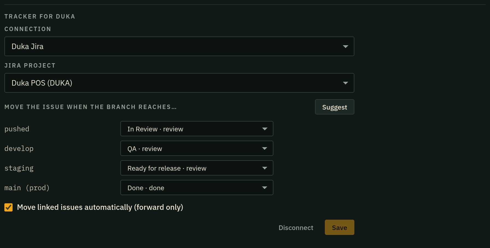
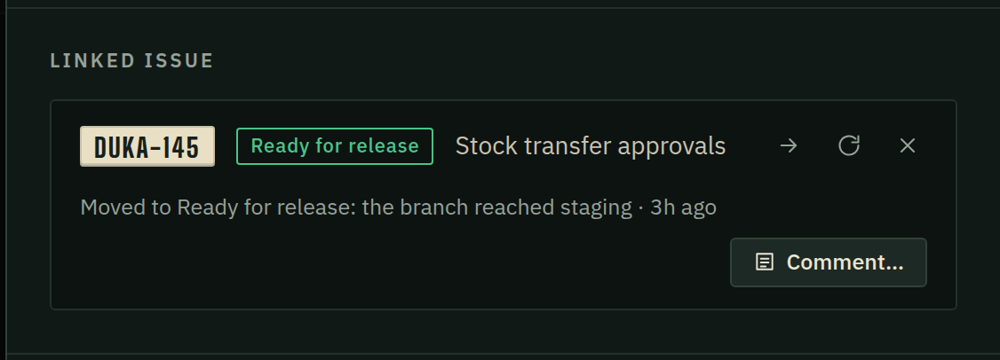

# Stage → status mapping

> Tell Signalbox which tracker status matches each stage on your line, and let it move linked issues forward as branches merge.

Section: Trackers & code hosts · Updated: 2026-11-23

Each project maps the stages on its line (pushed, then each stage branch) to statuses in its tracker. With automatic moves on, a linked issue follows its branch: pushed, merged to develop, on staging, in prod.

## Set up the map

1. Connect a tracker first: [Kanboard](kanboard.md), [Jira](jira.md), [Notion](notion.md) or a [Board API](board-api.md) board.
2. Open **Projects & settings → Projects** and click **Edit** on the project.
3. Under **Tracker for** your project, pick the **Connection** and the board, project or database.
4. Under **Move the issue when the branch reaches…**, pick a status for each row. Rows are **pushed**, then one per stage branch. The last one is marked **(prod)**.
5. Leave a row on **— leave as is** to skip that stage.
6. Tick **Move linked issues automatically (forward only)** if you want Signalbox to move issues for you.
7. Click **Save**.

> **Tip:** Click **Suggest** to fill the map from each status's place in the flow: pushed → the first "in progress" status, middle stages → the first "review" status, prod → the first "done" status. Check the result before you save.

Each status in the list shows its name and its category, for example "In review · review". The categories are backlog, todo, doing, review and done.

If the project has no stage branches yet, only **pushed** can be mapped. Set stages in the project's repos first. See [The track](the-track.md).

## How automatic moves work

Signalbox checks linked issues each time the board refreshes. For each ticket with a linked issue:

1. It finds the furthest mapped stage the ticket has reached. A stage left on **— leave as is** keeps the status of the mapped stage before it.
2. It reads the issue's live status from the tracker.
3. It moves the issue only if the new status is further along. It never moves an issue backwards. If someone moved it further by hand, it stays there.

Some statuses are never left automatically, because a person decides on them:

- **Kanboard and Notion:** a column or status whose name says the work was sent back, such as **QA FAILED** or **Rejected**.

Moves are paced so trackers aren't flooded: at most 10 checks per refresh, two seconds apart. A move that failed isn't tried again for 10 minutes.

## See what moved

- The ticket drawer's **Linked issue** section shows the last action, for example "Moved DUKA-138 to In review · 5m ago", or **No automatic moves yet.**
- **Projects & settings → Trackers** lists **Recent automatic moves**, with failures in red. This list starts empty each time Signalbox starts.

Click the refresh icon on the linked issue to read its status from the tracker again.

## Turn it off

Untick **Move linked issues automatically (forward only)** and click **Save**. The map stays, so you can turn it back on later. To unbind the project from the tracker, click **Disconnect**. Links on existing tickets stay.

To delete a connection, click **Remove** on it in **Projects & settings → Trackers**, then click again to confirm. This unlinks its tickets. Disconnect every project that uses it first; otherwise Signalbox says which projects still use it.

## Related

- [The track](the-track.md)
- [Kanboard](kanboard.md) · [Jira](jira.md) · [Notion](notion.md) · [Board API](board-api.md)
- [Importing from a tracker](import-from-a-tracker.md)

---

Also on the website: https://signalbox.accessa.co.ke/docs/stage-status-mapping/
