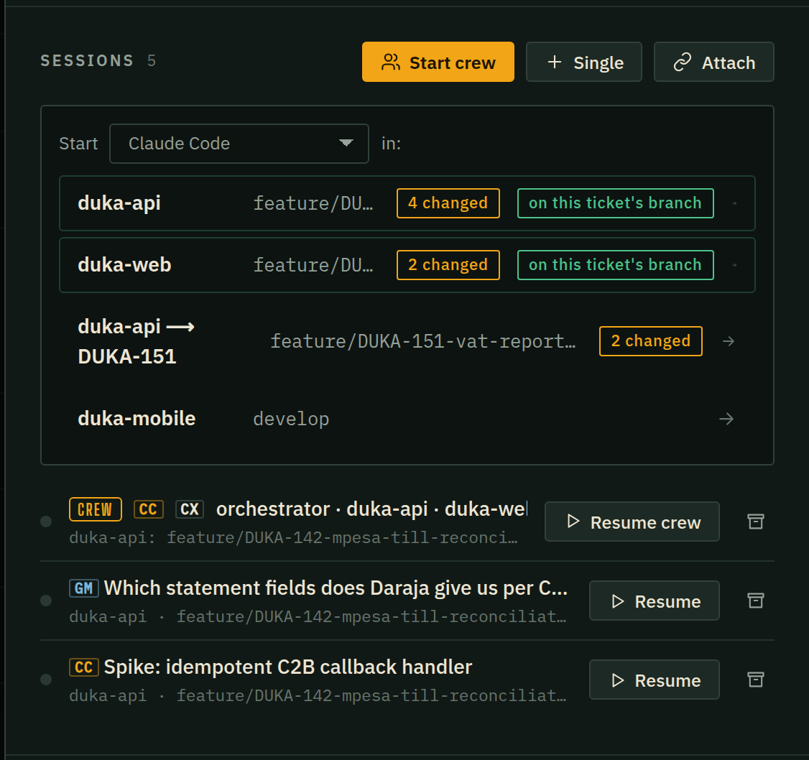
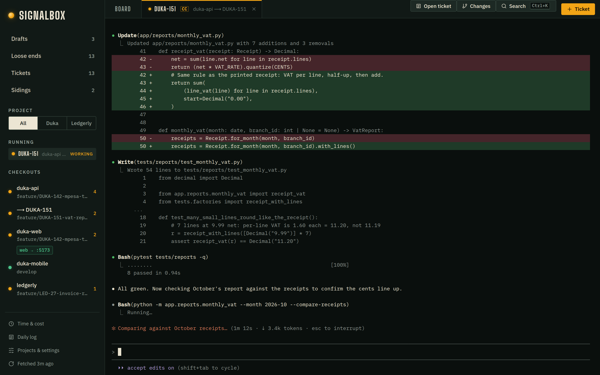

# Start your first session

> Start an agent on a ticket, give it its first instruction, follow it from the lamps, and pick it up again later.

Section: Getting started · Updated: 2026-11-23

A session is one conversation with a coding agent, in a terminal tab inside Signalbox. It runs in one checkout or worktree and belongs to one ticket. This page takes you through the first one.

## Start it

Pick whichever fits:

- **From the New ticket form.** Leave **Start the agent on it** ticked and click **Create & start …**. See [Create your first ticket](create-your-first-ticket.md).
- **From the ticket.** Open the ticket, then in **Sessions** click **New session** (called **Single** when the project can run crews). Pick the agent after **Start**, then click the checkout or worktree to run in. Places already on the ticket's branch are listed first and marked **on this ticket's branch**.
- **From a checkout.** Click a checkout in the rail. Under **Start a session on…**, click the ticket. The agent picker there defaults to **Each ticket's agent**.

## What you see

The session opens in a new tab named after the ticket key, with a badge for the agent (**CC** Claude Code, **CX** Codex, **GM** Gemini CLI, **OC** opencode) and the checkout it runs in.

This is the agent's own terminal interface, exactly as in your terminal. Signalbox starts it with the ticket's key and title as the session's name and no first message, so:

1. If the agent asks whether you trust the folder (new worktrees often trigger this), answer it.
2. Type what you want done, as you would in any terminal.

Signalbox never adds flags that skip the agent's permission prompts. The agent asks before it runs commands or edits files, the way it is configured to.

## Follow it

- **The lamp** on the tab and in **Running** in the rail shows the state: **working**, **needs you**, **done** or **idle**. See [States & notifications](states-and-notifications.md).
- **A notification** appears when a session needs you or finishes while you're looking elsewhere.
- **Open ticket** in the tab bar opens the ticket's drawer. **Changes** opens the diff of that checkout. See [Changes](changes.md).
- Hover a tab to see the ticket title and the session's latest state.

You can switch to other tabs, or close the window: sessions keep running.

## Stop and pick it up later

- Close a tab with its **×**. This ends the agent's process. The conversation is saved by the agent.
- To continue, open the ticket and click **Resume** on the session in **Sessions**. It resumes with the same agent, in the folder it last ran in. A session that is still running shows **Open** instead.
- When an agent exits on its own, the tab shows **Session ended.** with **Resume**, **Open** plus the ticket key (opens the ticket), and **Close tab**.

## Related

- [Sessions](sessions.md)
- [Supported agents](agents.md)
- [Crews](crews.md)
- [States & notifications](states-and-notifications.md)
- [Changes](changes.md)

---

Also on the website: https://signalbox.accessa.co.ke/docs/start-your-first-session/
