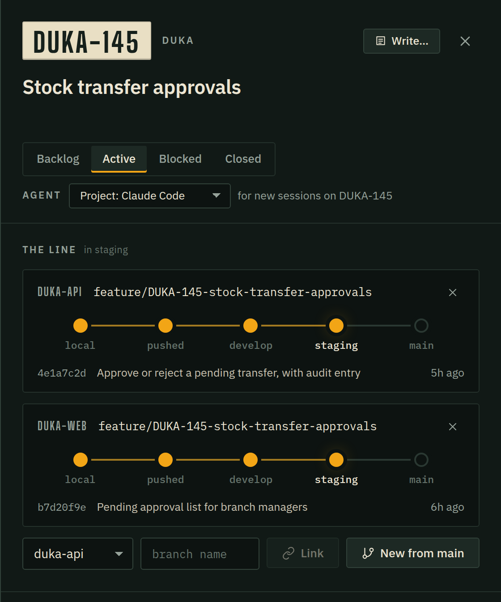
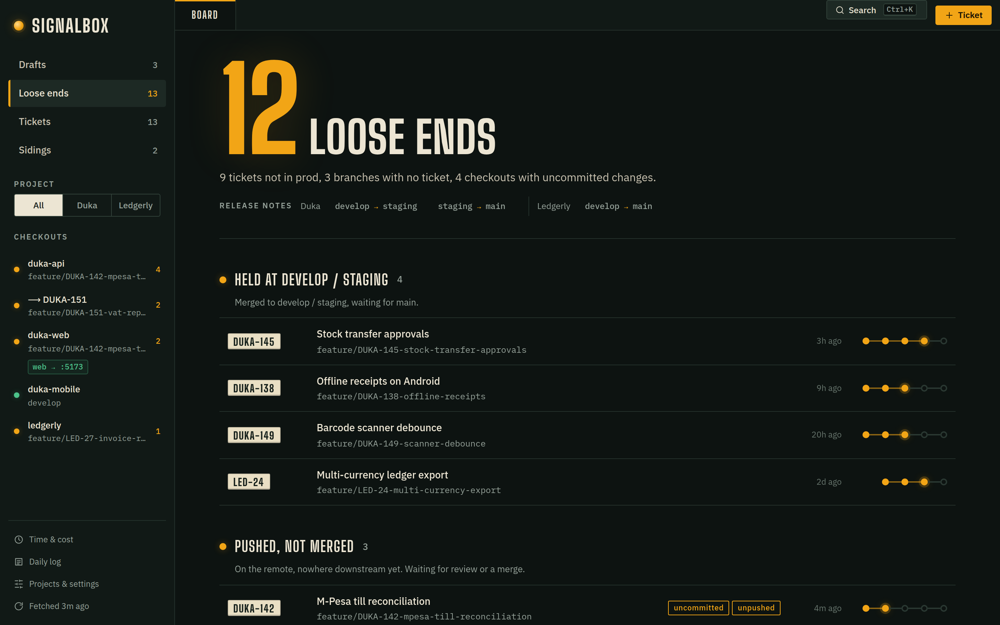
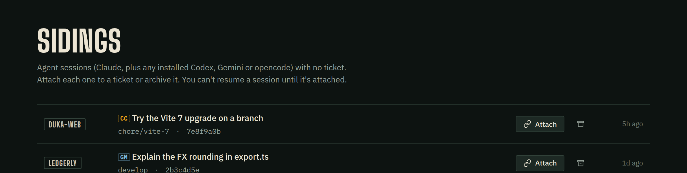

# The track

> How Signalbox shows where work is, from local to prod: stages, lamps, the Loose ends board, Sidings, and the uncommitted, unpushed and cold flags.

Section: Tickets & branches · Updated: 2026-11-23

The track is the row of lamps next to every ticket and branch. It shows how far the work has got on its way to production, read from git. This page explains the lamps and the board built from them.

## Stages and lamps

Every repo has a list of stage branches, set when you add the project, for example `develop → staging → main`. The last one is prod. The track has one lamp per stage, after two fixed ones:

| Lamp | Lit when |
|---|---|
| **local** | The branch exists on your machine. |
| **pushed** | The branch is on the remote. |
| One per stage, such as **develop**, **staging** | The stage branch on the remote contains the branch's last commit, that is, it has been merged there. |
| The last stage (prod), such as **main** | The work is in production. |

Lamps light from the left up to where the work has got, and the lamp with a glow is where it is now. The colour says how far it is: red while the work is only local, amber once it's pushed or in a stage before prod, green once it's in prod. No lamps lit means there is no branch, or the branch wasn't found in any checkout or on the remote.

In the ticket drawer, **The line** shows each branch on its own large track, with its repo, its last commit and when it was made. The heading says where the ticket is, for example **in staging**, **pushed**, **local only** or **no branch linked**.

### When a ticket has several branches

A ticket's place on the track is that of its least advanced repo: a ticket with the API in staging and the web app only pushed counts as **pushed**. Within one repo, the most advanced branch counts. When repos have different stage lists, they line up at prod.

### When the lamps update

Signalbox reads your checkouts every time the board reloads, and fetches every remote every 5 minutes. Click **Fetched … ago** at the bottom of the rail to fetch now. A merge on the remote shows up after the next fetch.

## Loose ends

**Loose ends** is the board you start on. The big number counts work that isn't finished: tickets not in prod (backlog tickets with no branch aside) and branches with no ticket. The **Loose ends** count in the rail is the same number. Checkouts with uncommitted changes and shipped tickets are listed below it but not counted. Each group below it only appears when it has something in it.

| Group | What's in it | What to do |
|---|---|---|
| **Held at** `develop / staging` | Merged to a stage before prod, waiting for prod. | Get it released. |
| **Pushed, not merged** | On the remote, not merged anywhere yet. | Get it reviewed and merged. |
| **On the bench** | Only on your machine, or the branch can't be found. | Push it before it rots. |
| **Closed, never shipped** | Marked closed, but its last commit isn't in prod. | Reopen the ticket, or drop the branch. |
| **No branch yet** | Active or blocked tickets with no branch linked. | Link or create a branch. |
| **Unclaimed branches** | Local branches with commits in the last 45 days, not in prod, not on any ticket. | **Ticket** makes a ticket for it; the eye button stops tracking it. |
| **Uncommitted changes** | Checkouts and worktrees with uncommitted files. | Commit, stash or discard. |
| **Shipped. Close these out** | Open tickets whose work is in prod. | Close the ticket. |

Backlog tickets without a branch and closed tickets that shipped don't appear. When everything is clear, the board says **Line clear.**

**Release notes** under the count has one button per stage step, such as `develop → staging`. See [Release notes](release-notes.md).

The project picked in the rail narrows everything on the board to that project.

## Sidings

**Sidings** lists agent sessions that ran in your checkouts but aren't attached to a ticket, such as sessions you started in a terminal. Attach each one to a ticket, or archive it. A session can't be resumed from Signalbox until it is attached.

- If a ticket already owns the session's branch, a button with that ticket's key attaches it in one click.
- **Attach** opens a list of open tickets, plus **+ New ticket from this session**.
- The archive button hides the session.
- Sessions older than 14 days are folded away; **Archive N older than 14d** clears them in one go.

## Flags

| Flag | Meaning |
|---|---|
| **uncommitted** | A checkout or worktree on the branch has uncommitted changes to tracked files. |
| **unpushed** | The branch has commits that aren't on the remote branch yet. |
| **cold Nd** | An active ticket with no activity for N days, 4 or more. Activity is a commit, a session, or an edit to the ticket. |
| **blocked** | The ticket's status is Blocked. |
| **branch not found in any checkout or on the remote** | The linked branch is gone, or its name is wrong. Unlink it or fix it. |

In the rail, each checkout's lamp is green when it is clean and amber with a count when it has uncommitted files.

## Related

- [Add a project and its repos](add-a-project.md)
- [Branches & worktrees](branches-and-worktrees.md)
- [Tickets](tickets.md)
- [Stage → status mapping](stage-status-mapping.md)
- [Sessions](sessions.md)

---

Also on the website: https://signalbox.accessa.co.ke/docs/the-track/
