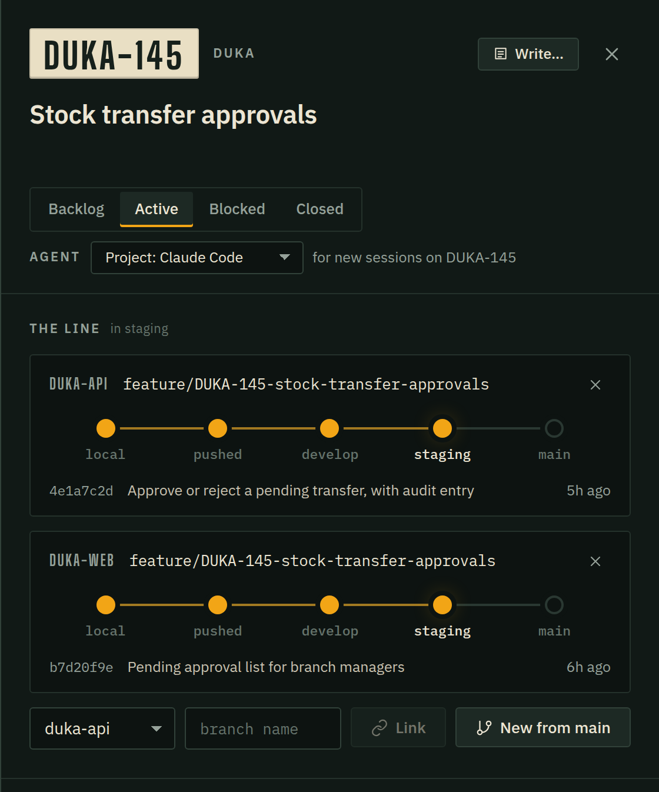
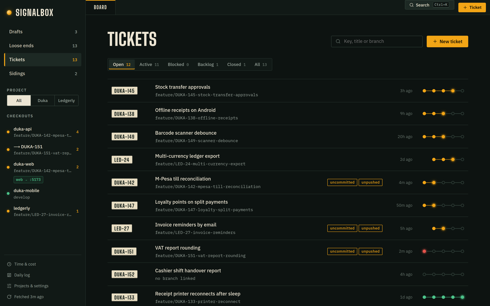
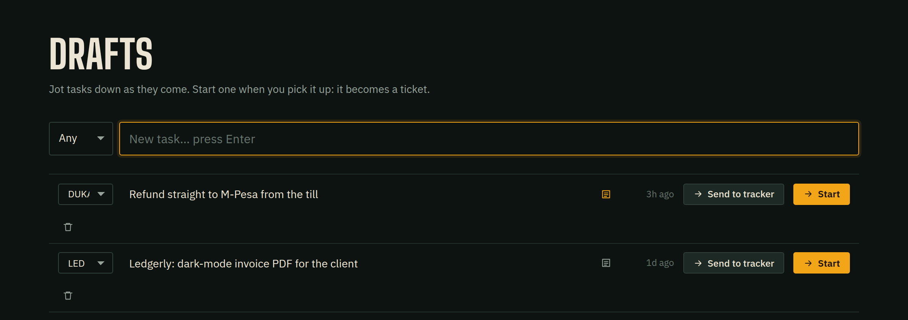

# Tickets

> What a ticket holds, its four statuses, notes, the agent per ticket, the Tickets list and Drafts, and how to delete a ticket.

Section: Tickets & branches · Updated: 2026-11-23

A ticket is one piece of work, with a key such as `DUKA-142`. It owns the work's branches, its agent sessions, its notes, and its link to a tracker issue and pull requests. Everything you do in Signalbox hangs off a ticket.

## Open a ticket

Click a ticket on **Loose ends** or **Tickets**, or press Ctrl+K (⌘K on Mac) and type its key or title. Its drawer opens on the right. In a session's tab, **Open ticket** opens the drawer of that session's ticket.

The drawer, from the top:

| Part | What it is |
|---|---|
| Key, project, **Write…** | The ticket key and project. **Write…** has an agent write a summary, PR description or QA note. See [Write…](write.md). |
| Title | Click to edit. Enter saves. |
| Status | **Backlog**, **Active**, **Blocked**, **Closed**. |
| **Agent** | The agent new sessions on this ticket use. |
| **The line** | The ticket's branches, each on its track. See [The track](the-track.md) and [Branches & worktrees](branches-and-worktrees.md). |
| **Linked issue** | The tracker issue, when the project has a tracker. See [Importing from a tracker](import-from-a-tracker.md). |
| **Pull request** | PRs from the ticket's branches and their review comments. See [Pull requests on the ticket](pull-requests.md). |
| **Time & cost** | Active time, tokens and API-equivalent cost. See [Time & cost](time-and-cost.md). |
| **Sessions** | Start, resume, attach and archive sessions, or start a crew. See [Sessions](sessions.md). |
| **Notes** | Free text. Saved when you click outside the box. |
| **Opened … ago**, **Delete** | When the ticket was made, and deleting it. |

Press Esc or click outside the drawer to close it.

## Statuses

A new ticket is **Active**. Click another status in the drawer to change it.

| Status | Meaning | Where it shows |
|---|---|---|
| **Backlog** | Not started. | Not on **Loose ends** unless it has a branch. |
| **Active** | Being worked on. | On **Loose ends** until its work is in prod. Marked **cold** after 4 days without activity. |
| **Blocked** | Waiting on something. | A red **blocked** flag on its row. |
| **Closed** | Done. | Off the open lists. If its last commit isn't in prod, it shows under **Closed, never shipped**. |

Signalbox doesn't change a ticket's status by itself. When the work reaches prod, the ticket shows under **Shipped. Close these out** on **Loose ends**; close it when you're happy. A tracker issue linked to the ticket can still move on its own as the branch progresses; see [Stage → status mapping](stage-status-mapping.md).

## Flags on a ticket row

| Flag | Meaning |
|---|---|
| **blocked** | The status is Blocked. |
| **uncommitted** | A checkout or worktree on one of its branches has uncommitted changes. |
| **unpushed** | A branch has local commits that aren't on the remote. |
| **cold Nd** | Active, but nothing has happened for N days (4 or more): no commits, sessions or edits. |

The time on the right is the last activity: a commit, a session or an edit to the ticket.

## Notes

The **Notes** box is plain text for you and your agents. Use it for what's left, who's waiting and links. An imported issue's description and URL land here. In a crew, the agents can read and update the notes too. See [Crews](crews.md).

## The agent per ticket

**Agent** in the drawer picks the agent for new sessions on this ticket. The first option, such as **Project: Claude Code** or **Default: Claude Code**, means "no override": use the project's agent, else the default. Existing sessions keep the agent they started with. See [Supported agents](agents.md).

## The Tickets list

**Tickets** in the rail lists every ticket in the project picked in the rail.

- Filter by **Open** (everything not closed), **Active**, **Blocked**, **Backlog**, **Closed** or **All**. Each shows a count.
- The search box matches the key, the title or a branch name.
- **New ticket** opens the New ticket form.

## Drafts

**Drafts** is a list of tasks you haven't started. Use it for things you're asked to do, before they need a branch.

1. Pick a project (or **Any**), type the task and press Enter.
2. The note icon on a draft opens its notes: who asked, links, what done looks like.
3. When you pick it up, click **Start**. The New ticket form opens with the draft's text as the title and its notes; the draft goes away once the ticket exists.

If the draft's project has a tracker, **Send to tracker** (click twice) creates an issue from it and removes the draft. Import the issue when you start the work.

The tray menu's **Add draft…** brings the window forward on Drafts, ready to type.

## Delete a ticket

At the bottom of the drawer, click **Delete**, then **Click again to delete**. The ticket and its links to branches and issues are removed. Its sessions move to **Sidings**, where you can attach them to another ticket. Branches, worktrees and the tracker issue aren't touched.

## Related

- [Create your first ticket](create-your-first-ticket.md)
- [The track](the-track.md)
- [Branches & worktrees](branches-and-worktrees.md)
- [Sessions](sessions.md)
- [Search & palette](search-and-palette.md)

---

Also on the website: https://signalbox.accessa.co.ke/docs/tickets/
