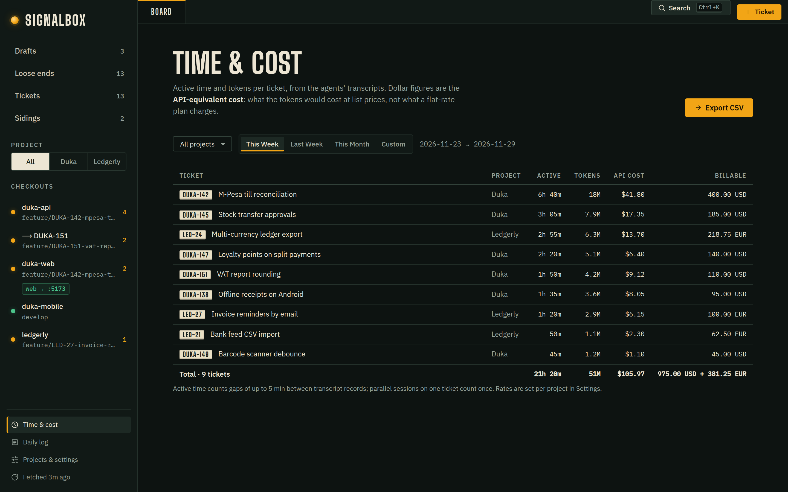
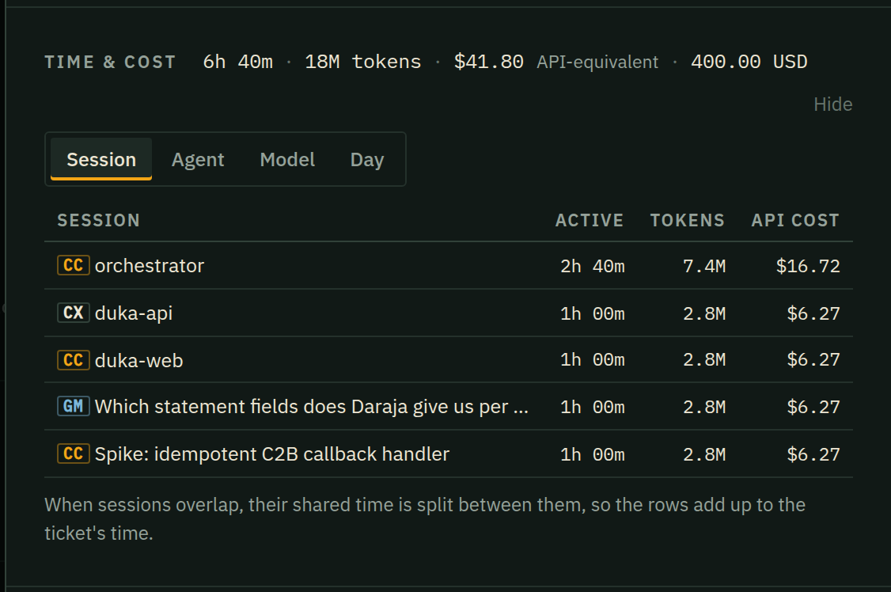
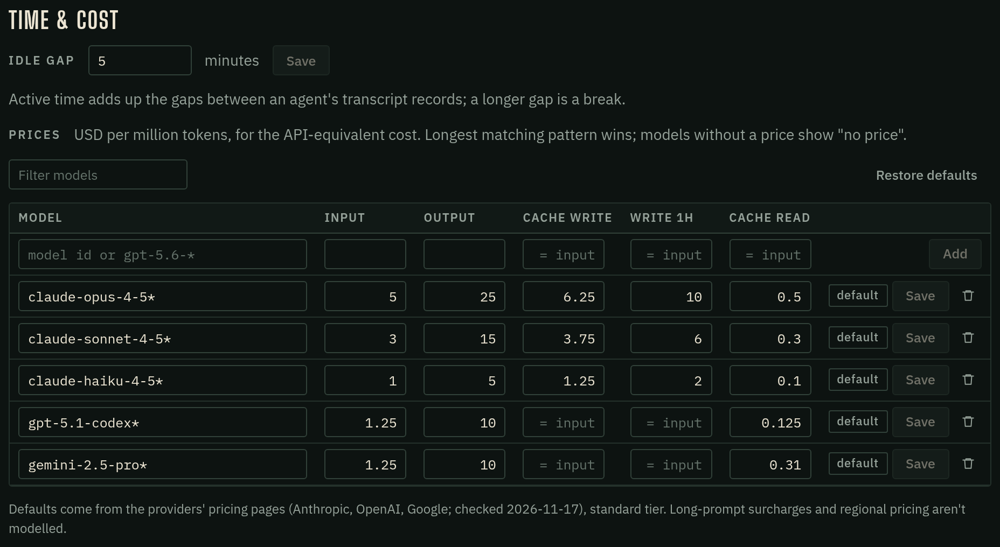

# Time & cost

> See active time, tokens and API-equivalent cost per ticket, set an hourly rate per project, and export it all as CSV.

Section: More · Updated: 2026-11-23

Signalbox reads your agents' transcripts and adds up, per ticket, how long the agents were active, how many tokens they used, and what those tokens would cost at list prices. Use it to see where time went, or to bill a client.



## Open the Time & cost view

1. Click **Time & cost** at the bottom of the rail.
2. Pick a project in the first drop-down, or **All projects**.
3. Pick a range: **This Week**, **Last Week**, **This Month** or **Custom**. Weeks run Monday to Sunday. With **Custom**, set the two dates.
4. Click a row to open that ticket.

The table has one row per ticket that had agent activity in the range:

| Column | What it shows |
|---|---|
| **Ticket** | The ticket's key and title |
| **Project** | Only when **All projects** is selected |
| **Active** | Active agent time on the ticket |
| **Tokens** | Input, output, cache write and cache read tokens added together. Hover for the split |
| **API cost** | The API-equivalent cost in USD |
| **Billable** | Active time × the project's hourly rate, or **no rate** |

The last row is the total for the range. Billable totals in different currencies are listed side by side.

> **Note:** Only sessions attached to a ticket count. Sessions waiting in Sidings aren't in the table until you attach them. See [Sessions](sessions.md).

## On a ticket

Open a ticket. Once it has sessions, the drawer shows a **Time & cost** line: active time, tokens, the API-equivalent cost and, if the project has a rate, the billable amount.



1. Click the line (or **Details**) to expand it.
2. Break the figures down by **Session**, **Agent**, **Model** or **Day**.
3. Click **Hide** to collapse it.

When sessions overlap, their shared time is split between them, so the session rows add up to the ticket's time.

## How active time is counted

Every agent writes timestamped records to its transcript while it works. Signalbox counts the time between two records as active when the gap is no longer than the **idle gap**. A longer gap counts as a break.

- Parallel sessions on one ticket count once. Two agents working for the same 10 minutes add 10 minutes, not 20.
- The idle gap is 5 minutes unless you change it.

To change the idle gap:

1. Open **Projects & settings → Time & cost**.
2. Enter a number of minutes next to **Idle gap** (1 to 240).
3. Click **Save**.

## API-equivalent cost

The dollar figure is what the tokens would cost on the provider's API at list prices. Many plans are flat-rate, so it isn't what you pay. It's a fair way to compare tickets.

Prices live in **Projects & settings → Time & cost**, under **Prices**, in USD per million tokens:



| Column | Meaning |
|---|---|
| **Model** | A model id, or a pattern with `*`, such as `gpt-5.1-codex*` |
| **Input** / **Output** | Required |
| **Cache write** | 5-minute (Claude) or 30-minute (OpenAI) cache writes. Empty means the input price |
| **Write 1h** | Claude's 1-hour cache writes. Empty means the input price |
| **Cache read** | Empty means the input price |

- The longest matching pattern wins.
- Rows marked **default** come from the providers' pricing pages (Anthropic, OpenAI, Google), standard tier. Long-prompt surcharges and regional prices aren't modelled.
- A model with no price shows **no price**, or **+ unpriced** when it's mixed with priced ones. Its tokens are still counted.

To add a price, fill in the top row and click **Add**. To change one, edit it and click **Save**. To remove one, click the bin. **Restore defaults** adds back default prices you removed; prices you edited stay as they are. Use **Filter models** to find a row.

## Hourly rate and currency

Each project can have its own rate.

1. Open **Projects & settings**, find the project under **Projects** and click **Edit**.
2. Enter the **Hourly rate** and a 3-letter currency code, such as `USD`, `EUR` or `KES`.
3. Click **Save**.

Leave the rate empty for none. The billable amount is active time × this rate, in the view, the drawer and the CSV.

## Export CSV

1. Set the project and range in the Time & cost view.
2. Click **Export CSV**.
3. Choose where to save it. The suggested name is `signalbox-time-cost-<from>-to-<to>.csv`.

If no save dialog can open, the file goes straight into your Downloads folder, and a message says where.

The CSV has one row per date, ticket, agent and model, with these columns:

```
date, project, ticket key, ticket title, agent, model, active minutes, input, output, cache write, cache read, API cost USD, billable amount, currency
```

## Related

- [Sessions](sessions.md)
- [Supported agents](agents.md)
- [Tickets](tickets.md)
- [Privacy & data](privacy-and-data.md)

---

Also on the website: https://signalbox.accessa.co.ke/docs/time-and-cost/
