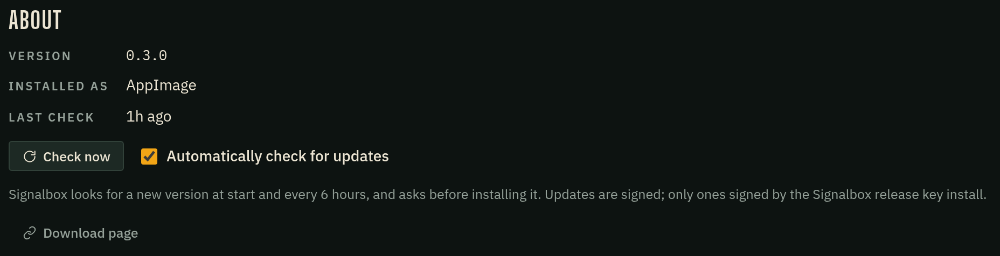

# Updates

> How Signalbox checks for new versions, asks before installing, and restarts without cutting off a working agent.

Section: More · Updated: 2026-11-23

Signalbox updates itself. It looks for a new version, tells you when one is ready, and installs it only when you say so.

## How it works

1. At start and every 6 hours, Signalbox asks the Signalbox update server whether there's a newer version.
2. When there is, a banner appears above the tabs: **Signalbox <version> is ready**, with the version you have.
3. Open **What's new** in the banner to read the release notes.
4. Click **Restart now** to download, install and reopen. Or click **Later** to hide the banner until an even newer version comes out.

While it works, the banner shows **Downloading…** with progress, then **Installing…**, then **Installed. Restarting…**.

Updates are signed. Only a file signed with the Signalbox release key installs.

## If an agent is working

Before it restarts, Signalbox checks your sessions. If an agent is working or waiting for you, it asks first, for example: "2 agents are working — restart anyway?"

- **Not now** keeps everything running.
- **Restart anyway** stops them mid-task. The conversations are saved and can be resumed after the restart.

It asks again after the download, in case an agent started meanwhile.

## What happens per install type

| Installed as | What the update does |
|---|---|
| **.deb package** | Installs the new .deb. It asks for your password. |
| **AppImage** | Replaces the AppImage file in place and reopens. |
| **macOS app** | Replaces Signalbox in Applications and reopens. |
| **.rpm package**, **plain binary** | Can't update itself. Download a new copy from the download page. |

On macOS you don't need to clear the quarantine again after an update Signalbox installs itself. You do if you replace the app with a new download. See [Install on macOS](install-macos.md).

## Check by hand

- Open **Projects & settings → About** and click **Check now**.
- Or open the palette (Ctrl+K, ⌘K on Mac) and choose **Check for updates**.

A message says either that a new version is ready or that you're up to date. Checking by hand also brings back a banner you hid with **Later**.

**About** also shows:

- **Version**: the version you're running.
- **Installed as**: the install type from the table above.
- **Last check**: when Signalbox last asked.
- **Last check failed:** and the reason, when the last check didn't work.
- **Download page**: opens the Signalbox download page in your browser.

## Turn off automatic checks

Untick **Automatically check for updates** in **Projects & settings → About**. Signalbox then only checks when you click **Check now** or use the palette.

## Related

- [Update failed](update-failed.md)
- [Install on Linux](install-linux.md)
- [Install on macOS](install-macos.md)
- [Privacy & data](privacy-and-data.md)

---

Also on the website: https://signalbox.accessa.co.ke/docs/updates/
