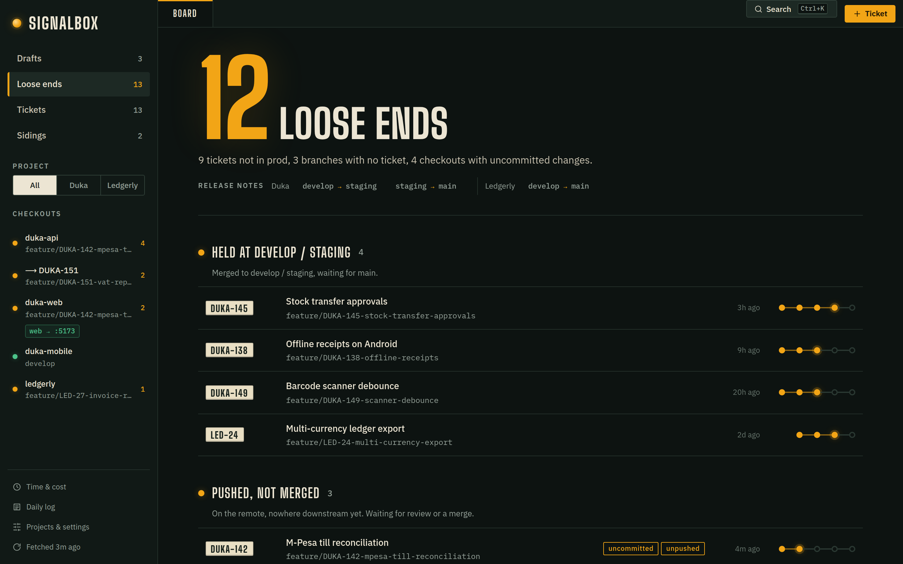

# What is Signalbox

> Signalbox is a free desktop app for macOS and Linux that ties AI coding agent sessions to tickets, branches and the path to production.

Section: Getting started · Updated: 2026-11-23

Signalbox is a desktop app for people who run AI coding agents, such as Claude Code, Codex, Gemini CLI and opencode, on real projects. It keeps every agent session tied to a ticket and a branch, and shows how far each piece of work has got on its way to production. Signalbox is free.

## What it does

- **Tickets own the work.** Every session belongs to a ticket. Open the ticket and you see its branches, its sessions, its pull request, its tracker issue, and the time and tokens spent on it.
- **Branches on a track.** Each repo has a list of stage branches, such as `develop → staging → main`. Signalbox lights a lamp for every stage a branch has been merged into, so you can see what is still local, pushed, waiting in staging, or shipped.
- **Loose ends.** The board lists work that isn't in production yet: tickets held at a stage, branches pushed but not merged, work that only exists on your machine, and branches with no ticket.
- **Agents in tabs.** Agents run in real terminals inside the app. A lamp on each tab shows whether the agent is working, done, or waiting for you, and you get a notification when it needs you.
- **Crews.** For work that spans several repos, a crew runs one orchestrator agent and one agent per repo, in one split tab. They message each other through Signalbox. Each member can be a different agent.
- **Worktrees.** Start a ticket in its own git worktree so several agents can work in the same repo at once. Signalbox can copy `.env` files and install dependencies into each new worktree.
- **Trackers and code hosts.** Link tickets to Jira, Kanboard or Notion issues, or to any board that implements the Board API. Linked issues move along as the branch reaches each stage. Pull requests and review comments from GitHub and Bitbucket show on the ticket.
- **Writing from the work.** An agent can write a summary, a PR description, a QA note for testers, a daily log or release notes from the commits, sessions and ticket. You read and edit it before anything is saved or posted.

## What it doesn't do

- It doesn't replace your agent. Signalbox starts the agent's own command-line tool in a terminal. You log in to each agent yourself, and it works the way it does in your terminal.
- It doesn't add permission-skipping flags to any agent. The agent asks for permission the way it normally does.
- It doesn't host your code. Your repos stay where they are. Signalbox runs `git` on them.

## Words used in these docs

| Word | Meaning |
|---|---|
| Project | A group of repos that ship together, with its own ticket key prefix, such as `DUKA`. |
| Repo | One git repository in a project, with its remote and stage branches. |
| Checkout | A folder on your disk with a clone of a repo. A repo can have several. |
| Worktree | An extra working folder for a checkout, made with `git worktree`, on its own branch. |
| Stage | A branch work is merged into on its way to production. The last stage is prod. |
| Ticket | A piece of work, such as `DUKA-142`. It has branches, sessions and notes. |
| Session | One conversation with an agent, in one checkout or worktree. |
| Crew | An orchestrator session plus one session per repo, working on one ticket together. |

## Platforms

Signalbox runs on macOS 11 or later (Apple silicon and Intel) and on 64-bit Linux with glibc 2.34 or newer. You need `git`, and at least one supported agent installed and logged in.

## Related

- [Install on macOS](install-macos.md)
- [Install on Linux](install-linux.md)
- [First run](first-run.md)
- [Create your first ticket](create-your-first-ticket.md)
- [Supported agents](agents.md)

---

Also on the website: https://signalbox.accessa.co.ke/docs/what-is-signalbox/
