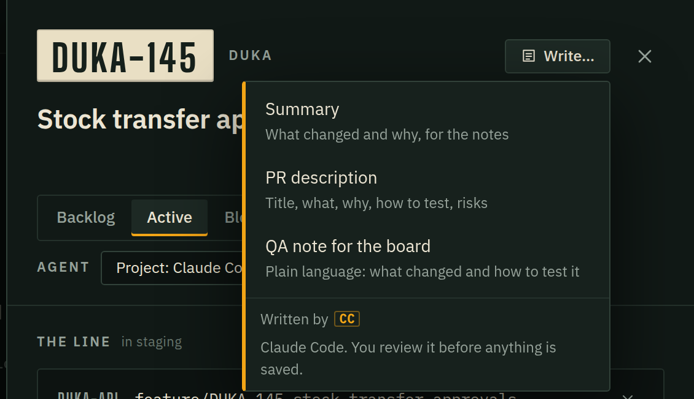
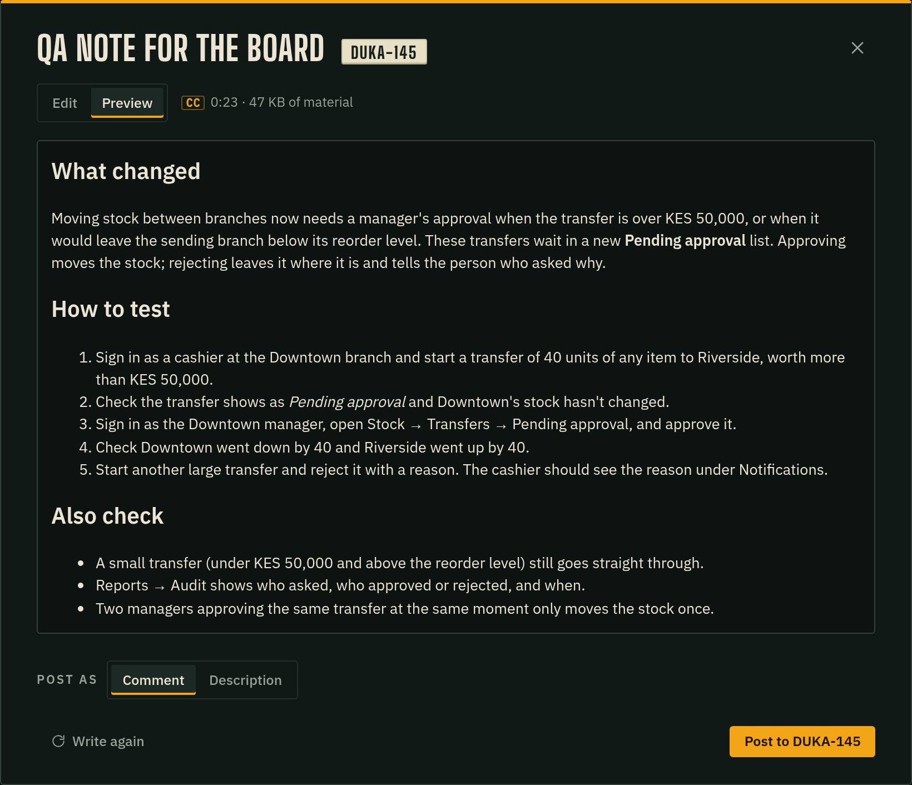

# Write… overview

> Have an agent write a summary, PR description, QA note, daily log or release notes from the work. You review and edit it before anything is saved.

Section: Writing · Updated: 2026-11-23

Signalbox can have an agent write text from the work it already knows about: the branch diff, the commits and the ticket's sessions. Nothing is saved, copied or posted until you click.

## What it can write

| Text | Where you start it | What you can do with it |
|---|---|---|
| [Summary](summary.md) | Ticket drawer → **Write…** | Add it to the ticket's notes, or replace them |
| [PR description](pr-description.md) | Ticket drawer → **Write…** | Copy it, or create a PR with it |
| [QA note for the board](qa-note.md) | Ticket drawer → **Write…** (needs a linked issue) | Post it as a comment or into the issue's description |
| [Daily log](daily-log.md) | **Daily log** in the left rail | Copy it, or save it as a draft |
| [Release notes](release-notes.md) | **Release notes** buttons on Loose ends | Copy it, or save it to a file |

## Write for a ticket

1. Open the ticket.
2. Click **Write…** at the top of the drawer.
3. Pick **Summary**, **PR description** or **QA note for the board**.

The menu's footer says which agent writes: "Written by Claude Code. You review it before anything is saved." **QA note for the board** is greyed out with **Link an issue first** until the ticket has a linked tracker issue.

You can also start any of these from the palette: with a ticket open (or its session tab in front), press Ctrl+K (⌘K on Mac) and type "Write". Actions such as "Write… Summary for DUKA-142" open the ticket and start writing. See [Search & palette](search-and-palette.md).

## While it writes

The editor opens and starts at once.

- First it says **Gathering the diff, commits and sessions…**.
- Then **Writing with** the agent's name, with a timer, how much material it read, and the agent's latest output line.
- Click **Cancel** to stop it and close the editor.

A run that takes longer than 3 minutes is stopped. If the agent fails, the editor shows the error and **Try again**.

## When it's done

1. Read the text. Switch between **Edit** and **Preview** to see the Markdown rendered.
2. Change anything you like in **Edit**.
3. Use the buttons at the bottom to save, copy or post it. Each text's page explains its buttons.

Next to the tabs you see the agent, how long it took and how much material it read. If some material was cut to fit, a link such as "2 cuts for size" lists what was left out, for example part of a long diff.

**Write again** writes it fresh from the current state of the work. Press Escape or click the close button to close without saving.

## Who writes

By default, the agent that new sessions on the ticket use writes the text. To pick a different one for a project:

1. Open **Projects & settings → Projects**, and click **Edit** on the project.
2. Under **Writing agent**, pick an agent. **Same as new sessions** follows the ticket's agent.

Daily logs and release notes use the project's writing agent too, else the project's or default agent.

## What the agent can do

The writing agent runs once in the background, not as a session. It gets the material on its input and is told this is a read-only task: it may read files in the repo, but not edit files, run commands or commit.

| Agent | How it runs |
|---|---|
| Claude Code | `claude -p` with only the Read, Grep and Glob tools, and no saved session |
| Codex | `codex exec` with a read-only sandbox |
| Gemini CLI | `gemini -p` |
| opencode | `opencode run` |

Signalbox never adds permission-skipping flags.

## Related

- [Summary](summary.md) · [PR description](pr-description.md) · [QA note](qa-note.md)
- [Daily log](daily-log.md) · [Release notes](release-notes.md)
- [Supported agents](agents.md)

---

Also on the website: https://signalbox.accessa.co.ke/docs/write/
