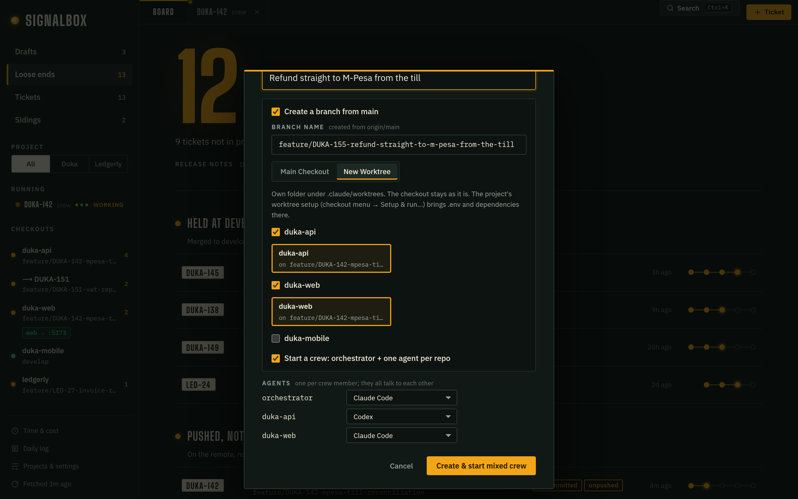
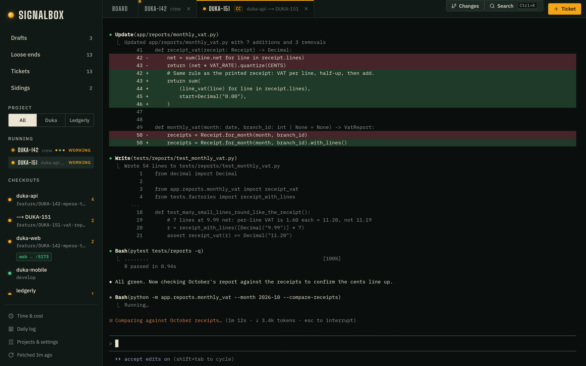

# How to run several Claude Code sessions without losing track

File every Claude Code session under the ticket it's for, see which one is waiting for you, and resume the right one tomorrow. With plain terminals and with Signalbox.

One Claude Code session in one terminal is easy to follow. The trouble starts at three or four. Each session sits in its own tab or tmux window, `claude --resume` lists past sessions by folder and first prompt, and none of it tells you which session was for which piece of work, which branch it was on, or which one has been sitting at a permission prompt for twenty minutes.

## The plain-terminal version

If you run one or two sessions at a time, you may not need a tool for this. A setup that holds up:

- One folder per task. A git worktree per branch works well (see [Git worktrees for parallel AI agents](git-worktrees-for-parallel-ai-agents.md)).
- One tmux window per session, named after the task.
- A note somewhere with the task, the branch and the session id, so you can run `claude --resume <id>` later.

This breaks down when the note isn't kept up to date, when you close a window without writing the id down, or when you have to check every window to see which session needs you. Signalbox keeps that bookkeeping for you: every session belongs to a ticket, and the ticket shows its sessions, its branch and where that branch has got to.

## 1. Add your project

Open **Projects & settings** and add a project. Choose the folder your code lives in. Signalbox looks for git repos in that folder and up to two levels below it, and the scan doesn't change anything on disk. It then suggests branch stages from the branches on your remote, such as develop, staging and main, and asks for a ticket key prefix, for example `DUKA`.

## 2. Make a ticket for each piece of work

Click **+ Ticket** and type what the work is. Tickets are numbered from the prefix: `DUKA-41`, `DUKA-42` and so on. If the project is linked to Jira, Kanboard or Notion, **Import from tracker** takes the title and description from an existing issue instead.

Tick **Create a branch from main** to get a branch for the ticket. Choose **Main Checkout** to switch your existing checkout to it, or **New Worktree** to give the ticket its own folder, so two sessions never edit the same files.

## 3. Start Claude Code from the ticket

Tick **Start the agent on it** in the New ticket dialog, or open the ticket later and click **New session**. Pick the checkout or worktree to run it in; the one already on the ticket's branch is listed first.

The session opens in a terminal tab inside Signalbox. It is the real `claude` CLI, started through your login shell, so it uses your PATH, your Claude Code login and your settings. Signalbox gives the session the ticket's key and title as its name and records its id against the ticket.

## 4. See which session needs you

The **Running** list in the sidebar shows every open session with a lamp:

- amber while the agent is working;
- red when it's waiting for you, for example at a permission prompt;
- green when it has finished its turn.

For Claude Code this comes from its hooks. Signalbox passes them to each session it starts with `--settings`, so your own `~/.claude` settings files aren't changed. When a session finishes or needs you and you're looking at something else, you get a desktop notification. You can also send these alerts to your phone through ntfy or a Telegram bot. By default they go out only when Signalbox isn't the focused window or you haven't touched it for a few minutes, and you can set quiet hours.

## 5. Resume the right session later

Close the tab, or quit Signalbox, and the session isn't lost. Open the ticket and click **Resume** on the session. Signalbox runs `claude --resume` with that session's id in the same folder, so the conversation carries on where it stopped. A ticket can hold several sessions, for example one that wrote the feature and one that fixed review comments, and each resumes on its own.

## 6. Bring in sessions you started elsewhere

Sessions you started in a normal terminal show up under **Sidings**, as long as they ran in a folder Signalbox knows: one of the project's checkouts, their worktrees or a crew folder. If a ticket already owns that session's branch, Sidings offers that ticket in one click. Otherwise attach it to any open ticket, make a new ticket from it, or archive it.

For a session from anywhere else, open the ticket, click **Attach** and paste the session id. A pasted `claude --resume …` line works too.

## 7. Find an old conversation

Press `Ctrl+K` (`⌘K` on a Mac) and type a few words. Besides tickets, projects and settings, the palette searches what you typed and what the agent answered in the sessions filed under your tickets, and opens the matching session. It indexes your prompts and the agent's final replies, not tool output. Sessions that aren't attached to a ticket aren't searched.

## What it doesn't do

Signalbox doesn't attach sessions to tickets on its own guess; you attach them. It doesn't commit or push for you. It never adds `--dangerously-skip-permissions` or similar flags, so Claude Code asks for permissions exactly as it does in a terminal.

## Questions

### Does Signalbox change my Claude Code configuration?

No. The hooks it uses to read a session's state are passed to each session on the command line with `--settings`. Your `~/.claude` settings, your MCP servers and your permission rules stay as they are.

### Can I still use claude in my own terminal?

Yes. The sessions are ordinary Claude Code sessions with ordinary transcripts. You can run `claude --resume <id>` in a terminal at any time, and sessions you start outside Signalbox appear in Sidings when they ran in one of the project's folders.

### Does this work with Codex, Gemini CLI or opencode?

Yes, the same way: pick the agent when you start the session, or set a default for the project or the ticket. The lamps depend on what each agent reports. Codex only reports when it has finished a turn, so its lamp never shows "needs you", and opencode reports no state, so its lamp stays idle.

### How many sessions can I run at once?

Signalbox sets no limit. The practical limits are your machine, your plan with the agent's provider, and how many changes you can review.

### Is it free?

Yes, for now, with no account. Your agent usage is billed by its provider as it is in a terminal.

---

This guide is also on the website: https://signalbox.accessa.co.ke/guides/multiple-claude-code-sessions/
